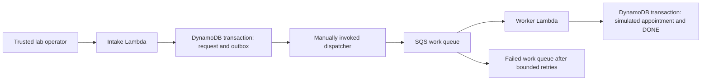
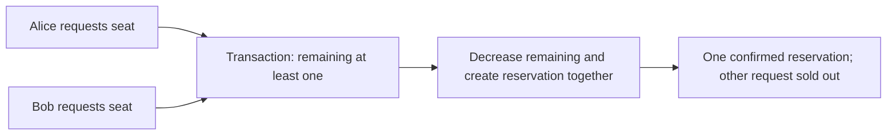

# A02 and A03: reliable requests and the last seat

Two small architecture lessons share one disposable AWS stack. Read [cost controls](../../reader/COST-AND-CREDIT-FIELD-LESSON.md) and the [bounded-run cost packet](../../examples/costs/A02-A03-BOUNDED-RUN.md) first. Status: implemented and locally checked with Moto; real AWS deployment, concurrency, IAM and cleanup checks are pending role setup and a complete priced, credit-eligible run review. No public endpoint is provided.

## What you will learn

A02 asks: a customer clicks Submit twice and the scheduling worker fails—how do we avoid losing the request or creating two appointments? A03 asks: two people want one seat—how do we prevent both from winning? Both need reliable writes, but the business rule differs.

A database transaction is a promise that a group of changes succeeds together or none does. In A02 it joins the request with a durable dispatch record, then joins a simulated appointment with completion. In A03 it joins a capacity decrement with the reservation. Merely using a queue does not enforce either business rule.

A02's request item also stores `accepted_at`, a server-sampled Unix second written in the same transaction as the request and outbox. A same-intent retry reads the original item, so it does not restart the acceptance clock. This is sampled before the remote write, not an exact commit time. Old items without the field stay unknown on retry. Private domain methods can record a fixture's first contact, manually open repeat-safe overdue work and independently read open work after a lost checker reply. They run in the [local customer journey](../../examples/request-journey/README.md). A default-off, private `contact_worklist` Lambda source candidate now exposes only `check_due` and `read_open` under table-scoped execution permissions. A stored fixture time is not proof of actual human contact. There is no automatic deadline check, alert, notification or assigned responder, and the new function has not been deployed.

For a larger table, the [scan-versus-index choice exercise](../../examples/contact-discovery-choice/README.md) compares this manual path with a **proposed** sparse GSI, a base-record recheck and periodic reconciliation. Its missing/stale index cases are authored local states. It does not add an index, schedule, operator route or price to this stack.

## Boundaries you must understand

- Callers need IAM permission to invoke the functions. Actor names are synthetic labels supplied by a trusted operator, not authenticated customer identities. Do not expose these functions to customers without deriving identity server-side and adding authorization tests.
- The appointment is a row in the same DynamoDB transaction, not a real booking with an external company. An external effect needs a provider idempotency key or reconciliation/compensation design.
- The original `reserve` action confirms immediately. A separate experimental hold path now supports acquire, confirm, cancel, explicit expiry and bounded manual due-hold discovery for synthetic actors. It has no payment, waitlist, default-enabled schedule or authenticated customer identity; it is not a complete enrollment service.
- Dispatch is a manual command. Pending outbox records survive a failed dispatch, but nothing drains them until the operator runs it again. Each dispatch evaluates at most 20 table items and returns `next_cursor` when another page exists; pass it as `cursor` in the next invocation. Starting over at the first page can miss later pending items. The bounded scan suits a tiny lab; a larger system needs indexed dispatch, backpressure and recovery ownership.
- This example uses a queue worker, not a multi-step orchestrator. A later multi-step exercise must compare visual service orchestration with code-based durable execution rather than adding either automatically.

## A02: follow the request



The dispatcher sends before marking the outbox record sent. If it fails in between, the next run can send again. That is intentional: losing work is worse than delivering a duplicate that the worker can safely recognize. The dispatch-gap test now reads the two actual emulated queue messages, verifies their distinct transport IDs and matching business request payloads, and passes those payloads to the worker. This is a deterministic Moto observation, not an assertion that one live SQS receive must return every available message. The worker commits the effect and completion together. A new attempt sees DONE and does no additional work.

The contact exercise reads one bounded scan page at a time. Its filter applies after table items are evaluated, so an empty page may still carry a cursor. The due check transaction tests the current contact item before creating an escalation item, and a repeated check does not create another. The independent open-worklist read remains useful if the first check committed but its reply was lost. Every cursor must be followed; a whole scan is still not a concurrent snapshot. The opt-in function takes time from the handler clock and rejects contact-record actions; only the separate trusted local fixture can assert contact. Its `capacity_observations` output requests DynamoDB's reported capacity for the scans, follow-up gets and transaction attempts; it preserves an unreported or canceled attempt rather than inventing a zero. The [cost lesson](../../examples/costs/contact-worklist/README.md) explains how to reconcile those page-by-page observations without treating them as a bill. This manual path adds DynamoDB scans, strongly consistent reads and transactional writes that the current live-run worksheet has not priced. Do not enable a cloud contact workflow until its invoking identity, monitoring, ownership, reconciliation, retention and complete cost are reviewed.

The contact scans now request only the attributes needed for the worklist, and its request lookup asks only for `accepted_at`. The local privacy test rejects a response containing request `text`. This narrows what the checker receives; the execution role still has table-level read permission, and DynamoDB still calculates scan read capacity from the evaluated item sizes rather than the returned attributes. Do not lower the cost worksheet merely because a projection made the response smaller. [AWS Scan projection and capacity](https://docs.aws.amazon.com/amazondynamodb/latest/developerguide/Scan.html).

**Predict:** What would happen if the dispatcher marked sent before sending? Work could disappear if the send failed afterward. What if the worker called a real payment provider before updating DynamoDB? The provider could charge twice unless its own contract prevents it.

## A03: follow the last seat



Checking the count first and writing later leaves a gap where both callers can see one seat. The condition must be part of the write. A reservation key combines course and actor, so repeating a successful request returns the prior result without consuming another seat.

**Predict:** If the reservation write fails, should the remaining count change? No; both writes belong to one transaction. A zero count must also prevent creation of a new reservation.

## A03: the confirmation never reached the caller

Alice requests a seat. The database records her reservation and reduces capacity, but the reply is lost. Her screen could show an error even though she has a seat. Repeating the same course-and-actor request must recover that outcome; changing the actor would describe a different reservation.

The new tests deliberately place a failure on either side of the emulated write:

| Supplied failure | Stored evidence | Correct next interpretation |
| --- | --- | --- |
| Failure before the transaction | Capacity unchanged; no Alice reservation | No reservation was recorded by this controlled attempt; a later retry can try again |
| Failure after transaction commit | Alice reservation exists; one seat consumed | Retry with the same identity returns that reservation and consumes no additional seat |
| Five injected transaction conflicts | Capacity unchanged; no reservation | Surface an operational failure; do not tell the caller that the course is sold out |

```text
Write commits → reservation exists
       ↓
Reply is lost → caller lacks the answer
       ↓
Same logical retry → recover stored reservation
```

The application cannot infer which side of the write a real connection failure occurred on simply by reading the error name. The test knows because it injects the failure at an exact location. The recovery path uses the stored reservation, not that test-only knowledge. In the after-commit case, the test starts with two seats, creates a new `Lab` instance for Alice's retry, then lets Bob reserve the remaining seat and verifies Carol is sold out. This checks both duplicate protection and continued useful capacity.

The new instance is not a process restart. Moto holds the database in this test process, and an injected exception is not a severed AWS connection. The conflict cases are authored responses, not evidence of real contention or AWS retry timing. No SDK network retry is exercised by patching the client method. Actual concurrent AWS calls and lost-response behavior remain live verification work.

**Explain it back:** A teammate catches every database error and returns `SOLD_OUT` to keep the interface simple. Explain what information this destroys and how it could mislead the customer or operator. Then change the case: the customer submits under a new actor label. Why can this lab no longer recognize the request as Alice's retry? Our trusted synthetic labels are not an authentication design.

Ask Codex to identify the durable reservation identity, the authoritative read and the difference between a business rejection and an unresolved operational outcome. Require it to cite the actual tests and retain the local/emulated boundary. The immediate-confirmation contract still has no expiry, payment or cancellation.

## A03 extension: set aside a seat

The optional `acquire_hold` action changes the promise. A course must explicitly have `mode: holds` and a fixed `capacity`; existing courses without a mode keep the immediate-confirmation behavior. Do not switch an occupied course in place. A hold has a stable ID, an actor/course claim, a state and an expiry timestamp. The capacity decrement, hold creation and claim creation commit in one DynamoDB transaction. A second hold ID for the same actor/course reports the existing claim rather than consuming a second seat. Confirming changes `HELD` to `CONFIRMED` without another decrement. Cancelling or expiring changes only a still-held record and returns one seat in the same transaction, with a condition that the returned count stays below the configured capacity before incrementing. The claim is removed on release, while the terminal hold record remains so a retry can recover its earlier outcome.

The private `reservation` Lambda accepts `action: acquire_hold` with `course`, `actor`, `hold_id` and `duration_seconds` (1–600), `action: confirm|expire|cancel` with `course` and `hold_id`, the manual discovery actions `sweep_due` and `query_due` with an optional returned `cursor`, or `query_due_tick` for one bounded multi-page call. It obtains `now` inside the handler; the event cannot supply its own clock. Omitting `action` still invokes the original immediate reservation. The hold methods accept a trusted integer time only for deterministic local tests. Each handler invocation also checks the separate two-hour **lab** expiry; that is an operating stop, not a seat transition or resource cleanup.

An operator may invoke `expire` for a known hold or `sweep_due` to discover due holds. The sweep evaluates **at most five table items per call**, returns the number examined and matched, and gives `next_cursor` when another page remains. Keep passing that cursor until it is absent—even if one page matches no holds. A failed transition stops the call without returning a success cursor; inspect and rerun from the last safe point. After reaching the end, start another pass later because a scan is not a snapshot of writes made during traversal. The sweep returns `scan_capacity_units` when the service supplies it; that excludes the conditional transactions and all other workload charges. [AWS Scan behavior](https://docs.aws.amazon.com/amazondynamodb/latest/developerguide/Scan.html).

`query_due` is an optional second discovery path. The table now declares a sparse `due-holds` global secondary index: a new `HELD` record carries `due_partition=HELD` and `expires_at`; its terminal transition removes the partition attribute. The index query asks for up to five due keys rather than reading unrelated table records. For every returned key, the worker reads the base item strongly and uses the **same** conditional release transaction as the scan path. Keep following `next_cursor` and repeat passes from the beginning. A GSI is eventually consistent: a newly due hold can be temporarily absent, and a completed hold can still appear. The base read prevents an index entry from becoming release authority; the conditional write prevents a double release. `query_capacity_units` is only the index query's reported capacity, excluding base reads, index writes and transactions. Existing holds without `due_partition` will not appear in this index; keep the scan path for migration/reconciliation. One constant index partition is a tiny-lab teaching choice, not a high-volume shard design. The schedule candidate is off by default and cannot provide a strict real-time deadline guarantee. [AWS GSI consistency and cost](https://docs.aws.amazon.com/amazondynamodb/latest/developerguide/GSI.html).

`query_due_tick` starts a fresh index pass and processes at most three pages of five entries each. It returns aggregate page, index-item, release and reported index-capacity counts plus `page_limit_reached`. A true flag means the third page had a cursor; another invocation is needed. False means only that no more due entries were visible to this pass. The handler supplies its own clock. A page failure raises, so the caller cannot mistake a partial release for a complete pass; restarting from the beginning is safe because the release is conditional. Moto tests exercise a 16-hold backlog and a failure on page two. The opt-in [Scheduler candidate](infra/scheduled_due_tick.tf) adds a dedicated tick Lambda, a one-minute recurrence ending at the lab stop, a delivery DLQ and a separate Lambda execution-failure destination. The scheduled worksheet must price the entire run including index/base work, function invocations, logs, failure-queue requests, alarms and teardown. Standard SQS message retention is not a separate GB-month meter; review applicable transfer and any chosen KMS key. The hold deadline, proposed tick recurrence and whole-lab expiry are separate clocks. [Scheduler delivery retry and DLQ](https://docs.aws.amazon.com/scheduler/latest/UserGuide/configuring-schedule-dlq.html), [Lambda asynchronous failures](https://docs.aws.amazon.com/lambda/latest/dg/invocation-async-retain-records.html), [SQS pricing](https://aws.amazon.com/sqs/faqs/).

The [schedule design packet](../../examples/reservation-cloud-transition/SCHEDULE-DESIGN.md) compares a direct Scheduler/Lambda target with an extra SQS consumer, names the two different failure queues and lists missing cost/cleanup controls. Its [assessor](../../examples/reservation-cloud-transition/SCHEDULE-ASSESSOR.md) is a design aid. The direct route is now an opt-in Terraform candidate. The guarded runner matches `schedule_mode` to the Terraform flag, so a recurring run cannot borrow the manual estimate.

Terraform sets the GSI's on-demand read/write throughput targets to 20 request units per second, matching the base table's teaching cap. [AWS describes those maxima as best-effort targets](https://docs.aws.amazon.com/amazondynamodb/latest/developerguide/on-demand-capacity-mode-max-throughput.html), not a USD spending limit; burst traffic may exceed them. The current cost worksheet is incomplete for this index and cannot authorize a live apply.

The scan filter is applied **after** items are read, so an empty result can still consume read capacity. Strongly consistent scanning also costs more than an eventually consistent scan and still does not create a whole-table snapshot. This page-by-page full-table approach is intentionally bounded for a tiny disposable lab. The added index avoids unrelated table reads, but its one shared partition is also a teaching-scale choice; a larger design needs a measured partition strategy, rate control, reconciliation and a cost/latency policy. The default lab invokes neither path automatically; the opt-in route invokes only the bounded index tick. An overdue `confirm` returns `EXPIRED_NEEDS_RELEASE` until release occurs. The opt-in recurrence still does **not** meet a promise that all seats become available exactly at ten minutes. DynamoDB TTL is not configured for these records. A transaction compares the deadline with a time sampled before the write; that establishes the sampled-time rule, not a strict remote commit cutoff.

The Terraform reservation role now permits `Scan`, `DeleteItem` and `ConditionCheckItem` on this lab table in addition to its earlier read/write actions. These correspond to discovery, claim deletion and the course-mode check inside a transaction; AWS documents that a transactional `ConditionCheck` uses the `ConditionCheckItem` IAM action. Local Terraform validation cannot prove the effective live permissions. [DynamoDB transaction IAM](https://docs.aws.amazon.com/amazondynamodb/latest/developerguide/transaction-apis-iam.html).

The ten-case [cloud-transition packet](../../examples/reservation-cloud-transition/README.md) and separate [assessor](../../examples/reservation-cloud-transition/ASSESSOR.md) ask readers to evaluate this partial implementation. Local Moto tests cover duplicate acquisition, both cancellation/confirmation orders, one-time release, rejected mixed course modes, ambiguous replies, empty filtered pages, a second worker's release, a multi-page tick and a failed-page retry. They do not establish concurrent AWS behavior or live deadline accuracy. Any future cloud trial of this new path needs an updated whole-run cost worksheet that includes scan and index reads, conditional transaction work, retries, logs and cleanup, plus explicit live IAM/behavior checks. The existing live harness currently tests only immediate reservations. No provider capture or refund is performed.

## Optional private contact worklist: manual source candidate

`enable_contact_worklist` defaults to `false`. When true, Terraform adds one private `handlers.contact_worklist` Lambda, a separate execution role scoped to the lab table and its own one-day log group. It has **no trigger or public endpoint**. An IAM-authorized operator would invoke it synchronously with `{"action":"check_due"}` and follow `next_cursor` across every page, then invoke `{"action":"read_open"}` and likewise follow its cursor. The first response reports *newly opened* items, so an empty retry response cannot replace the independent open-worklist read. `now` in the event is ignored; the handler samples its own clock and refuses work after `expires_at_epoch`. No handler action records a human contact.

The run wrapper requires `contact_worklist_mode: manual_review` in the private worksheet to match the true flag, positive reviewed rates and quantities for `contact_scan_reads`, `contact_escalation_writes`, `contact_lambda_requests`, `contact_lambda_compute`, `contact_logs_ingest` and `contact_logs_retention`, and enough Lambda requests for the planned due checks plus open-worklist reads. Record a named operator, scan/cursor and follow-up procedures, and a cleanup deadline within an hour after handler expiry. The [pending contact worksheet](../../examples/costs/contact-worklist-worksheet.json) lists all six rows and separates them from base A02/A03 usage to avoid double counting; every contact quantity and rate remains blank. Check the planned table size, repeat passes, transaction attempts, source rates and exact Terraform plan before filling it. Plausible numbers do not establish a spending cap. The included runner enforces project-specific account and credit gates; choose and verify appropriate limits for your account before adapting it. There is no scheduled coverage, notification route, verified invoker permission, contact evidence or live cloud result.

Run `.venv-labs/bin/python -m unittest discover -s architectures/reliable-workflows/tests -p test_domain.py -k private_contact_handler -q` to check the private handler without AWS. One case refuses an event-supplied clock and a contact-record action; another submits 25 invented requests, follows every due-check cursor and then reads the open worklist through its own cursors. The second read matters after a lost due-check reply, because “no newly opened items” does not mean “no open work.” `terraform -chdir=architectures/reliable-workflows/infra test -no-color` uses mock providers to verify the default absence, opt-in function count, separate table-scoped execution role and lack of an automatic trigger. These tests do not inspect the effective permission of a real invoker or show a person contacting a customer.

## Optional scheduled tick: source candidate, not a live result

In the ignored `run.tfvars.json`, `enable_due_tick_schedule` defaults to `false`. With that value the four-function stack remains manual. Setting it to `true` selects [the separate Terraform file](infra/scheduled_due_tick.tf): a dedicated `handlers.due_tick` Lambda with only the index/base-record and conditional-release permissions it needs, a schedule group and role scoped by account and group ARN, one UTC tick per minute ending at `expires_at_epoch`, two distinct failure queues, a Lambda on-failure destination, and four CloudWatch alarms. The Scheduler target gets one delivery retry within 60 seconds; Lambda gets one code-error retry within a 120-second event age. These retry settings bound authored attempts; they do not establish exact execution counts or an exact business deadline. [AWS Scheduler group trust scope](https://docs.aws.amazon.com/scheduler/latest/UserGuide/cross-service-confused-deputy-prevention.html), [Lambda asynchronous failure handling](https://docs.aws.amazon.com/lambda/latest/dg/invocation-async-error-handling.html).

Use the [scheduled worksheet candidate](../../examples/costs/scheduled-due-tick-worksheet.json) only as a starting inventory. Its rates, account, operator and cleanup review are pending. The runner matches `schedule_mode: scheduled_due_tick` to the true Terraform flag, requires indexed-query holds, positive scheduled and downstream meters, at least 121 planned occurrences for the permitted two-hour window, an operator who will inspect every one to five minutes, named delivery/execution/backlog procedures, and cleanup no later than an hour after handler expiry. It also requires a scoped assumed role, a current plan and credit check, project-specific estimate and reserve gates, and a reviewed plan. A filled form cannot prove the person is present, the rates are right or the schedule works in AWS.

The alarms are **console signals without notification actions**. Check both queues, tick errors/throttles, the log group and due-hold age while the schedule is enabled. A successful tick may leave visible backlog after its 15-entry cap; pre-index or delayed GSI records also need the reconciliation scan. At the stop, disable the schedule, inspect outstanding asynchronous work, destroy the exact Terraform stack, verify every named resource is gone and later reconcile billing. The schedule end date and handler expiry do not delete resources. The [ELI5 route and changed cases](../../examples/reservation-cloud-transition/SCHEDULE-DESIGN.md) explain those distinctions. Terraform validated locally; no schedule has been installed or measured in the personal account.

## Run locally first

Prerequisites: Python 3.12, a terminal, Git; no AWS account is used by these emulated tests. From the repository root:

```sh
python3 -m venv .venv-labs
.venv-labs/bin/pip install -r architectures/reliable-workflows/requirements-dev.txt
.venv-labs/bin/python -m unittest discover -s architectures/reliable-workflows/tests -v
```

Read `src/domain.py` beside the tests. Run `test_domain.py` with `DomainTests.test_dispatch_crash_can_duplicate_without_duplicate_effect` to focus on the dispatch gap. Repeat with `DomainTests.test_last_seat_and_idempotent_retry`. Expected: the assertions pass; the failure tests deliberately print `work_failed` events. Those log lines are part of the exercise.

Moto emulates services. It does not prove real AWS transaction contention, Lambda delivery timing, IAM policy correctness, pricing, or production behavior. Test failures must be investigated rather than weakening assertions to get green output.

## Prepare a live run

Prerequisites: reviewed working budget and estimate, explicit AWS profile, confirmed isolated account/Region, Terraform 1.6+, CLI session, and permissions to provision the named lab resources. Prefer a scoped learning role; never put keys in the repository. The Lambda runtime supplies boto3; the recorded development SDK version does not pin AWS's bundled runtime SDK.

```sh
python3 architectures/reliable-workflows/run.py init
python3 architectures/reliable-workflows/run.py validate
cp architectures/reliable-workflows/infra/run.tfvars.json.example architectures/reliable-workflows/infra/run.tfvars.json
```

Edit that ignored JSON: account, Region, isolated name, approved run budget, reviewed estimate and expiry. Zero values intentionally fail. Obtain the current Unix timestamp with `python3 -c 'import time; print(int(time.time()))'` and set expiry no more than two hours ahead. The expiry makes handlers refuse work; it does not remove resources.

The [priced indexed-hold example](../../examples/costs/ohio-indexed-hold-2026-10-19.json) includes GSI meters and public paid-tier Ohio rates, but deliberately remains `pending` with a placeholder account and unreviewed run decisions. It is teaching data, not a plan input. The [refresh helper](../../scripts/refresh-indexed-hold-prices.py) can make a new dated rate example without AWS credentials.

Start from the [cost worksheet template](../../examples/costs/worksheet.json) in ignored `evidence/billing/`; the [dated Ohio core-meter example](../../examples/costs/ohio-core-services-2026-10-18.json) is historical arithmetic and omits the index. Replace all rates and quantities with the selected Region's current whole-run estimate. Select `hold_mode`: `immediate_only`, `scan_due`, `query_due`, or `scan_and_query_due`, and set `schedule_mode` to `manual_only` only after verifying the intended calls are manual. Leave `contact_worklist_mode` as `disabled` unless separately reviewing the optional manual contact path above. The template separates due-index writes, reads and retained storage with stable meter IDs; retain all three rows even when an immediate-only run reasonably estimates zero index usage. A hold run must price positive index writes and storage; a query run must also price positive index reads. Include base-table reads/writes, Lambda work, pagination, retries and cleanup for the selected actions. Record the exact account and a reason for each named cost driver; mark each `priced` or `not_applicable` only after checking the intended plan and workload. Resolve any “core-service subtotal only” limitation, then set `status` to `complete_live_run` only when the whole-run review is actually complete. The runner checks the rate date is within seven days, matches account/Region, requires the index meters and every driver decision, matches schedule and contact modes to the Terraform flags, requires their additional meters/operator procedures when enabled, and refuses an entered Terraform estimate below the worksheet's contingency total. It cannot know whether a rate, quantity, reason or omission is true. Review those against the source and plan yourself.

```sh
python3 architectures/reliable-workflows/run.py plan --profile YOUR_PROFILE --cost-worksheet evidence/billing/a02-a03-run.json
```

Review the default plan: one table, two queues, four functions with separate execution roles/policies, four log groups, one SQS mapping and supporting resources. The contact opt-in adds one private function/log group/role and no trigger. The schedule opt-in adds a schedule group and schedule, two failure queues, a dedicated tick function/log group/role, a Scheduler role, async failure configuration and four alarms. No existing Amplify resources should change. Review permissions and charges. The default template defines no public access, autonomous schedule or budget notifications; the opt-in schedule has no notification action, so its named operator must inspect alarms and backlog. The preflight is a local convenience; direct Terraform invocation can bypass it.

After approving the specific plan, apply it within fifteen minutes:

```sh
python3 architectures/reliable-workflows/run.py apply --profile YOUR_PROFILE --cost-worksheet evidence/billing/a02-a03-run.json
mkdir -p evidence/patterns
python3 architectures/reliable-workflows/run.py output --profile YOUR_PROFILE > evidence/patterns/outputs.json
```

Exported credentials are held only in memory for Terraform; they may expire during a run. Refresh the profile and rerun the appropriate command if necessary. Do not print the credential-process response. `run.py` refuses an account mismatch.

## Observe normal behavior, then controlled failure

Use a fresh lab. The live harness creates unique invented requests, invokes functions synchronously, races two seat requests, switches a simulated scheduling dependency off, waits for failed work, restores the dependency and replays the failed message. It polls with a deadline and records actual passing checks. It does not run a load test.

```sh
.venv-labs/bin/python architectures/reliable-workflows/verify_live.py \
  --profile YOUR_PROFILE \
  --outputs evidence/patterns/outputs.json \
  --evidence evidence/patterns/live-results.json
```

Before running, read each check and predict the state. Expected live observations: unchanged request identity on retry; changed-content reuse rejected; pending outbox after the injected dispatch failure; one simulated appointment; only a bad batch record reported failed; exactly one seat winner; no negative capacity; failed work reaches the failed-work queue; replay succeeds after recovery. A timeout is a failed observation, not permission to assume eventual success.

The verifier requires a temporary assumed-role session in the recorded account before opening workload clients. For its outage test, it claims the scheduler-control record only if no marker exists and labels it with this run's identifier. Cleanup removes only that run's marker. Think of a repair sign with your name on it: you must not replace or take down another operator's sign. A failed or lost response does not grant ownership. If cleanup cannot be verified, retain the evidence and inspect the isolated lab; the record is not a successful cleanup receipt. This marker protects the injected outage, not every test operation or concurrent use of the lab. Use a fresh, exclusive lab and the separately reviewed whole-run estimate.

Compare DynamoDB items and CloudWatch logs with the output. The harness logs error types rather than customer text. The example has no alert subscription or production operations dashboard; those remain later lessons. Retain the partial results if a check fails, inspect the error and remove the lab afterward.

## Cleanup is part of success

```sh
python3 architectures/reliable-workflows/run.py destroy --profile YOUR_PROFILE
python3 architectures/reliable-workflows/run.py state --profile YOUR_PROFILE
.venv-labs/bin/python architectures/reliable-workflows/verify_cleanup.py --profile YOUR_PROFILE --outputs evidence/patterns/outputs.json
```

Confirm destruction only for the isolated lab. Empty state is one check. Independently query the exact function names, table and queues in the recorded account/Region and confirm they are absent; inspect named log groups and IAM roles too. Review the bill later when usage has arrived. Local state/outputs/evidence are ignored; do not upload them or reuse them as another reader's deployment configuration.

## Use Codex as a learning partner

Ask it: “Read domain.py and the tests. Explain the exact failure window between sending and acknowledging. Propose a test that would expose duplicate effects. Do not deploy.” Verify its explanation against the two transaction boundaries. Then ask: “Why does the last-seat rule belong in a write condition? Show a two-caller timeline for a broken read-then-write design.”

Ask for the smallest counterexample, not reassurance. Have Codex review the infrastructure for unbounded work, broad permissions and retained costs. Review its changes and run the tests yourself. Two AI answers agreeing do not establish correctness. [Chapter 34's coaching exercise](../../reader/BOOK-LOCATORS.md#book-c68d47502f998ea8) shows how to keep your first answer, the AI hint and your corrected reasoning separate.

## Independent challenges and answer guidance

1. Add cancellation without returning the same seat twice. The state transition and capacity increment must commit together; a repeated cancellation must not increment again.
2. Introduce a real external scheduler in a design document. Explain how to recover when it succeeds but the worker dies before recording success. A local DONE flag alone is insufficient.
3. Turn the experimental hold path into a timed service: compare this manual full-table sweep with an indexed due-time route, then design safe automatic scheduling, a customer-visible deadline policy and a reviewed live test. Use the [A03 cloud-transition design review](../../examples/reservation-cloud-transition/README.md) to identify what the current source and tests do not prove.
4. Add customer authentication. Derive the actor from a verified identity and prove cross-user access is denied at the service boundary, not just hidden in the UI.

These challenges remain incomplete beyond the stated experimental path. Record a design, a negative test, a result and remaining limits before claiming completion.

## Sources

[DynamoDB transactions](https://docs.aws.amazon.com/amazondynamodb/latest/developerguide/transaction-apis.html), [SQS event mapping](https://docs.aws.amazon.com/lambda/latest/dg/services-sqs-configure.html), and [SQS batch failures](https://docs.aws.amazon.com/lambda/latest/dg/services-sqs-errorhandling.html). Check current service details before deployment.

## Updated deployment and credit prerequisites

Plan/apply now requires a temporary assumed-role identity in the configured account. Root and IAM-user sessions are rejected; this check does not prove least-privilege policies. Read-only inspection and cleanup remain available under the existing account checks.

The included runner and Terraform enforce project-specific run-budget limits. The runner also invokes `scripts/credit-check.py`, which checks the selected plan, credit reserve and handler end against the configured project policy. Read the actual configuration and checks before running: these limits are not automatically suitable for another account and are not a hard billing cap. The handler end does **not** destroy resources; name a cleanup owner and finish cleanup before the applicable plan expires. Adapt the policy deliberately for your account and verify its effect before any separately authorized run. See [credit stewardship](../../reader/COST-AND-CREDIT-FIELD-LESSON.md).

The checked local examples do not establish a deployment, a live recovery result or a priced run in another account. Use a scoped role, a dated estimate for the selected Region and eligible services, and an explicit cleanup owner before adapting this exercise.
