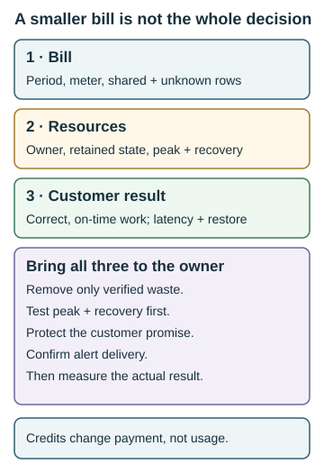

# COST 03: a small project chart can hide a growing bill

Reviewed October 20, 2026 against the six linked [AWS Well-Architected COST 03 practices](https://docs.aws.amazon.com/wellarchitected/latest/framework/cost-03.html). This is an authored A02/A03 **teaching review**, not an AWS Well-Architected Tool assessment, a current account bill or a measured customer outcome. The [normalized fictional billing lab](../../examples/costs/optimization-audit/README.md) supplies the numbers below. Run its exact-arithmetic script before attempting the changed case.

## Start with one repair shop

Maya's project chart says **$78 in both months**. The whole fictional account says **$101, then $117 before credits**. Her team also counts completed repair reports. Which number tells her whether the repair system became more efficient? None by itself. The project chart leaves out shared and unallocated charges; the whole account includes things not proven to belong to repair; and a report count needs a correctness and deadline rule. Draw the evidence join before dividing dollars by anything:

The figure shows the questions to join, not a live account result. A bill is evidence about metered usage. A tag is an attribution clue, not proof that all costs have an owner. A correct, on-time customer result is the business denominator. Credits affect payment, not the amount of underlying work.

| AWS practice | A02/A03 application and existing evidence | Missing proof or next decision |
| --- | --- | --- |
| [BP01 — Configure detailed information sources](https://docs.aws.amazon.com/wellarchitected/latest/framework/cost_monitor_usage_detailed_source.html) | The local CSV names period, resource, meter, quantity, pre-credit amount and project. A02/A03's run record asks for resource IDs and a later billing reconciliation. | The CSV is not CUR 2.0. For a real investigation, choose the billing and usage intervals, line-item types, granularity, resource-ID option, export destination, query access, retention and their own costs. Match outcome-log intervals to cost intervals. A detailed export is optional for this tiny trial, not an automatic prerequisite. |
| [BP02 — Add organization information](https://docs.aws.amazon.com/wellarchitected/latest/framework/cost_monitor_usage_org_information.html) | `repair`, `shared` and blank project fields in the fictional rows make attribution visible. The run record records owner and environment. | Inspect support for each selected AWS resource's tags and the activated cost-allocation keys before relying on a project filter. Record creation and removal dates. A missing tag remains unallocated until evidence supports assignment. An AWS Organizations tag policy is design-only for this personal Free-plan account. |
| [BP03 — Identify cost attribution categories](https://docs.aws.amazon.com/wellarchitected/latest/framework/cost_monitor_usage_define_attribution.html) | For the exercise, use direct repair, shared platform, unallocated and account-level credit as four separate categories. A02 processing and A03 immediate seat confirmation also serve different promises. | Decide with a business owner whether shared spend is assigned by measured usage, another declared rule or kept shared. Do not assign the entire account credit to repair or call the account total repair cost. Organization-wide cost categories remain a future multi-account design choice. |
| [BP04 — Establish organization metrics](https://docs.aws.amazon.com/wellarchitected/latest/framework/cost_monitor_usage_define_kpi.html) | Unit 04 defines a correct, on-time, distinct output, and its local script rejects duplicate, wrong and late outputs. That is more useful than a count of attempts. | Select the actual A02 completion deadline and A03 last-seat correctness rule with stakeholders. Instrument accepted requests, correct on-time completions and unmet promises without putting customer IDs into a high-cardinality metric. A real outcome count has not been collected. |
| [BP05 — Configure billing and cost tools](https://docs.aws.amazon.com/wellarchitected/latest/framework/cost_monitor_usage_config_tools.html) | The [credit gate](../../scripts/credit-check.py), pending [bounded-run worksheet](../../examples/costs/A02-A03-BOUNDED-RUN.md), resource inventory and fictional $110 alert design each answer a different question. | In the selected account, inspect current Free-plan and credit terms, permissions, alert delivery, billing-data lag and ongoing resources before a live run. AWS Budgets and anomaly tools notify or investigate; they do not make $5 a hard account ceiling. Do not enable a costed export, dashboard or Organization for this paper case. |
| [BP06 — Allocate costs by workload metrics](https://docs.aws.amazon.com/wellarchitected/latest/framework/cost_monitor_usage_allocate_outcome.html) | Unit 04 teaches cost per correct, timely output and warns that zero outputs make the ratio undefined. The fictional billing lab can supply candidate numerators, but not a settled repair allocation. | Choose one time window and an explicit allocation method for shared and unallocated spend. Reconcile the allocation to the whole account before calculating repair cost per accepted outcome. Verify the same customer promise under a proposed optimization; a smaller bill with fewer correct results may be worse. |

## Changed-condition exercise: the green chart and the missing repairs

Run `python3 examples/costs/optimization-audit/lab.py` and then `python3 examples/costs/optimization-audit/unit_cost_lab.py` from the repository root. Both periods are fictional months. The separate [summary-count fixture](../../examples/costs/optimization-audit/outcome-counts.csv) **declares**, but cannot substantiate from event receipts, 1,000 distinct correct on-time repair reports in baseline and 800 in current. A teammate points to the flat `$78` repair-tagged chart and calls the system equally efficient. Another divides the entire account totals by the repair reports and calls that the repair cost per report. A third subtracts account credits first.

Write your answer before opening the [assessor](A02-A03-COST03-ASSESSOR.md):

1. Reconcile the four fictional cost buckets in each period: direct repair, shared, unallocated and full-account pre-credit. Explain the $16 change and where it appears. Then show after-credit totals separately.
2. Compute the **direct-tagged-cost-per-correct-on-time-repair proxy** in both periods. State exactly which costs this proxy omits. Explain why `account total ÷ repair outcomes` is not yet an allocated repair unit cost, even though its arithmetic is possible.
3. Name a plausible rule for distributing the shared $12 and the newly larger unallocated network line. What observation would justify each rule? If attribution evidence is absent, show the dollars as unallocated instead of making a neat but invented unit price.
4. The day-28 close still approaches its deadline and the database p99 misses its promise in the fictional resource notes. Would a worker rightsize, an alert or a discount prove the system improved? Specify the outcome, peak-load and rollback observations needed before claiming it did.
5. Run `python3 examples/costs/optimization-audit/unit_cost_lab.py --current-outcomes 0` to change the current month to **zero correct on-time repairs** with the same charges. What is the unit-cost result? Ask Codex to audit your arithmetic and identify one unsupported attribution claim in its own answer. Verify the result with the supplied rows and explain why its prose is not independent learner or cloud evidence.

**Disposition:** all six COST 03 practices now have a workload-specific teaching question, source pointer and assessable changed case. This closes the question-mapping-to-teaching weakness for this one row. Actual tag activation, real billing/export scope, delivered alerts, selected workload allocation, measured AWS customer outcomes and independent learner assessment remain open. No AWS call or credit was used.
