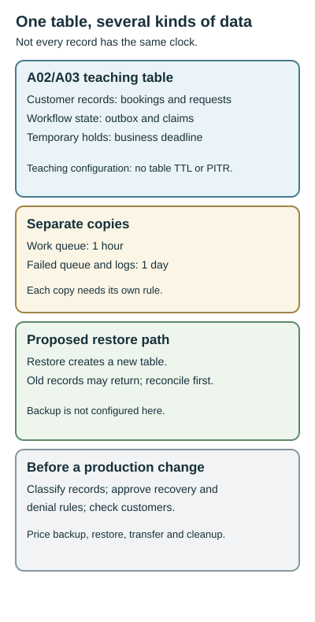

# SUS 04: decide which data deserves which life

Reviewed October 19, 2026 against the eight [AWS Well-Architected SUS 04 data practices](https://docs.aws.amazon.com/wellarchitected/latest/framework/sus-04.html). This is a source-traced teaching review of A02 repair processing and A03 reservations, not a Well-Architected Tool finding, a production classification policy, measured storage use, energy or carbon, or an instruction to enable backups in an account. Inspect the actual [Terraform table, queue and log settings](../../architectures/reliable-workflows/infra/main.tf) and [domain item kinds and queue payload](../../architectures/reliable-workflows/src/domain.py) before using this packet.

## Begin with the customer's record, not a storage tier

Maya can reconstruct a report from its accepted input only if the input, code version and dependencies are still available and the recomputation meets the customer's deadline. She cannot reconstruct a customer's original booking choice from a report total. “Derived” is therefore a *testable recovery claim*, not a synonym for disposable.

In the current synthetic lab, one DynamoDB table mixes request, outbox, appointment, course, reservation, hold and claim items. The work queue retains messages for one hour; its failed-message queue retains them for one day; the four Lambda log groups have one-day retention. The table has no TTL or PITR block in this Terraform root. These source facts do not decide what a real shop may retain or delete. The whole stack is intended for explicit teardown with synthetic records. [Source](../../architectures/reliable-workflows/infra/main.tf).

| Data class in this study | Why it exists | Decision before production |
| --- | --- | --- |
| Accepted request and appointment/reservation | Customer promise and authoritative business result | Owner, sensitivity, correction/revocation rule, recovery objective and retention basis. |
| Outbox, claim and hold state | Prevent lost work, duplicate effects or double allocation | Determine when an item is truly settled; expiry of a hold is a business transition, not a storage-deletion timer. |
| Work and failed-queue messages | Carry or diagnose unfinished processing | Preserve a recovery path long enough to handle failures; distinguish queue lifetime from record retention. |
| Function logs | Diagnose a bounded incident | Minimize customer content, restrict readers and choose a retention window that still supports investigation. |
| Report or cached view, if later added | Faster reading of a result | Show that source and recomputation can meet the actual deadline before excluding it from backup. |

## Apply all eight practices to this workload

| Practice | Current evidence or decision | Remaining proof |
| --- | --- | --- |
| [BP01 Classify data](https://docs.aws.amazon.com/wellarchitected/latest/framework/sus_sus_data_a2.html) | The item-kind inventory above separates authoritative customer records from workflow and diagnostic data; it does **not** assign real legal classes. | Product/data owner must decide sensitivity, integrity, availability, retention, deletion and access for each class and copies. |
| [BP02 Match access and storage](https://docs.aws.amazon.com/wellarchitected/latest/framework/sus_sus_data_a3.html) | A key-value table serves known request/seat actions; a sparse due-hold GSI serves one discovery path. It adds index writes and storage and may lag the base record. | Measure read/write patterns, index cost, missed/stale candidates, and a correct last-seat result before changing storage. |
| [BP03 Manage lifecycle](https://docs.aws.amazon.com/wellarchitected/latest/framework/sus_sus_data_a4.html) | Queue and log retentions are declared, but the table has no item deletion or archival policy; stack destruction is a different, whole-lab action. | Define and test class-specific state and retention transitions, including failed work, backup copies and customer offboarding. |
| [BP04 Elastic block/file capacity](https://docs.aws.amazon.com/wellarchitected/latest/framework/sus_sus_data_a5.html) | The current root provisions no EBS or shared file system. An irrelevant service should not be created to tick a checklist box. | Revisit only if an attached file/block workload is selected; size its growth, throughput and idle capacity. |
| [BP05 Remove redundant data](https://docs.aws.amazon.com/wellarchitected/latest/framework/sus_sus_data_a6.html) | A sent outbox row or repeated report might later be removable, but deleting it too early can lose retry or audit evidence. The failed queue is not merely a duplicate of the work queue. | Prove settlement, dependency and retention conditions, then inventory every copy and measure bytes and repeated work. |
| [BP06 Share common storage](https://docs.aws.amazon.com/wellarchitected/latest/framework/sus_sus_data_a7.html) | One table is already shared by several actions. That reduces separate-table administration but mixes recovery and retention scopes. | Verify access isolation, restoration and deletion granularity; do not add a file system where no file-sharing need exists. |
| [BP07 Minimize data movement](https://docs.aws.amazon.com/wellarchitected/latest/framework/sus_sus_data_a8.html) | A02 sends a request key in the SQS body, not the full repair text. This can avoid repeatedly copying the text into queue messages. | Measure bytes and reads, protect the lookup, avoid sensitive log payloads, and compare total work; a key-only message still causes a table read. |
| [BP08 Back up hard-to-recreate data](https://docs.aws.amazon.com/wellarchitected/latest/framework/sus_sus_data_a9.html) | No PITR is configured for the disposable table. A production customer promise might need it, but DynamoDB restore is table-wide into a **new** table, so the mixed item classes move together. | Approve RTO/RPO and backup scope, price backups and temporary restored capacity, rehearse authorization/cutover/reconciliation, and validate customer records. |

A proposed DynamoDB TTL can help retire eligible stored items, but expired items can remain readable and billable until background deletion. It is not the clock that releases a seat or revokes access. A DynamoDB point-in-time restore produces a new table; settings such as TTL, stream configuration, alarms, tags and PITR need separate restoration steps. A one-table backup cannot simply say “restore only appointments” without an additional filtering and reconciliation design. [AWS expired-item behavior](https://docs.aws.amazon.com/amazondynamodb/latest/developerguide/ttl-expired-items.html), [AWS table restore behavior](https://docs.aws.amazon.com/amazondynamodb/latest/developerguide/PointInTimeRecovery.Tutorial.html).

Costs follow every retained and moved copy: base-table and index storage, writes and reads, queue requests, log ingestion/storage, backup storage, restore into a second table, possible transfer, and any export/recomputation. Check the selected Region's current prices and trial-credit eligibility before recommending a live configuration. The existing A02/A03 USD 5 worksheet does not include a production backup/restore run and cannot authorize one. The data policy also needs least-privilege readers, encryption in transit and at rest, and an approved owner for retention and deletion; this packet does not establish effective AWS permissions.

## Changed-condition exercise: restore the wrong life

Shop A closes at noon. Its future requests are denied, but a retention decision keeps a small audit record for a defined period. Shop B remains active. At 13:00, an operator proposes restoring yesterday's whole table into production because one Shop B appointment was deleted by mistake. The snapshot also contains Shop A's now-closed request and an unsent outbox item. A teammate says, “The table is only 20 MB, so restore it all and let TTL clean up later.” The 20 MB is a fictional prompt, not a measured table size or price.

Before opening the [assessor](A02-A03-SUS04-ASSESSOR.md), identify which records are authoritative, which are retry state, and which are copies. Draw the current and restored table side by side. Decide how to recover Shop B without reviving Shop A's access or replaying the old outbox effect. Name the owner of the retention rule and the evidence needed before cutover. Compare the whole-path storage, request and recovery work of two bounded alternatives: (a) restore and selectively reconcile into the active table; (b) rebuild the lost appointment from an independent authenticated source if such a source actually exists. Do not assert that (b) exists merely to avoid backup cost.

**Change:** the missing Shop B appointment was never recorded elsewhere, and the business requires it before opening tomorrow. Revisit your choice. **Change again:** the only desired output is a report that can be regenerated from retained inputs and code within the deadline. Which backup scope might shrink without losing the promise? Ask Codex to name one way either plan could leak Shop A's data or duplicate a customer effect; verify its claim against the source and the changed facts.

**Review disposition:** all eight SUS 04 practices now have a workload-specific teaching decision and a changed-case prompt. The current Terraform and domain source support only the stated configuration facts. This is not production data classification, AWS restore, measured resource/carbon reduction, validated legal retention, independent learner performance or an exact-final book review.
