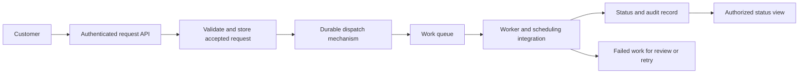

# One recurring problem: accept a request and do work reliably

Status: teaching design with a [runnable A02/A03 implementation](../architectures/reliable-workflows/README.md), local emulated checks and a prepared live harness; not yet deployed. The existing Amplify lab supplies identity, private data, storage and a small function; it does not implement this full workflow.

## Start with a repair request

A customer submits a request to repair a heater. The screen needs to show that the request was accepted. Scheduling a technician may take longer, and the scheduling system might be unavailable. The application must not create two appointments because the customer pressed Submit twice.

Separate “we safely received your request” from “the work is finished.” A queue is a waiting line for work. Durable storage is the record that survives a process stopping. A status page tells the person what has actually happened.

This is a conceptual flow. A design must specify how durable dispatch works: saving a record and independently sending a queue message can fail halfway. Evaluate an outbox/stream mechanism or another coordinated workflow; simply drawing two arrows does not establish reliable delivery.

## Candidate AWS mapping and bounded alternatives

An Amplify frontend and Cognito identity can remain the entry point. A candidate backend uses AppSync or API Gateway, Lambda, DynamoDB, SQS, and CloudWatch. Choose one API approach after requirements are known; do not provision both by default. A stream/outbox approach requires explicit duplicate, ordering, retention, and replay behavior. Step Functions is a candidate when work has multiple coordinated stages, waits, or compensation.

| Choice | Suitable situation | Cost of the choice |
| --- | --- | --- |
| Process synchronously | Short work with a dependable dependency and acceptable timeout behavior | Caller waits; dependency failures directly affect submission |
| Accept durably, process asynchronously | Work can wait, bursts occur, or a dependency is unreliable | Requires status, queue management, duplicate handling and recovery |
| Orchestrated workflow | Several steps need coordination, waits or compensation | More workflow design, state transitions and operational responsibility |

These are candidate designs, not universal defaults. Check current service capabilities and costs before implementation.

## Shared shape, different correctness rules

| Business scenario | Shared foundation | Difference that changes the design or tests |
| --- | --- | --- |
| Repair request | Authenticate, validate, record, process, report | Scheduling windows and technician skills; duplicate appointment prevention |
| Retail order | Same request lifecycle | Inventory reservation, payment reconciliation, cancellation and compensation |
| Course enrollment | Same request lifecycle | Capacity, waitlists and concurrent attempts for the last seat |

A queue does not automatically make a payment safe. A database write does not automatically reserve inventory correctly. Those are domain rules: rules about what this particular business considers valid.

## Illustrative requirement-to-evidence mapping

Targets below are invented teaching inputs, not measured guarantees or recommendations for a real business.

| Requirement | Design consequence | Evidence to collect |
| --- | --- | --- |
| Customer sees acceptance within two seconds under the specified test load | Acceptance path excludes slow scheduling work | Timed end-to-end test with stated load and percentile |
| Repeating a submission must not create a second appointment | Durable request identity plus conditional state change; integration must support reconciliation or duplicate prevention | Concurrent duplicates and retry after worker interruption |
| Customer A cannot read customer B's request | Server-side authorization at each access path | Direct API denial and file access denial |
| Scheduling outage must not silently lose accepted requests | Durable pending state, retry policy, failure queue, operator procedure | Simulated outage, alarm observation, recovery/replay without duplicate effects |
| Only the dispatcher can assign a technician | Role rule enforced by backend, with transition validation | Forbidden action denied even when UI is bypassed |

## What automation can and cannot decide

Automate repeatable mechanics after decisions are explicit: generate environment configuration, format and validate infrastructure, run tests, produce a deployment plan, deploy within an authorized scope, gather evidence, and check cleanup. Keep workload identity, environment and source revision attached to every result.

Business owners must supply the meaning of a valid request, acceptable loss/delay, retention obligations, budget, and who owns recovery. Engineers translate these into architecture and tests, with stakeholders reviewing consequential tradeoffs. Unknown requirements stay unknown; a generator must not silently turn them into production defaults.

## Completion gate for the future implementation

Use synthetic data. Provide runnable infrastructure with one owner per resource, application code, configurable context, failure tests, recovery instructions, an explicit cost model and cleanup verification. Record what was deployed, what was measured, what failed and what remains untested. A successful deployment is only the start of verification.
