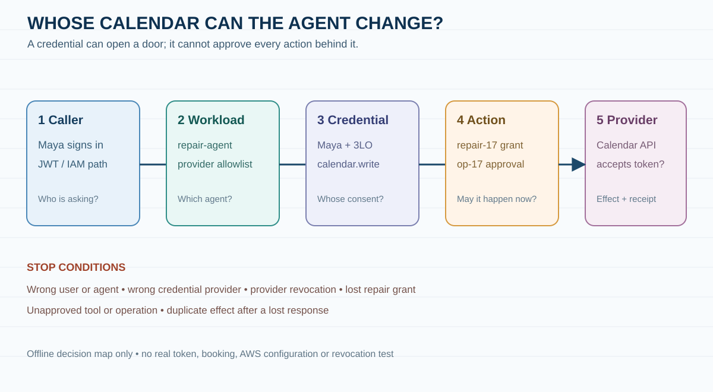

# Whose calendar can the agent change?

Maya asks the repair assistant to schedule a pickup on **her** calendar for `repair-17`. The assistant can propose a tool call, but the calendar must not become the assistant's unrestricted notebook. Before anything is written, the system needs to know who called, which agent workload is acting, which credential it may obtain, what Maya consented to, which repair she still owns, and whether this exact booking has already happened.

This illustrated offline lesson addresses [SAP-C03 skill 2.5.2](https://docs.aws.amazon.com/aws-certification/latest/solutions-architect-professional-03/solutions-architect-professional-03-domain2.html). It builds on the [agent action boundary](../agent-tool-boundary/README.md) and [authorized retrieval chapter](../../reader/BOOK-LOCATORS.md#book-c7716c08655f741e). The code below models **application decisions** with trusted fixtures. It does not run AgentCore, call an identity provider, receive a real token, or make a calendar booking.



## Four different permissions

1. **May Maya call this agent?** Inbound authentication validates the caller at AgentCore Runtime or Gateway, using an appropriate JWT or IAM path. Configure and verify issuer, audience/client, allowed caller, and the chosen entry point. A free-form user ID header is not itself proof of a person; AWS warns that the runtime user-ID path treats that string as opaque unless an upstream system has verified it. [Inbound JWT authorizer](https://docs.aws.amazon.com/bedrock-agentcore/latest/devguide/inbound-jwt-authorizer.html), [runtime security guidance](https://docs.aws.amazon.com/bedrock-agentcore/latest/devguide/runtime-security-best-practices.html).
2. **Which credential may this agent obtain?** AgentCore Identity gives the workload an identity and can use credential providers and a token vault for outbound access. Scope the agent's role to the specific workload identity and credential provider. AWS notes that the role controls which providers the agent may call; a successful provider call does not mean the right user's credential exists. [Workload identities](https://docs.aws.amazon.com/bedrock-agentcore/latest/devguide/understanding-agent-identities.html), [provider access scope](https://docs.aws.amazon.com/bedrock-agentcore/latest/devguide/scope-credential-provider-access.html).
3. **Whose outside account and which scope?** For Maya's personal calendar, use a user-delegated OAuth authorization-code flow (3LO) with her consent and only the needed calendar scope. An autonomous client-credentials flow (M2M) fits a company-owned resource with machine authority; it is not a substitute for Maya's personal consent. Keep the authorization URL bound to the same authenticated user who began the flow. AgentCore can store and refresh tokens, but AWS warns that a returned token is **not guaranteed valid** after provider-side revocation. Observe a rejection from the downstream provider and handle reauthorization; do not claim immediate revocation of every cached token. [Authentication patterns](https://docs.aws.amazon.com/bedrock-agentcore/latest/devguide/common-use-cases.html), [session binding](https://docs.aws.amazon.com/bedrock-agentcore/latest/devguide/oauth2-authorization-url-session-binding.html), [token retrieval and revocation caveat](https://docs.aws.amazon.com/bedrock-agentcore/latest/devguide/identity-authentication.html).
4. **May this exact action happen now?** The application or downstream resource must check the tool, repair ownership, current grant, approved operation, and replay state. A valid token with `calendar.write` may still be too broad for `repair-17`; AgentCore Identity does not infer Maya's shop-specific repair ownership. The [existing action-gate lab](../agent-tool-boundary/README.md) models that policy and a separate operation ledger models uncertain provider effects. [Shared authentication/authorization pattern](https://docs.aws.amazon.com/bedrock-agentcore/latest/devguide/gateway-using-auth.html).

## Run the identity-path challenge

From the repository root:

```sh
python3 examples/agentcore-identity-path/identity_path.py
python3 -m unittest discover -s examples/agentcore-identity-path -p 'test_*.py'
```

The first case passes local fixture gates but **does not book anything**. Then the fixture changes only one fact at a time: Leo's token is presented for Maya; Maya's repair grant is revoked; the outside provider rejects a token; and `op-17` is replayed. The tests also deny a different workload, provider, tool, repair, and an M2M token for a personal calendar. A successful `decide()` call cannot prove JWT validation, IAM scope, consent, token-vault binding, provider response, durable idempotency, or audit completeness.

Write a decision record before reading the [assessor](ASSESSOR.md): identify the authority for **caller, workload, credential provider, outside user, scope, tool, repair, operation ID, and final effect**. For each denial, name the layer that should record it and the data that must not enter logs (raw access or refresh tokens). Ask Codex to challenge the design with a copied consent URL, a provider-revoked token, an agent using a second credential provider, and a booking response lost after the provider accepted it. Demand current AWS and provider documentation for any service behavior. A local success is a question to investigate, not a certificate of safety.

This lesson creates no cloud resources or charges. A later live lab would require current AgentCore/IdP availability and pricing, a complete estimate within the account owner's chosen limit and reserve, a scoped non-root identity, cleanup, and observed allowed/denied calls plus audit correlation. No organization setup is assumed. Live identity configuration, real revocation timing and independent learner performance remain open.
