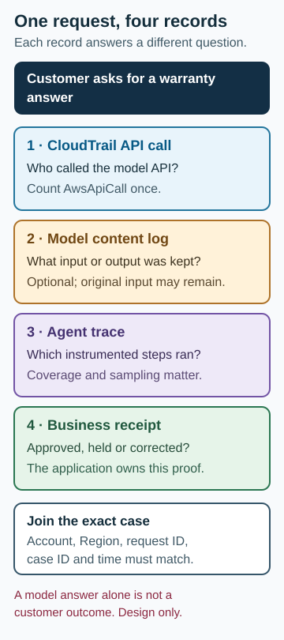

# Four records for one repair answer

Maya's repair assistant tells a technician that a repair is covered. A dashboard shows one model call. Did the technician receive a correct answer? The call record cannot answer that. The application must also record whether a reviewer approved the answer, held it, or sent a correction. This lesson keeps four evidence routes separate before joining them.



| Record | The question it can help answer | A tempting but unsupported conclusion |
| --- | --- | --- |
| CloudTrail API event | Which recorded API call occurred, from which principal, and when? | “The customer got a correct answer.” |
| Bedrock model invocation log | What input/output was captured for a supported invocation when logging was configured? | “All model endpoints and earlier calls were covered.” |
| AgentCore trace | Which instrumented steps and failures were observed? | “Every uninstrumented step was safe.” |
| Application business receipt | What did the application record as the disposition of this case? | “A customer was satisfied” without customer evidence. |

AWS documents that [Bedrock model invocation logging](https://docs.aws.amazon.com/bedrock/latest/userguide/model-invocation-logging.html) is off by default, scoped to an account and Region, and currently captures supported calls through `bedrock-runtime`, not `bedrock-mantle`. Its content destination can be CloudWatch Logs or S3 in the same account and Region. [CloudTrail's Bedrock guide](https://docs.aws.amazon.com/bedrock/latest/userguide/logging-using-cloudtrail.html) distinguishes management and data events and explains why a stream-completion `AwsServiceEvent` is not another `AwsApiCall`. Agent calls that are data events need deliberately configured selectors; inspect the existing selector set before changing it. [AgentCore Observability](https://docs.aws.amazon.com/bedrock-agentcore/latest/devguide/observability.html) supplies agent telemetry and instrumented spans; its trace is not an application business receipt.

**Sensitive-content trap.** A guardrail's masked response does not prove the original prompt was removed from an enabled invocation log. AWS says its CloudWatch `input` field can retain the original request and a guardrail trace can include the original match. See the [sensitive information filter limits](https://docs.aws.amazon.com/bedrock/latest/userguide/guardrails-sensitive-filters.html). The fixture uses a boolean named `input_contains_synthetic_marker`; it contains no person's data or real prompt. For a real design, first ask whether metadata alone answers the audit question; then restrict access, encryption, retention and deletion for any approved content collection.

## Run the cloud-free evidence join

From the repository root:

```sh
python3 examples/ai-audit-evidence/lab.py
python3 -m unittest discover -s examples/ai-audit-evidence -p 'test_*.py' -v
```

The fixture is a **fictional normalized teaching contract**, not a CloudTrail, AgentCore or Bedrock export parser. Its application `case_id` is the proposed join key; the model request ID links the invented CloudTrail and invocation-log records. The baseline has one API call, one stream-completion service event, one invocation-content record, one agent trace, and a business receipt saying **human review required**. The script reports that all four record routes exist; it does not report a successful warranty decision.

Before reading the assessor, make three changes to a copy of `fixture.json` and predict the report:

1. Set `collection.invocation_logging.enabled` to `false`. Explain why the absent content cannot be called clean or sanitized.
2. Restore that value and change the invocation log's `region`. Explain why matching request text or case name does not bridge accounts or Regions.
3. Restore the Region and remove `business_receipts`. Explain what the model and trace still establish, and what remains unknown.

Also inspect the two CloudTrail event types. Count actual API calls. Then change `endpoint` to `bedrock-mantle`: the current invocation logging route does not establish content coverage for that endpoint. The code's `sensitive_log_risk` is a reminder about the synthetic fixture marker, not a PII detector or a guarantee that any other record is safe.

## Design the real audit path on paper

Draw the exact account/Region and endpoint for each workload; select the operations and CloudTrail event categories you need; name the model-content collection decision, destination, access owner, retention purpose and deletion route; show how AgentCore instrumentation carries a non-sensitive correlation key; and define a separate, authorized application receipt for approval, hold, correction or delivery. Add an integrity and retrieval test, including a missing/late record and an access-denied retrieval. A report is complete only for the selected scope and time window. For a regulated workload, have the relevant compliance and privacy owners approve the actual evidence specification.

No AWS resources are created or queried here. A live implementation would require a current Region-specific cost estimate for selected CloudTrail data events, log ingestion/storage, traces, queries and retention. Compare any future discretionary run with spending and credit-reserve limits chosen for its account. Delete experimental destinations after verified retrieval and approved retention handling. The cross-account or organization-wide version remains design-only.

Ask Codex to attack your plan: “Which record proves the customer outcome? What happens if logging is off, an endpoint changes, a stream-completion event is counted twice, the account/Region differs, or a masked response leaves sensitive input in a log? Cite current AWS documentation and identify what must be tested live.” Check its citations and proposed selectors before using any configuration.

Compare your answer with [the assessor notes](ASSESSOR.md). This local exercise verifies a reasoning rule against synthetic cases; it does not verify delivery, completeness, tamper resistance, retention, customer satisfaction or AWS configuration.
