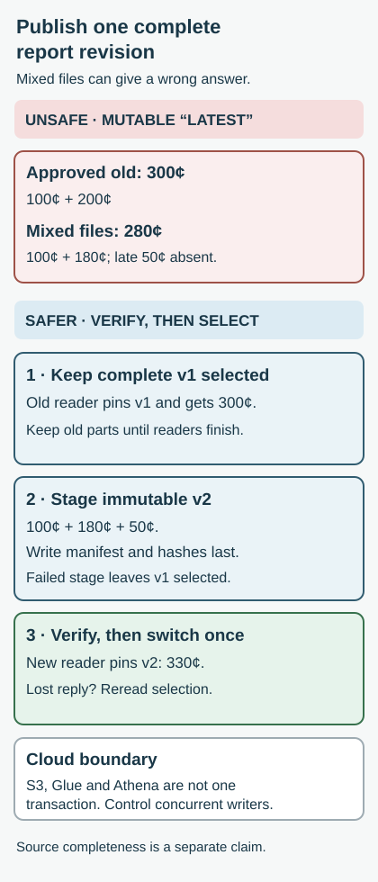
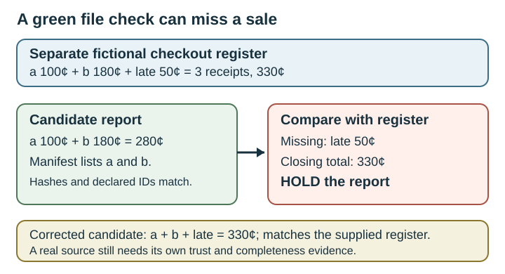

# Read less data without changing the answer

The query, conversion and schema-evolution drills use the real DuckDB 1.4.3 query engine and local Parquet files. A separate rerun/publication drill below uses only Python's standard library. None makes an AWS call. From the repository root, create an isolated environment and install the pinned package from PyPI for the DuckDB drills:

```sh
python3 -m venv .venv-analytics
.venv-analytics/bin/python -m pip install -r examples/analytics-query/requirements.txt
.venv-analytics/bin/python examples/analytics-query/lab.py
```

Installation uses the network; the lab itself uses local data and disables automatic extension loading/installation. The environment is ignored by Git. The pin reproduces this exercise's tested API/profile behavior; it is not a claim that this is the newest release or a dependency-security audit. Upgrades require rechecking results and profile parsing.

## Predict before running

There are 1,000 sales of $1 on each of three days. One extra $25 sale occurred late on day one and arrived on day two. Day one's correct total is therefore $1,025 from 1,001 distinct events. We want that answer, not just a fast query.

| Query/layout | Expected first-day total | Local files read |
| --- | --- | --- |
| Arrival partitions; event-time filter only | $1,025 | 3 |
| Arrival partitions; also require arrival on day one | $1,000 — wrong | 1 |
| Event-date partitions; event time and event-day filters | $1,025 | 1 |

The second query is the deliberately incorrect control. It removes a valid late sale. The third changes the physical layout so that its partition filter agrees with the report's event-time meaning.

## Read the evidence

The program creates 3,001 synthetic records and writes two three-file datasets. It executes each aggregate, then executes it again with `EXPLAIN (ANALYZE, FORMAT JSON)` against unchanged files. It extracts the Parquet operator's `Total Files Read` and file-filter details. It also compares the corrected query's exact ID set with a separately selected Python fixture set; equal money totals alone could hide the wrong records.

All temporary datasets are removed on exit. The virtual environment remains for later runs. The program prints the measured summary; the aggregate companion runner can retain it in its ignored report:

```sh
python3 scripts/check-companion.py --analytics-python .venv-analytics/bin/python
```

This option does not install dependencies. Without it, the analytics drill is `not_requested`, not a pass.

File counts are operator-reported values, not filesystem read instrumentation or Athena billable bytes. File sizes can differ; Parquet statistics, projection and caches can change physical work. This is not a throughput benchmark. It does not test S3, Glue catalogs, Iceberg, IAM, concurrent updates, schema evolution or source completeness. The synthetic timestamps share one agreed time convention; production needs an explicit timezone contract.

Independent challenge: add a refund, an event exactly at midnight, and a very late event arriving several days later. Preserve correct ID membership and totals under an appropriate accounting rule. Explain why simply widening the arrival filter by one day is insufficient when lateness has no such bound. Then vary file sizes and show why “one third as many files” need not mean “one third the cost.”

Ask Codex: “Propose a query optimization, then construct a valid event it might incorrectly exclude. Preserve the expected ID set and accounting total before interpreting performance counters. Separate measured local behavior from predicted Athena behavior.” Read [the event and reporting lesson](../../reader/BOOK-LOCATORS.md#book-f0f0044d800d44b9).

## Publish a complete daily result after a failed job

Query pruning is useful only if readers know which **complete** dataset they queried. Maya's first daily result has events `a` and `b`, totaling 300 cents. A later source revision adds a late 50-cent sale. A worker crashes while staging that revision. Readers should still get the first complete 300-cent result; after a successful rerun they should get 350 cents once, not 650 cents or a partial table.

Predict which revision is selected at each point, then run this independent standard-library drill:

```sh
python3 examples/analytics-query/rerun_lab.py
python3 -m unittest discover -s examples/analytics-query -p 'test_rerun_lab.py'
```

The local SQLite transaction stages a whole candidate or none of it. A current-generation check and a monotonically increasing **supplied** source revision control selection. A retry with the same run ID and identical rows is harmless; reusing that ID with changed rows is rejected. A delayed older run cannot replace the newer selected result. Four tests cover the injected failure, exact rerun, changed-input conflict, stale publication, missing expected event and invalid money.

This one-database transaction does **not** make S3 objects, Glue metadata and Athena readers change atomically. The source revision and expected-ID list are trusted fixture inputs; they do not establish source completeness or authority. A real design needs immutable candidate paths, a controlled reader selection mechanism, an owner for incomplete/rejected runs, recovery of orphaned output, and a cost/retention plan for both old and new data. Separate acceptance checks must verify the exact event IDs and amounts that the published query returns.

Transfer challenge: a third source revision corrects event `b` from 200 to 180 cents while keeping the late 50-cent event. State its expected row set and 330-cent total, then explain why appending a correction as another positive row or rerunning the second output in place would be wrong. Ask Codex to propose a publish sequence, then remove one step and identify the incorrect reader outcome it would allow. Its suggestion is a design prompt, not executed cloud evidence.

## When one report spans several files

The SQLite drill has one transaction. A data lake's report may occupy many separate objects. Imagine replacing two files under a mutable `latest` folder while a customer opens the dashboard. The old complete report is 300 cents. The new report corrects `b` from 200 to 180 cents and adds a late 50-cent sale, making 330 cents. After only the first file changes, a reader could get 280 cents: neither approved result.



Predict the selected total after a worker fails while writing the first new file. Then run the independent standard-library drill and seven focused checks:

```sh
python3 examples/analytics-query/file_publication_lab.py
python3 -m unittest discover -s examples/analytics-query -p 'test_file_publication_lab.py'
```

The drill writes actual temporary files. Its unsafe mutable folder exposes the 280-cent mixed state after only the first new part replaces its old counterpart. The protected path leaves v1 selected when v2 staging fails, resumes the same exact input, verifies both v2 part hashes and declared IDs before replacing a **local** selection pointer, and recovers an injected lost reply by reading that pointer. A reader that pinned v1 can still read it after v2 is selected; deleting v1 too early breaks that reader. A corrupted selected part is rejected. The unsafe and protected results are both observed locally rather than inferred from a paper trace.

This models a *publication protocol*, not an AWS feature already configured. The local pointer replacement is atomic only for that one file on this filesystem, and the local generation check is sequential. It does not resolve simultaneous writers, independently authenticated sources, durable storage failures or a query engine that ignores the pointer. AWS documents [strong consistency and atomic updates to a single S3 key](https://docs.aws.amazon.com/AmazonS3/latest/userguide/Welcome.html), plus [conditional writes](https://docs.aws.amazon.com/AmazonS3/latest/userguide/conditional-writes.html). **Inference:** those single-key guarantees do not make an S3 dataset, Glue catalog change and Athena reader one transaction. Athena's [partition metadata rules](https://docs.aws.amazon.com/athena/latest/ug/updates-and-partitions.html) are another separate boundary. A live design must define how *every* reader selects the same version, how competing writers compare state, how old objects are retained, how permissions protect the selection and data, and how orphaned/stale files are cleaned without breaking a pinned reader. Include storage, requests, catalog changes, query scans and cleanup in a current full-run estimate before any cloud experiment.

Answer the [eight changed-condition questions](FILE-PUBLICATION-ASSESSOR.md#questions-to-attempt-first) before reading the rationale. Ask Codex to play a second publisher and a reader holding an old revision; require it to name the exact step where each can fail. A hash comparison proves the bytes match a manifest made by this publisher; it does not prove the source manifest included every real sale, or that the business approved the correction.

### Compare the report with a separate checkout register

A sealed box can match its packing list and still omit an item the customer bought. Here the publisher stages a **self-consistent** report with `a` and corrected `b`: two IDs, 280¢, matching part hashes and a matching declared ID list. Its own checks pass. A separately supplied fictional checkout register has a third receipt, `late` for 50¢, and closing controls of three receipts and 330¢. Predict what each check can say, then run:

```sh
python3 examples/analytics-query/source_completeness_lab.py
python3 -m unittest discover -s examples/analytics-query -p 'test_source_completeness_lab.py' -v
```



The local publisher really selects the incomplete 280¢ candidate because its manifest and parts agree. The separate comparison names the missing `late` receipt and holds the report; a corrected 330¢ candidate then matches the **supplied** register. One negative control keeps the count and total at three and 330¢ but substitutes an `other` ID for `late`; matching aggregate numbers still cannot prove membership. Another removes `late` from the register's row list while leaving its separate closing count and total at three and 330¢; the register contradicts itself. Without a register, the result is unknown.

The register and closing controls are authored fixture inputs, not authenticated checkout evidence. A real report needs a business-owned source of accepted receipts, a defined reporting window and late-arrival policy, exact identity/value reconciliation, an owner for discrepancies, and a reader-release decision. Ask Codex to propose a green dashboard that hides `late`, then use the separate receipt and control total to test its claim. This lab creates temporary files only; it makes no AWS call or cost claim.

### Let two publishers reach the selection gate together

The file drill above lets only one publisher act at a time. Now two workers have already built complete candidate reports from the same old selection. Worker v2 offers 330 cents at source revision 2. Worker v3 offers 340 cents at source revision 3. Both expect selection generation 1. Which report should a reader see if their calls overlap? Predict the two acceptable results before running:

```sh
python3 examples/analytics-query/competing_publishers_lab.py
python3 -m unittest discover -s examples/analytics-query -p 'test_competing_publishers_lab.py' -v
```

Two local threads wait at a barrier, then use **separate connections** to a temporary SQLite database. Its write transaction checks the generation and selects one already-complete manifest. Exactly one call publishes generation 2; the other receives `stale_generation`. A separate observer reads either the complete 330-cent v2 report or the complete 340-cent v3 report. Which worker wins varies. If v2 wins, v3's higher source revision does **not** automatically win later: its publisher must reread the selected revision and make a new authorized decision with the new generation. The database controls only the selection record; old files must remain for readers already pinned to them.

This adds local overlapping-writer evidence to the earlier sequential file example. It does **not** turn a SQLite row, local file manifest, S3 objects, Glue catalog and Athena queries into one transaction. A real implementation must make the selection mechanism and reader protocol explicit, protect selection authority, test conditional-write conflicts and lost replies on the chosen service, and reconcile the source separately. Ask Codex to explain why “highest revision wins” is not proven merely by the number in a candidate manifest. The [assessor cases](FILE-PUBLICATION-ASSESSOR.md#questions-to-attempt-first) now include that transfer decision.

## Convert a contracted CSV before optimizing it

Using the same pinned environment, run:

```sh
.venv-analytics/bin/python examples/analytics-query/schema_lab.py
```

This separate drill writes a real CSV, validates it, writes typed Parquet and reads back the complete rows. Its exact header is `event_id,occurred_utc,amount,currency`. IDs are 1–64 ASCII letters, digits, underscores or hyphens. UTC timestamps must be valid dates using `YYYY-MM-DDTHH:MM:SSZ`. Amounts have exactly two decimal places with an optional minus sign, fit signed 64-bit cents and use USD. No timezone guessing, currency conversion or rounding is performed.

The fixture preserves text IDs `001`, `NULL` and `refund`; `NULL` is not a missing value here. Amounts 12.30, -2.30 and 0.10 become 1230, -230 and 10 cents, totaling 1010. It checks the whole expected row set and Parquet reader column types. Timestamps are read in UTC text form for comparison, while their column type is independently checked. Row order is normalized by ID; original CSV byte layout is not preserved or claimed.

Fifteen rejected batches cover invalid/blank fields, nonexistent dates, missing or unsupported timezone notation, excess precision, exponent notation, non-finite text, integer overflow, unsupported currency, duplicate identity, short/extra rows, empty input and an unexpected header. Every rejected fixture leaves no output file. A preexisting output is refused and its bytes remain unchanged. These are sequential fixture checks, not protection against concurrent writers or a crash during output writing.

The optional `--analytics-python` companion check runs the query, schema conversion and mixed-version evolution drills. All fixture files are temporary and removed; the environment remains. The schema drill holds the small batch in memory and rejects it as a whole. It does not implement streaming quarantine, cross-batch deduplication, schema evolution, atomic dataset publication, source authentication or S3/Glue/Firehose integration.

For transfer, propose a version that accepts EUR without adding EUR and USD together, then one that accepts explicit timestamp offsets without shifting the event's instant. State the changed contract and independent expected values before editing code. Ask Codex to strip leading zeros from IDs as a deliberately incorrect change: the complete-row check must fail even though the row count and money total remain unchanged.

## Read old and new contracts together

Run the third drill in the same pinned environment:

```sh
.venv-analytics/bin/python examples/analytics-query/evolution_lab.py
```

Predict the result before running: version 1 has 1230 integer cents; version 2 has decimal USD text `-2.30` and `0.10`. Combining columns by name and summing only `cents` incorrectly returns 1230. Translating each supported version returns 1010 cents and preserves all three expected records. Historical missing channels remain null rather than being guessed. The output records the source version.

The drill writes real Parquet inputs, reads them together, writes a canonical Parquet output and checks complete expected rows. Eight rejected mixed batches cover an unknown version, excess precision, unsupported currency, missing amount, equal and conflicting duplicate IDs, overflow and an unknown channel. Rejected batches create no output. A preexisting output is refused unchanged, and source SHA-256 hashes are unchanged after the run. Temporary files are removed.

This is a bounded trusted-fixture migration, not a general hostile-file validator or a cloud publication protocol. It does not exhaustively validate physical input schemas, preserve arbitrary extra columns, authenticate producers, synchronize writers, provide atomic dataset selection or handle crashes during writing. Missing required columns and incompatible schemas can also raise query errors. The whole source set must fit memory. The separate conversion and query labs retain their own scope; this exercise adds local coexistence evidence, not live schema evolution in AWS.

Transfer challenge: add a EUR version and return totals grouped by currency. Define expected IDs, units, missing fields and duplicate policy before changing the code. Ask Codex to invent a backward-compatible-looking change that would corrupt an old report, then explain how your independent expected rows catch it.
