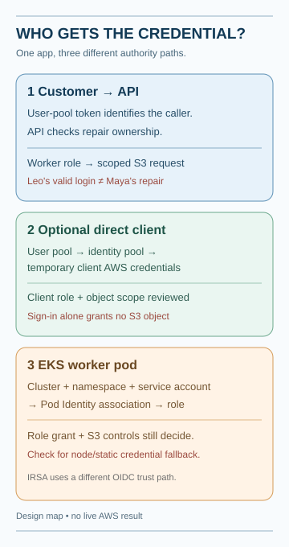

# Who gets the credential: the customer, the API, or the pod?

Maya's repair app lets customers upload a photo of a broken appliance. A browser calls her API, and a background worker records the job in S3. The worker later moves to an Amazon EKS cluster. A teammate proposes giving the browser, API and every pod the same AWS role because they all serve one app. That would join three different jobs and make a stolen browser token or an unrelated pod far more useful than it should be.

This is a cloud-free design lab for [SAP-C03 skill 2.1.2](https://docs.aws.amazon.com/aws-certification/latest/solutions-architect-professional-03/solutions-architect-professional-03-domain2.html). Read the [identity chapter](../../reader/BOOK-LOCATORS.md#book-eb08f5640c6b0750). The diagram shows proposed paths, not installed policies or a successful AWS request.

## First principles

The customer needs to prove who they are to the **application**. A Cognito user pool can issue tokens for that sign-in. When the browser calls Maya's own API, that API validates the relevant token and checks the customer's permission for the specific job. The worker uses its **own workload role** to call AWS. A customer token is not an IAM role session and does not authorize the worker to read every customer's records. [Cognito scenarios](https://docs.aws.amazon.com/cognito/latest/developerguide/cognito-scenarios.html).

If Maya instead chooses direct browser access to an AWS service, an identity pool can exchange a supported sign-in token for temporary AWS credentials. That is a new credential path with a client-side IAM role and resource-policy review. It is not necessary merely because the app has a user pool. Compare the direct path with an API-mediated upload using the actual access pattern and exposure requirement. [Cognito scenarios](https://docs.aws.amazon.com/cognito/latest/developerguide/cognito-scenarios.html).

For a worker on EKS, a Kubernetes service account identifies which pods may receive a particular workload credential path. With **EKS Pod Identity**, an administrator associates a cluster, namespace and service account with an IAM role. The Pod Identity Agent (built into EKS Auto Mode, installed for other supported clusters) and a supported SDK credential chain are needed. The role trusts `pods.eks.amazonaws.com` for assumption and session tagging; the role's permissions and applicable resource policies still govern S3 operations. The association does not add an annotation to the Kubernetes service account. A pod must actually use that service account. [EKS association guide](https://docs.aws.amazon.com/eks/latest/userguide/pod-id-association.html), [Pod Identity setup](https://docs.aws.amazon.com/eks/latest/userguide/pod-id-agent-setup.html).

**IRSA** is a separate EKS option: the role trusts the cluster's IAM OIDC provider and a particular service-account subject, and the SDK exchanges the projected web-identity token for temporary role credentials. AWS recommends Pod Identity when its prerequisites and workload fit, while IRSA covers other Kubernetes deployment options and certain requirements. Choose against the documented differences for the selected cluster; do not blend an IRSA annotation and a Pod Identity association into one imaginary mechanism. [EKS comparison](https://docs.aws.amazon.com/eks/latest/userguide/service-accounts.html).

## Trace six changed conditions

Write the **actor, credential source, trusted binding, permitted action and target, useful denial, cost/operating consequence, and evidence still needed** for each case. Answer before reading [the assessor](ASSESSOR.md).

1. **API-mediated upload.** Maya's browser sends a user-pool token to the repair API. The API starts a worker that writes only `photos/repair-17/`. Which component checks that Maya owns repair 17? Which role calls S3? Specify a safe attempt by Leo to upload to Maya's repair and an out-of-prefix worker request.
2. **Direct upload.** Mobile users need to upload large photos without sending bytes through the API. Compare a scoped presigned upload issued after an application authorization check with a user-pool plus identity-pool temporary-credential path. Name the new direct-client permission surface and how object ownership and key prefix are constrained. Neither sign-in nor a presigned URL alone proves the object's business owner.
3. **Pod moved to another namespace.** The `photo-writer` deployment moves from `repairs` to `preview`. The Pod Identity association names the old namespace and service account. Predict the credential-path result; do not assume a missing workload credential always yields a clean access denial, because an SDK might find another provider such as node credentials. State how to inspect the actual principal safely.
4. **Shared node.** A metrics pod runs next to the photo worker. Someone gives the node role broad S3 write rights and argues the worker's narrow role makes the cluster safe. Explain the escape path if a pod can reach node credentials. Specify the expected role for each pod and the observed negative request that would test separation in a future authorized cluster.
5. **Two AWS accounts.** The cluster and photo bucket have different owners. Map the workload's role, target-account resource policy or target role, and any KMS key policy needed. A same-account association is not automatically a cross-account grant. Identify a readback and an allowed/denied request for the selected design.
6. **Agent or credentials unavailable.** The worker cannot obtain its Pod Identity credentials. Should it use a baked access key, the node role, or a bounded queue/retry? Name the customer effect and stop condition. Separate a credential failure from a valid credential that lacks S3 permission.

## Run the local boundary worksheet

`python3 examples/application-pod-identity/lab.py` prints design review results for four fictional rows. `python3 -m unittest discover -s examples/application-pod-identity -p 'test_*.py' -v` checks the worksheet's classification. The code checks declared facts; it does **not** simulate AWS IAM, validate a JWT, issue credentials, create an EKS cluster, or contact S3.

Ask Codex to challenge your answers one boundary at a time. Require it to identify a token/role mix-up, a namespace or service-account mismatch, a fallback credential source, and a real denied request that would discriminate between the proposals. Have it cite current AWS documentation and verify those citations yourself. Use fictional names and identifiers; never paste live tokens, policies with private account details, or kubeconfig content.

Before any selected live experiment, choose the Region and supported setup, check current EKS, node, logging, S3, data-transfer and request costs, set a reader-chosen ceiling, name the cleanup owner, and reserve room for the rest of the account. This lab does not launch EKS. A design worksheet is partial teaching evidence, not a measured isolation or cost result.
