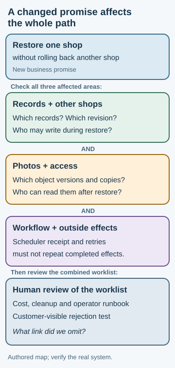
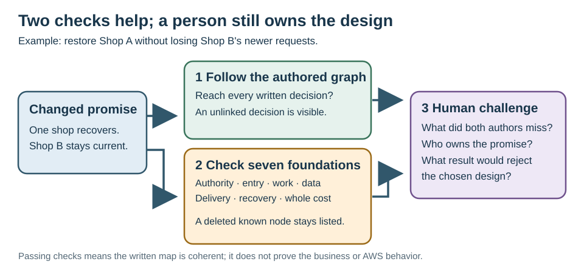
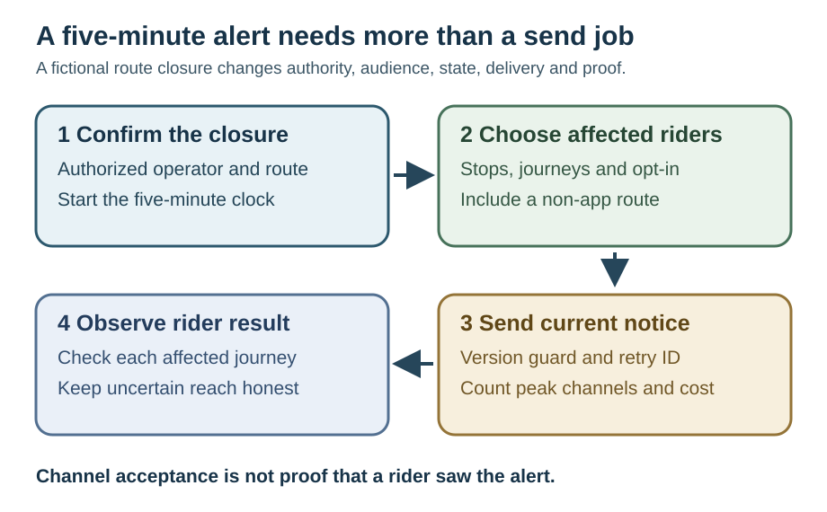

# When a promise changes, follow the design consequences

Maya asks to restore one repair shop after an error. A teammate changes the database restore procedure. That sounds plausible until a restored request points to an absent photo, a technician gets assigned twice, or a different shop loses newer work. The new promise has reached more than one box in the architecture.



This local exercise turns four changed business facts into **review worklists**, not architecture recommendations. It covers one-shop recovery, two-person school document approval, a hundredfold SaaS tenant burst and a five-minute transit alert. The [case file](cases.json) names each dependency, the question it raises and an observation that could reject a careless answer. The small [program](impact.py) walks the authored links and prints every reachable decision with its path from the change. It then checks that the case has mapped all seven shared design questions from Chapter 1 to reachable decisions.



Picture two lists on Maya's desk. The first is a **route map**: “A one-shop restore changes records, photos, work and the customer route.” A graph walk catches a destination that someone wrote down but disconnected. The second is a **packing list**: “Who can act? Where does the request go? What does the work? Where is the data? How does the change reach customers? How do we detect and recover? What does the whole path cost?” If a known scheduler effect disappears from the graph, the still-authored work entry in this second list calls for it. Both lists are maintained by people. Neither can discover a requirement that no one has identified.

From the repository root, predict what a narrow fix would miss, then run:

```sh
python3 examples/architecture-change-impact/impact.py shop-restore
python3 examples/architecture-change-impact/impact.py school-two-reviewers
python3 examples/architecture-change-impact/impact.py tenant-burst
python3 examples/architecture-change-impact/impact.py transit-alert
python3 -m unittest discover -s examples/architecture-change-impact -p 'test_*.py' -v
```

For the restore case, draw two bounded alternatives: selective reconstruction into shared storage, and selected dedicated storage for each shop. Name what happens to records, photos, workflow state and outside effects in each. For the school, compare keeping private intake with a revised approval state machine against a separate publication record; show how both deal with an old direct link. For the tenant burst, compare a scheduling/worker change with a selected resource boundary; check the shared database and each tenant's accepted-to-complete time before preferring either. The [assessor](ASSESSOR.md) discusses the tradeoffs after your first attempt.

## Transfer the same questions to a time-sensitive public alert

A bus route closes at 5:00 p.m. The operator now promises an alert to affected riders who opted in within five minutes. The previous application merely posted a route update when staff had time. An automated message job may look like the whole fix, but someone must first decide who is authorized to declare the closure, which journeys are affected, which version is current and what “alerted” means. A rider without the app may need a public-stop or another usable route. A provider's accepted-send receipt does not tell you whether a rider saw the notice before boarding.



Run the `transit-alert` worklist and answer these before opening the assessor:

1. The bus operator closes Route 8 at 5:00, clears it at 5:03, then closes it again at 5:04. A delayed message for the 5:03 all-clear arrives at 5:05. Which state may be announced? Name the version or ordering fact the design needs.
2. The text provider accepts 4,000 messages by 5:02, the app page updates at 5:01, and a diverted stop still shows yesterday's display. Which part of the promise is observed, which is unproved and which has failed?
3. An opt-out arrives during fanout. Explain the boundary between audience selection and sending. What evidence would you need before claiming the opt-out was honored? Do not assume a channel can retract bytes already delivered.
4. Compare an application-only notice with a multi-channel route that includes a usable non-app path. Give the latter's extra costs and failure modes. State one changed business fact that could make the simpler design defensible.

The five minutes start from the **confirmed closure fact**, not from whichever worker later wakes up. Count peak sends, retries, channel charges, logs and contact-data retention for a later cost review; an average day will understate a closure burst. This fictional worklist chooses no AWS service and makes no delivery, accessibility, privacy or deadline claim. A future cloud trial would need its own current price and credit check, a complete estimate against account-chosen spending and reserve limits, a scoped non-root identity, stop conditions and cleanup.

### Try the clock and evidence yourself

The [timeline fixture](transit-timeline.json) is a tiny day in the alert room. At 5:00 the route closes (version 1); at 5:03 it clears (version 2); at 5:04 it closes again (version 3). Rider B opts out at 5:05. Six fictional events then test a late all-clear, a send after opt-out, an accepted text, an observed app page and an old stop display. Run the [local reviewer](transit_timeline.py) and its tests:

```sh
python3 examples/architecture-change-impact/transit_timeline.py
python3 -m unittest discover -s examples/architecture-change-impact -p 'test_*.py' -v
```

Read `stale_send_blocked` as “this proposed send should not go out because a newer confirmed route fact exists.” Read `stale_notice_observed_on_path` differently: an old stop display **was seen**, so it is a failure to investigate, not a successfully blocked send. `channel_accepted_reach_unproved` means only that the fictional provider accepted a message. `current_notice_observed_on_path` means the fictional app path showed the current version; it says nothing about every rider. The `within_five_minutes_of_current_fact` flag times that **one event** from the newest confirmed fact. It cannot turn a send receipt into a rider-reach measurement or prove the whole public-alert promise.

Before reading the assessor, change the app observation from minute 7 to minute 10. The five-minute flag becomes false. Then move Rider B's attempt to minute 4, before the opt-out: the consent gate permits an attempt, although this fixture says that particular send was not accepted. Finally, invent a rider who never sees either path. Which evidence is now missing before the operator can claim the promise was kept? A real service would also need authenticated operator authority, a durable status/version rule, current consent at each actual send, timestamps from independently observed paths, retry reconciliation, privacy review and a bounded cost/cleanup plan. This standard-library fixture installs none of those controls in AWS.

The strengthened restore case asks how **Shop A alone** reaches the selected restored state while Shop B keeps its newer route. The tenant case asks how a new fairness rule is rolled out without stranding jobs already acknowledged by older workers. Those are different consequences of the same reusable foundation question: “How does a change reach customers?” The printed worklist gives each decision a path from the changed fact; the `foundation_review` output names the authored decisions assigned to each of the seven questions. That output says the map is filled in, not that its answers are true.

## What the automation can and cannot do

The graph is a checklist a team can **maintain as code**. It can expose a missing work item when an authored node becomes unreachable, and it can keep the same review questions visible after a changed requirement. It cannot invent a dependency the authors never wrote. One negative test removes the `outside_effect` link while leaving its node: graph validation fails. Another removes both the link **and** the node: the graph walk alone passes, but the separate foundation map still names that known work decision and rejects the case. A third test changes the foundation map too, hiding the scheduler effect from both authored lists; both machine checks then pass even though a technician could still be double assigned. Inspect all three outcomes before trusting the output.

Use Codex to challenge **both** lists: “For this changed promise, find one dependency the graph and seven-question mapping may both have omitted. Give a concrete failure and the observation that would expose it. Do not call the two green checks proof.” Check any proposed AWS-specific service behavior against current primary documentation. A business owner must still define the promise; an architect must compare designs; operators must obtain real evidence. Copying a service list from another case automates the wrong thing.

The exercise uses fictional information and Python's standard library. It makes no AWS call, authenticates no person, and proves no recovery, review, tenant fairness, cost or learner outcome. Any later account experiment needs current plan/credit and price review, a scoped non-root identity, a complete estimate within the owner's chosen limit, an owner-chosen credit reserve, stop conditions and cleanup. Organization-dependent variants remain design-only here.
