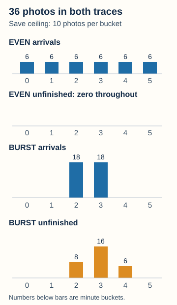

# Same total, different customer wait

Maya's photo desk can complete ten photos per minute. A coworker says the desk is safe because 36 photos over six minutes average only six per minute. That average is true. It does not tell Maya when people arrive.

Run `python3 examples/arrival-shape/lab.py` from the repository root. The program uses **fictional whole-minute buckets** and one FIFO line. It accepts a photo at the start of its numbered bucket and counts it as late if completion happens more than one numbered bucket later. This is a deliberately coarse teaching rule, not a measured service latency or a real customer promise.

Before running it, predict the peak unfinished count and late count for each case:

| Case | Six arrival buckets | Worker capacity | Save capacity |
| --- | --- | ---: | ---: |
| Even | 6, 6, 6, 6, 6, 6 | 10/min | 10/min |
| Burst | 0, 0, 18, 18, 0, 0 | 10/min | 10/min |
| More workers only | Same burst | 12/min | 10/min |
| Both stages reviewed | Same burst | 12/min | 12/min |

After the run, identify **which stage limits completions**. Explain why adding workers alone cannot improve this invented save-bound path. A higher save capacity is only a reviewed scenario here: a real database may face query work, contention, connection limits and cost. A photo is counted complete only after its required save. The program has no retries, failures, variable job sizes, startup time, measured duration, AWS queue, or competing workload.

**Change one fact.** Keep 36 total photos and a ten-per-minute save ceiling, but move six photos from the third bucket to the first. Predict whether the same average still hides a deadline miss. Edit a copy of the `ARRIVALS` tuple, rerun and compare exact minute rows. State what you would measure in a real workload before buying capacity: arrival timestamps, per-stage service times, success/correctness, waiting-time distribution, retry attempts, downstream headroom and the whole-run cost.

Ask Codex to explain a result in plain language, then make it show the minute-by-minute arithmetic and the assumption behind every capacity claim. Keep your own first prediction and compare it with the [assessor notes](ASSESSOR.md). The fixture is a local model, not evidence that Lambda, ECS, EC2, SQS or a database can reach these rates in AWS. It provisions nothing and spends no trial credit.
