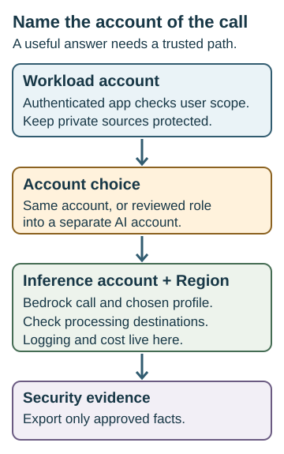

# Decide where a Bedrock answer is made

Maya's repair company has two shops. The US shop and the European shop each keep customer notes in a separate AWS account. Both want an assistant to summarize a repair history. A shared AI team suggests one central account for every model call. That sounds tidy, but Maya must still answer whose credentials send the request, where the prompt may be processed, who can see a saved prompt, and which account receives the bill.

This is a **paper architecture lab**. The accounts, Regions, dollars, balances and decisions in [cases.json](cases.json) are fictional supplied facts. The [checker](boundary_review.py) never contacts AWS. A green result means only that the supplied facts passed its few explicit gates; it does not grant IAM access, prove residency, configure logging, establish prices, or approve a deployment.

## First, draw the two account choices

**Model call in each workload account.** The shop's application identity calls Bedrock in its own account. The team repeats some setup, but the caller, invocation logging configuration and cost boundary are easier to relate to that shop. Each shop still needs a current service, model, Region and price check.

**Model call in a shared AI account.** The shop app obtains an explicitly reviewed role in the AI account, and that role invokes Bedrock there. Write both sides of the role boundary: who may assume it and what the assumed role may invoke. A role's trust policy and the caller's permission are separate checks. This is one possible design, not a claim that every Bedrock model supports direct cross-account resource sharing. [AWS cross-account role guidance](https://docs.aws.amazon.com/IAM/latest/UserGuide/access_policies-cross-account-resource-access.html).

For either design, name the **inference account** and **source Region**. Bedrock model invocation logging is disabled by default and configured per account and Region. When enabled for supported runtime calls, its CloudWatch Logs or S3 destination must be in that same account and Region. It can include request and response content, so a central security team's wish for evidence is not permission to copy private prompts. Decide retention and an approved export separately. The logging feature does not cover every newer Bedrock endpoint, including `bedrock-mantle`; verify the selected API. [AWS invocation logging](https://docs.aws.amazon.com/bedrock/latest/userguide/model-invocation-logging.html).

The source Region is not always the processing Region. A cross-Region inference profile may send prompts and outputs to one of its listed destination Regions. A **geographic** profile confines processing to its geography; a **global** profile has a broader destination set. Compare the actual profile's destinations with the business rule before approving a request, and review the relevant Region permissions. Do not infer residency from the source Region or from a profile name alone. [AWS geographic routing](https://docs.aws.amazon.com/bedrock/latest/userguide/geographic-cross-region-inference.html), [inference profile destination lookup](https://docs.aws.amazon.com/bedrock/latest/userguide/inference-profiles-support.html).

Finally, estimate the **whole request path**: model input and output, retrieval and its storage, logs, retries, and any selected guardrail, caching, transfer or other service charges. Identify the account that accrues each cost. Credits can reduce the amount payable but do not make the underlying gross usage free or turn a protected reserve into spendable headroom. The example dollars are arithmetic practice, not current AWS prices. Record a run limit and stop condition before a live experiment.

## Try six changed cases

1. Read `local-us-boundary` and `shared-eu-reviewed-paper-path`. Explain why both pass this *paper* check even though their account routes differ. Name one permission and one privacy fact still unverified in each.
2. For `eu-global-route`, circle every listed processing destination. Which one violates the stated approved geography? What would you need to read from the selected inference profile before changing the answer?
3. For `shared-role-without-trust-review`, identify the missing trust review. Explain why a successful application sign-in does not itself authorize a role in another AWS account.
4. For `logs-placed-in-security-account`, distinguish the local invocation-log destination from a later, separately approved evidence export.
5. For `reserve-is-not-spendable`, subtract the proposed run estimate from the fictional credit balance. Compare the result with the fictional reserve. Then check the gross budget and run limit separately.
6. Change **one field** in a copied case and predict the checker result before running it. A useful variation is adding a second destination Region to a `single_region` case. Ask Codex to challenge your design and identify a missing meter; verify the challenge against the case and current AWS documentation.

Run `python3 examples/bedrock-account-boundaries/boundary_review.py` from the repository root, or pass a path to a copied JSON case file. Open [assessor reasoning](ASSESSOR.md) only after recording your answers. The checker accepts supplied statements; it does not inspect their truth. No live AWS call, account access, learner transfer, or production suitability follows from this exercise.
