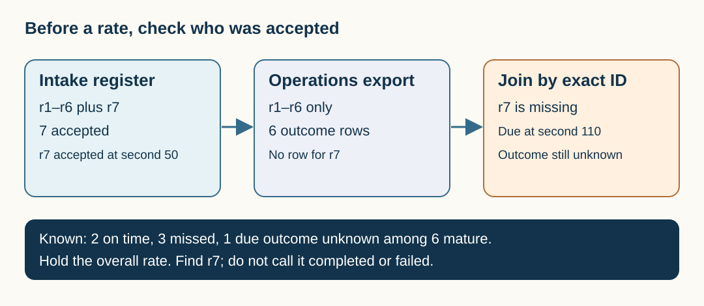

# Operations capstone: accepted does not mean completed

This is an original fictional incident, not a certification exam question or live AWS exercise. Use `incident.json` as the fixed evidence pack. Do not read `ASSESSOR.md` or run the answer-producing checker until you have submitted your first response.

## Brief

A repair service promises to complete technician assignment within 60 seconds of accepting a request. At scenario second 120, a customer says their request disappeared. A frontend deployment happened shortly before dependency failures appeared. Someone proposes immediately rolling back the frontend and raising worker concurrency tenfold.

You are the operator. You may inspect the provided evidence and propose read-only checks. You have no authorization to change a cloud account, send notifications or collect customer data. There are exactly six accepted jobs in this fixture; the timestamps are synthetic and share one clock.

## Submit before receiving hints

1. A timeline separating observed events, hypotheses and actions.
2. Counts at the incident snapshot: accepted, completed, unfinished, mature cohort, on-time outcomes and late/missing outcomes. Explain why the counts differ.
3. Two plausible explanations and a distinguishing observation for each. State which explanation the pack supports more strongly, and what remains unknown.
4. A bounded mitigation proposal with target, stop condition, expected effect and verification. Explain the risks of the proposed rollback and concurrency increase.
5. A recovery statement using the follow-up snapshot. Distinguish “all six eventually completed” from “the original deadline was met.” Check duplicate effects using the provided receipts.
6. A short customer-facing update that is accurate without exposing implementation details or promising an unsupported recovery time.
7. A handoff identifying open questions, preserved evidence and one improvement to test.

Timebox the first attempt to 45 minutes as a teaching suggestion, not an exam limit. Record actual time and help requested. You may use a calculator or write a local analysis script. Disclose AI assistance. For an unaided assessment, first freeze your reasoning before asking Codex to critique it.

## Change the situation

After the first submission, assume the processing dependency sometimes performs the assignment but loses its response. Explain why retrying solely because of a timeout can duplicate the effect. Specify the durable identity and reconciliation evidence needed before increasing retries. Do not claim the original fixture proves this new failure case.

Ask Codex to challenge your leading hypothesis without supplying a replacement incident report. Keep the original answer and the revision so a reviewer can distinguish your first reasoning from coached improvement.

After submission, use the assessor guide and `python3 examples/capstones/check-evidence.py`. The checker validates fixture arithmetic, not your mitigation judgment or communication quality.

## After your first attempt, reclassify the customers

Write the exact IDs on two lists at second 120: unfinished work and missed 60-second promises. Predict which list contains r5 and which contains r6. They each have three names, but they do not contain the same people. Then change one fact: r3 completes at second 121. At second 125, predict both lists again. Finally move the clock to second 130 without changing r6's completion. Does r6 become overdue at the boundary or one second later?

After freezing those answers, run:

```sh
python3 examples/capstones/cohort_lab.py
python3 -m unittest discover -s examples/capstones -p test_cohort_lab.py -v
```

The [separate cohort assessor](COHORT-ASSESSOR.md) explains the changed cases. Ask Codex to challenge your lists with a completed-late job and an unfinished-not-yet-due job. Make it name exact IDs and deadlines before accepting a revised count. The code uses retrospective fictional completion times and a supplied expected-ID list; it does not observe live AWS, establish source completeness, diagnose the dependency, send an alert, contact customers, or choose a mitigation.

After your first attempt, read the [annotated operating decision](../../reader/BOOK-LOCATORS.md#book-f37b7b76fb542d53). It explains cohort membership, causal limits, bounded mitigation, receipt reconciliation and communication using this fixture. Reading it first makes the exercise a guided practice rather than an unaided attempt.

## When the accepted list itself is incomplete

The six-job pack tells you there are exactly six accepted requests **in that pack**. A real operator needs a way to check whether the pack covers the customers who were accepted. Here is a new fictional source: an independent [intake register](intake-completeness.json) lists r1–r6 **and r7**, accepted at second 50. The operations export still lists only r1–r6. At second 120, r7's 60-second deadline has arrived, but the register does not say whether assignment completed. Draw the two sources and make one list of known missed promises and another of due outcomes you cannot yet classify. Do not count r7 as on time, late, or unfinished just because its operations row is missing.



Predict the result, then run:

```sh
python3 examples/capstones/intake_completeness_lab.py
python3 -m unittest discover -s examples/capstones -p 'test_intake_completeness_lab.py' -v
```

The lab joins exact IDs and acceptance times before it offers a rate. Its negative controls change r7 to a verified on-time or late completion, add a conflicting operations ID, change an acceptance time and duplicate a register ID. Explain why the known six-job rate of 2/5 is accurate **for those six** but cannot be reported as the overall accepted-customer result while r7 is unresolved. State who owns the intake source, how its completeness and clock would be checked, and how the customer-status path for r7 would be investigated. Then read the [separate intake assessor](INTAKE-COMPLETENESS-ASSESSOR.md). This is a local join over authored files; it does not prove any real intake ledger or telemetry is authoritative.
