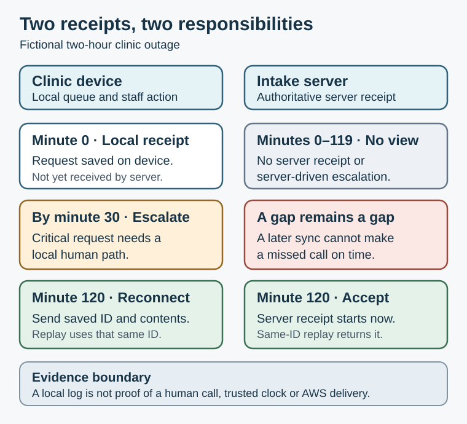
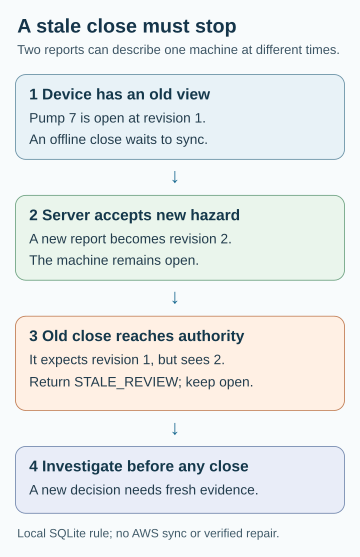

# A clinic can save a request before the server sees it

Imagine a clinic losing its connection for two hours. A staff member photographs a broken machine and taps Submit. The device may save that work locally, but the central repair service cannot yet see it. The screen must say which receipt exists. A safety-critical request cannot silently wait for reconnection if the business has promised human escalation within 30 minutes of **clinic intake**.

This fixture chooses two named moments. A **local receipt** means the request survived a restart of the same SQLite device file. A **server receipt** begins when the synchronized request is accepted by the separate SQLite server file. The local receipt does not claim central dispatch, and the server receipt cannot make an earlier missed escalation timely. Fixture minutes are invented inputs; neither clock is trusted time.



Before running the lab, predict these outcomes: a critical request is saved at minute 0, the device restarts, one local escalation is logged at minute 20, another critical request has no escalation, and synchronization resumes at minute 120. What can each receipt actually prove? Run from the repository root:

```sh
python3 examples/clinic-offline-intake/lab.py
python3 -m unittest discover -s examples/clinic-offline-intake -p 'test_*.py' -v
```

The demonstration prints three queued rows after a device restart. The server accepts them at minute 120. Replaying the first ID at minute 121 returns the original server receipt instead of creating a second accepted row. A changed photo token or critical flag under the same ID is rejected. The static device-to-clinic mapping rejects a device assigned to clinic B when it tries to sync or read clinic A's row. A local escalation log at minute 20 is classified as timely *in this fixture*; an unlogged critical request is missing at minute 120. Neither classification proves that a person made or received a call. Synchronization leaves the device rows in place; a real design needs a reviewed retention, confirmation and loss-response rule for that second copy.

## Change the business fact

1. The device is stolen before synchronization. Can the server recover the request? This fixture cannot; a same-file restart is a much narrower durability test. Decide whether staff need a paper fallback, protected device backup or an online-only critical path.
2. The device shows “repair service accepted” at minute 0. Explain why that message is false under this two-receipt contract. Write separate local and server-facing status text.
3. No local escalation is logged and connectivity returns at minute 120. Do not backdate the server receipt or infer a call from the request's `critical` flag. Name who investigates and how the clinic responds.
4. A retry uses the same ID but changes the photo token or critical flag. Preserve the first accepted intent and surface the conflict for review; a fresh ID might represent a genuinely new request, not a harmless retry.
5. Clinic B guesses clinic A's request ID. The fixture's static assignment rejects the tested read. Specify the real identity, membership, revocation, device-loss and per-object authorization checks that a deployed path would need.
6. One clinic moves to 24-hour dispatch. What local staffing, alert route, trusted timing, server workflow, recovery evidence and cost estimate change? Shared request structure does not imply identical escalation coverage.

Compare two bounded designs before opening the [assessor](ASSESSOR.md). An offline queue with a staffed local emergency route can preserve a clinic intake promise through the outage, but device loss, clocks and human follow-through are new risks. An online-only server receipt with a manual outage fallback simplifies software, but its screen must not imply the server received an offline draft. The business owner must choose the receipt and escalation promise; a diagram cannot choose it.

Ask Codex to trace the request through local storage, synchronization, duplicate handling, clinic authorization, photo lifecycle, local escalation and server dispatch. Require a claim–evidence–unknown table and one failure that reverses your preferred design. Check any proposed AWS behavior against current primary documentation. Keep the first unaided answer and the AI-assisted revision separate.

The code uses invented tokens, two local SQLite files and a static identity mapping. It uploads no photo, contacts no human or AWS service, measures no real time, and proves no mobile-device durability, authentication, compliance, notification, deployment or cost. A later live trial needs a scoped non-root role, current plan/credit and price review, a conservative whole-run limit and reserve chosen for the intended account, stop conditions and verified cleanup. Organization-dependent controls remain design-only.

## When an old device says the repair is finished

Imagine two staff members inspecting the same pump. Device A loses its connection while looking at revision 1 and records “repaired.” Device B sends a new electrical-hazard report, which the central work order accepts as revision 2. A later synchronization from A must not erase the newer warning merely because A's message arrived last. The business still needs a person to decide whether the machine is truly safe; the database can only stop a stale decision from silently replacing a newer one.



Before running, predict the stored status after these three operations: report a leak at revision 0, report a new hazard at revision 1, then close using the old device's expected revision 1. Predict what a retry with the *same* hazard operation ID should return if its first response vanished.

```sh
python3 examples/clinic-offline-intake/conflict_lab.py
python3 -m unittest discover -s examples/clinic-offline-intake -p 'test_*.py' -v
```

The fixture uses one local SQLite file as the authority for the machine revision and operation receipts. A transaction compares the supplied expected revision with the stored revision at the write. The old close returns `STALE_REVIEW`; the order remains open with the new hazard. After a process replacement, repeating the same hazard ID and content returns its saved revision-2 result. Reusing that ID with different content is rejected. A rejected stale operation remains a rejected receipt on replay; review the new report and use a **new** operation ID and current revision for any later, authorized closure.

Write your own answers before opening the [conflict assessor](CONFLICT-ASSESSOR.md):

1. What would a naive “last message wins” update do to the newer hazard? Which customer or staff statement would become false?
2. Does `STALE_REVIEW` mean the machine is unsafe, repaired, or awaiting a fresh decision? Which observation and actor would settle it?
3. A critical hazard report is itself based on an old revision and is rejected. How should the clinic keep the hazard visible and meet its local escalation promise while synchronization is uncertain?
4. The same operation ID is retried with a changed report. Why is this different from a lost-reply replay?
5. A second server process writes a different database file, or a worker bypasses the revision check. Does the local transaction still protect the whole system? Identify the actual shared authority and every write path a deployed design would need.

This extension uses invented identities and words, sequential local steps plus a two-connection test, and one SQLite authority. It is not a two-device or cross-Region sync test; it has no real authorization, trusted clock, photo handling, confirmed human escalation, verified repair or AWS implementation. Keep its local result distinct from any selected Amplify offline client behavior or cloud data-store guarantee. A live experiment would need the account-specific spending and cleanup gates above.
