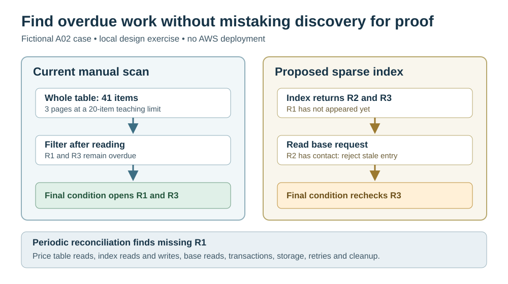

# A02: should the contact checker use a scan or an index?

Maya's request is overdue, but the worker's “overdue” list does not show it yet. A reader might say, “Add an index and the problem is solved.” This exercise asks for a better answer: **what work will the index save, what new work will it create, and how will an operator find a request the index temporarily misses?**

The existing A02 code in [`domain.py`](../../architectures/reliable-workflows/src/domain.py) uses a **manual**, strongly consistent scan of at most 20 evaluated table items per page. Its filter runs after reading. A small table makes this visible and teachable; repeated complete passes across a growing mixed-purpose table are a different operating choice. AWS says a scan filter does not reduce the read capacity of that scan. [Scan documentation](https://docs.aws.amazon.com/amazondynamodb/latest/developerguide/Scan.html).

A **proposed** sparse global secondary index could carry only unresolved contact work with a due timestamp. A query can then read candidate keys instead of every unrelated table item. But the index must be maintained when a request becomes pending or is contacted; it adds index write and storage meters. Its results are eventually consistent, so a just-written pending request may be absent and a contacted request may remain visible briefly. AWS documents both the extra cost and asynchronous propagation. The candidate must be read again from the base table, and the final write must recheck contact and duplicate work. A periodic full-table reconciliation or another independently durable source must find entries missed by the index. [AWS GSI guide](https://docs.aws.amazon.com/amazondynamodb/latest/developerguide/GSI.html).

Run `python3 lab.py case.json` in this directory, then `python3 -m unittest test_lab.py`. The local fixture has four requests and 37 unrelated table items. At `now=3602`, R1 and R3 have no contact and passed the one-hour deadline. The fictional index returns R2 and R3: it **misses R1** and still shows R2 even though R2 was contacted at 3500. Index-only discovery finds R3 and misses R1. A full reconciliation pass inspects all 41 table items and finds R1 too. The final variant records R3's contact at 3601 after a base read but before the final condition. That **late** contact leaves a historical escalation record under the current A02 condition, while R3 no longer appears on the open-contact worklist. A customer-promise breach and work that remains to be done are different facts. These are **authored states**, not measured DynamoDB propagation, a concurrent AWS transaction or a human-contact receipt.

The script prints work counts, **not request units or dollars**. In this small case a complete scan needs at least three 20-item pages if no earlier 1 MB page limit intervenes; actual reads depend on item bytes, partition work and repeat passes. The index path also requires base reads, conditional writes, index maintenance, retained bytes, logs and any real scheduler/notification. Feed a selected workload into the [whole-run cost packet](../costs/A02-A03-BOUNDED-RUN.md) with current regional rates and account credits. Compare the estimate and verified reserve with limits chosen for the account; neither path is a hard spending cap. The linked project packet has its own configured gate: inspect its actual inputs before treating its result as applicable to your account.

This is a **design-only alternative**. It creates no index or schedule in Terraform, changes no A02 handler and spends no AWS credits. Before implementing it, choose the authority for contact state, the exact indexed attributes and key distribution, migration/backfill behavior, a reconciliation cadence, an assigned operator and a deadline response. A single constant index partition could become a hot-key problem as workload grows. An index query alone cannot prove a one-hour human-contact promise. Compare the [changed-case assessor](ASSESSOR.md) before recommending a path.

## Rehearse the move without changing the table

Imagine replacing the receptionist's complete folder check with a shorter list. You would keep the complete check running while comparing the new list against it. A shorter list that missed Maya even once needs investigation, even if the next comparison looks clean. That is the boundary in [`cutover.py`](cutover.py).

Run `python3 cutover.py cutover-case.json` and `python3 -m unittest discover -s . -p 'test_*.py'`. The authored sequence has one `CREATING` window and two `ACTIVE` windows. The first active index view misses R1 and includes stale R2. The second active view looks clean, but the result remains `keep_scan`: one clean observation cannot erase the unexplained miss. Change the first active `index_visible` list to `R1,R3` and rerun. The result becomes only `consider_bounded_pilot_with_scan_fallback`, provided complete base scans, no reported key violations, a reviewed whole-run cost and an assigned operator are all present. It never says production-safe.

AWS says an index added to an existing table is unavailable for queries while `CREATING`; it becomes queryable at `ACTIVE`. During online creation DynamoDB backfills table items. Key-schema violations can leave base items absent from an `ACTIVE` index, so status alone does not prove complete coverage. [Online GSI operations](https://docs.aws.amazon.com/amazondynamodb/latest/developerguide/GSI.OnlineOps.html), [violation detection](https://docs.aws.amazon.com/amazondynamodb/latest/developerguide/GSI.OnlineOps.ViolationDetection.html). The fixture's `key_violations` is a **supplied observation**, not a call to that detector. Its completed scans and index views are invented snapshots, not a concurrent DynamoDB comparison.

An actual migration would need to validate candidate key shape and distribution, monitor base-write throttling and index build progress, investigate violations, compare complete base-table passes with candidate results, review the added build/run cost and preserve a rollback path. Even a clean pilot needs base-record reads, final conditions and periodic full reconciliation because a GSI is eventually consistent. The A02 Terraform has **no proposed GSI**; this command creates nothing in AWS. Attempt the [migration changed cases](CUTOVER-ASSESSOR.md) before reading the answer criteria.
