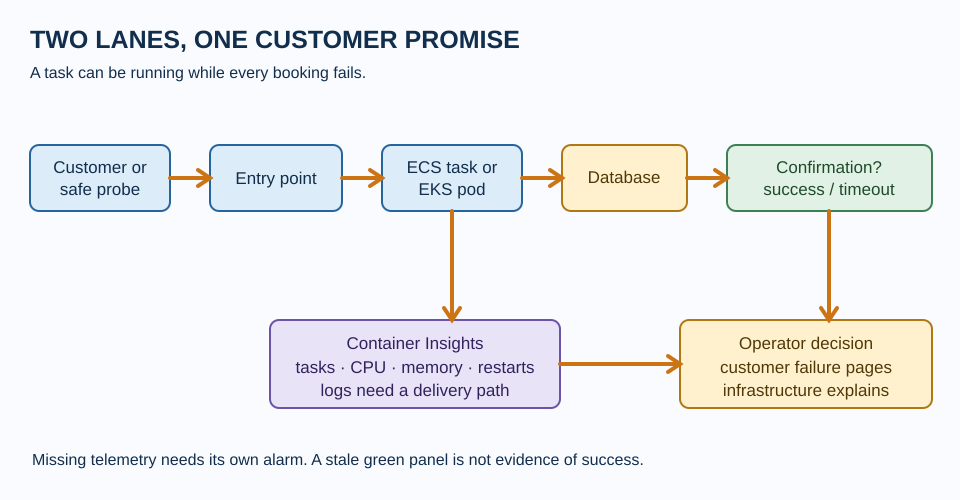

# A healthy container can still fail a customer

Maya moved her booking API into containers. At noon, every ECS task is running, CPU is low and the service has its desired task count. Yet customers cannot confirm a booking: the API's database connection times out. If the team watches only the container, the dashboard is green while the business is closed.

## Build two observation lanes

**Container lane:** Can the orchestrator start and keep the required tasks or pods? Are CPU, memory, restarts, network and deployment state normal? Container Insights can help explain resource and placement behavior. It does not, by itself, prove that booking confirmation works.

**Customer lane:** Does a real or safe synthetic booking attempt reach the API, the database write and the confirmation response? Emit a request or trace correlation ID through the application logs and dependency call. Measure success, error rate and latency at the customer boundary. Keep personal data out of logs.

| Platform choice | Container signal path | Application signal path to add |
| --- | --- | --- |
| ECS/Fargate | Enable [Container Insights for ECS](https://docs.aws.amazon.com/AmazonCloudWatch/latest/monitoring/deploy-container-insights-ECS-cluster.html) for selected cluster/service/task metrics; configure task logging such as [`awslogs`](https://docs.aws.amazon.com/AmazonECS/latest/developerguide/specify-log-config.html) separately. | Instrument API requests and database calls; correlate a safe booking probe with task ID, deploy version and application error. |
| EKS | Install a compatible [CloudWatch Observability EKS add-on](https://docs.aws.amazon.com/eks/latest/userguide/cloudwatch.html) or chosen supported collection path for pod/node metrics and logs. | Instrument the ingress/API/dependency path, carry request identity through pods and alert on customer results. |

Do not assume identical metric names or log collection between ECS and EKS. Verify the current [metric inventory](https://docs.aws.amazon.com/AmazonCloudWatch/latest/monitoring/Container-Insights-metrics.html), required permissions, add-on version and Region. CloudWatch's [ECS metric guide](https://docs.aws.amazon.com/AmazonCloudWatch/latest/monitoring/Container-Insights-metrics-ECS.html) shows task-count and resource signals, while its [EKS troubleshooting guide](https://docs.aws.amazon.com/AmazonCloudWatch/latest/monitoring/container-insights-eks-troubleshooting.html) lists agent, IAM and network causes of missing data. **No data** is an observation failure, not a healthy zero.

## The first operator decision

At 12:05, the dashboard reads: desired tasks 4, running tasks 4, CPU 22%, memory 38%, restart count 0. In the last five minutes, 100 safe booking probes reached the API; 86 returned a database timeout, 14 succeeded. The application log has the matching request IDs and the same database endpoint. What should page the operator?

Page on the customer failure signal and investigate the database dependency while preserving the correlated task/version evidence. Do not restart all four tasks merely because they are visible; first determine whether a deploy, credential, connection pool, network rule or database capacity changed. Check whether the probe is representative of real users and whether there are parallel symptoms. The metric tells you *where to look*; it is not a root cause by itself.

**Changed condition:** the booking probe itself stops running after a deployment, but the last observed success rate remains 100%. Define an absence/staleness alarm and a second check from outside the service. An old green result must not stay green forever.

## Exercise: draw the evidence chain

Write an ECS or EKS path with six boxes: customer or safe probe → entry point → task/pod → database → confirmation → operator. At each boundary, name one signal, its owner, its correlation key, and a failure that could make the signal misleading. Then specify:

1. One alert for too few running tasks/pods, and a separate alert for failed or slow bookings.
2. How a log event joins a request to a task/pod, deploy version and dependency error without recording a customer's private data.
3. What the operator checks when metrics disappear, and which customer evidence decides whether to stop or roll back a deployment.
4. A bounded test: simulate a database timeout in a nonproduction environment, predict both lanes' observations, set a stop condition, then compare the measured customer outcome. State what would still be untested.

Use [the assessor](ASSESSOR.md) after answering. Ask Codex to challenge missing signals, false positives, probe representativeness and data exposure. It can draft queries and dashboards; verify metric names, permissions and actual telemetry against current AWS docs and a selected cluster before deployment.

## Cost and evidence boundary

Container Insights, application metrics, logs, traces, alarms and synthetic requests can all add charges. Estimate cardinality, emitted volume, retention and query frequency from the selected design; use [CloudWatch cost guidance](https://docs.aws.amazon.com/AmazonCloudWatch/latest/monitoring/cloudwatch_billing.html) and current regional pricing before turning on broad collection. This lesson creates no AWS resources. A local diagram and tabletop cannot show that an ECS/EKS collector emits data, that an alarm fires in time, or that customers can book. Those require selected instrumentation and an observed test.
