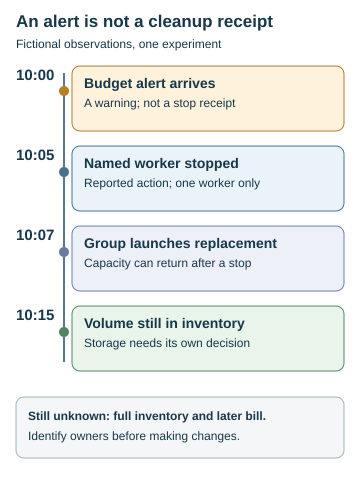

# The bill changed after cleanup

This is a fictional evidence-reading exercise. No prices, credits, resources or timestamps describe a real account. Save your answers before opening the [assessor rationale](RECONCILIATION-ASSESSOR.md). Use a calculator or the script for arithmetic; explain the decisions yourself.

## The incident packet

A lab ran on day 1 from 09:00 to 11:00 UTC. Its reviewed estimate was USD 1.50, including retained storage. The operator recorded the worker removed at 11:10, then inspected that worker's absence at 11:20. One storage resource was intentionally retained for a comparison exercise, with an owner and a day 2 18:00 removal deadline. Its removal and subsequent absence were recorded at 18:00 and 18:10 on day 2. These observations are stipulated fictional evidence, not API outputs.

The following are successive **replacement snapshots of the same experiment-period accounting view**, each through its stated observation time. They are not daily increments. The columns are complete only for this teaching packet; real evidence must specify covered periods, metric, currency, filters and inclusions.

| Observation (UTC) | Lab worker usage | Lab retained storage | Unrelated usage | Account credit adjustment |
| --- | ---: | ---: | ---: | ---: |
| Day 1 13:00 | $0.80 | $0.00 | $0.40 | −$0.60 |
| Day 2 13:00 | $1.20 | $0.10 | $0.70 | −$1.00 |
| Day 3 13:00 | $1.20 | $0.16 | $0.70 | −$1.00 |

The packet attributes all worker usage to day 1 09:00–11:00. Storage usage covers day 1 through day 2 18:00, with its last portion appearing on day 3. Unrelated usage belongs to another application. There is no evidence allocating the account credit adjustment to either application. Resource attribution is supplied by the fictional packet; a real billing summary does not necessarily provide it automatically.

## Your decisions

1. Calculate the latest lab usage before credits, account usage before credits, and account amount after this packet's credit adjustment. Which answers the lab's consumption question?
2. The worker cost rose after worker removal. Does that prove it was still running? Cite the relevant usage and observation periods.
3. The storage cost also rose. Separate continued intended retention from late appearance of earlier storage usage. What removal evidence would you inspect?
4. Compare latest lab usage to its estimate. Why is adding all three snapshot totals wrong? Why is an account credit change not a measured lab price?
5. Can you declare this account cost-free now? Identify what this packet cannot establish, and write the next reconciliation action without making another deployment.
6. Change card: the worker usage period now extends to day 2 10:00, after the recorded removal. What two evidence sources would you reconcile before declaring either a leak or a billing error?

After answering, run:

```sh
python3 examples/costs/reconciliation-exercise.py
```

The standard-library script computes with decimal amounts and demonstrates the overlapping-snapshot mistake. It does not parse AWS exports, inspect resources, check timestamps, discover attribution or decide that cleanup is complete. It calls no external service.

## When an alert is not a stop receipt

Keep the previous packet separate. In this new fictional case, Maya plans a short experiment with a worker, an automatically maintained worker group and a storage volume. At 10:00 she receives a budget notification. At 10:05 a configured action reports that it stopped the named worker. At 10:07 the group launches a replacement. At 10:15 the volume still appears in the inventory. No later billing or full resource inventory is provided.



Before reading the assessor, make a four-row timeline: **alert**, **action**, **running capacity**, and **retained storage**. For each, write what the stated observation supports and what remains unknown. Can Maya conclude spending stopped at 10:00? Did the successful stop action remove the volume? Which authorized owner should review the group's desired capacity and the retained volume before any further change? Name one reason why the alert's time is not necessarily the usage time. Do not assume an unfamiliar resource belongs to this experiment or delete it to make the timeline look clean.

After writing your prediction, run the [small local evidence classifier](alert-stop-exercise.py) and its [tests](test_alert_stop_exercise.py) from the repository root:

```sh
python3 examples/costs/alert-stop-exercise.py
python3 -m unittest discover -s examples/costs -p 'test_alert_stop_exercise.py' -v
```

It labels the fictional alert, named stop, replacement and volume separately; full inventory and later billing remain unverified. Now change the case on paper: an inventory report says the volume is absent but gives no coverage or timestamp. Why is that weaker than a verified inventory for the experiment's account, Region and resources? The script accepts its inputs as supplied labels and cannot authenticate any report or prove an absent resource. `not observed` means no observation was supplied, not that a worker or volume does not exist. It makes no AWS calls or resource changes.

AWS Budgets can send notifications and can also be configured with separate actions, such as applying a policy or stopping specified EC2 or RDS instances. An action may be automatic or require approval; a notification alone is not evidence that an action was configured, ran or stopped every meter. AWS notes that budget information and notifications can lag usage, and that an Auto Scaling group can replace a stopped instance. Those are service design considerations, not evidence that this fictional event occurred in AWS. A tested stop plan must cover the actual resource set, replacement mechanisms, persistent storage and later billing review. Organization-level actions require their own authorized environment and are not part of this local exercise. [AWS budget actions](https://docs.aws.amazon.com/cost-management/latest/userguide/budgets-controls.html), [budget update and notification delay](https://docs.aws.amazon.com/cost-management/latest/userguide/bcm-lite-view-budget.html), [budget best practices and Auto Scaling](https://docs.aws.amazon.com/cost-management/latest/userguide/budgets-best-practices.html), checked October 29, 2026.

Ask Codex to challenge your attribution and time-window assumptions using only the packet. Require it to mark each claim as supplied evidence, arithmetic or unresolved inference. Do not upload account identifiers or private billing exports to a public exercise. A convincing narrative without a matching usage period is still an inference.

AWS explains that Cost Explorer data can arrive later than its normal refresh interval. A billing view is therefore not a real-time resource inventory. [AWS Cost Explorer documentation](https://docs.aws.amazon.com/cost-management/latest/userguide/ce-what-is.html), checked October 18, 2026. This exercise does not assume every charge is finalized after a particular number of hours.
