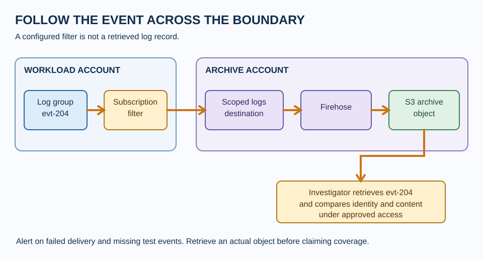

# Can Maya retrieve the log after the source account is locked?

At 14:00, Maya's booking service rejects a customer. Its application log records a synthetic event ID and the failed request. At 15:00, the workload account is quarantined during an incident. The investigator needs the 14:00 event from a separate archive account. A dashboard showing that a subscription filter exists is not enough; the event must have crossed the account boundary, reached storage and be readable by an authorized investigator.



## Follow one event, not just the configuration

| Boundary | What must be true | Evidence |
| --- | --- | --- |
| Producer | The application emits a safe, stable `event_id`, time, result and source identity into a Standard-class CloudWatch log group. | Source event and log-group inventory; no personal or secret payload |
| Subscription | An account-level or group-level filter includes the intended group and event. | Effective filter pattern, Region and target ARN; test event seen downstream |
| Cross-account destination | The archive account has a CloudWatch Logs destination with a policy scoped to permitted source accounts and an IAM delivery role. | Destination policy, role/trust, negative test from an unapproved account |
| Delivery and storage | The receiving Firehose stream delivers to the chosen S3 bucket and prefix. | Forwarding/error metrics, Firehose delivery result, S3 object with the event |
| Retrieval | The investigator can locate, decode and compare the event from a safe account. | Retrieved object bytes, parsed event fields, source-to-archive reconciliation and authorized access record |

The [AWS cross-account Firehose procedure](https://docs.aws.amazon.com/AmazonCloudWatch/latest/logs/CreateFirehoseStreamDestination.html) creates a CloudWatch Logs destination targeting a Firehose stream, with an S3 archive behind it. For that pattern, the source log group and CloudWatch Logs destination must be in the same Region; the underlying resource can have a different Region, but this lesson keeps all parts in one Region to make the first proof simpler. An S3 bucket is **not** a direct CloudWatch Logs subscription destination in this pattern. AWS also offers [CloudWatch Logs centralization](https://docs.aws.amazon.com/AmazonCloudWatch/latest/logs/CrossAccountSubscriptions.html); compare it separately if the goal is searchable centralized log groups rather than this archive path.

Subscriptions are near-real-time, **at least once** delivery: duplicates may occur. CloudWatch Logs retries retryable destination errors for up to 24 hours; a nonretryable access or missing-resource error can disable a filter temporarily and skip events. This makes an archive a monitored pipeline, not a guaranteed copy just because a filter exists. See [subscription behavior](https://docs.aws.amazon.com/AmazonCloudWatch/latest/logs/Subscriptions.html) and [`DeliveryErrors`/`DeliveryThrottling` metrics](https://docs.aws.amazon.com/AmazonCloudWatch/latest/logs/CloudWatch-Logs-Monitoring-CloudWatch-Metrics.html). Choose a source retention long enough to investigate and recover from delivery gaps; default indefinite retention is a cost and policy choice, not a free safety net.

## Run the small retrieval audit

The two JSONL files are **already normalized** source and retrieved archive events. They do not simulate CloudWatch's compressed/base64 subscription envelope, Firehose buffers, IAM or S3. From the repository root:

```sh
python3 examples/cross-account-log-archive/audit.py examples/cross-account-log-archive/source.jsonl examples/cross-account-log-archive/archive.jsonl
python3 examples/cross-account-log-archive/audit.py examples/cross-account-log-archive/source.jsonl examples/cross-account-log-archive/archive-defect.jsonl
```

The first archive contains every event, with one duplicate that the audit reports. The second lacks the failed booking event and must fail. The join uses source account, Region, log group and application `event_id` to avoid treating identical IDs from two producers as one event. A real system must define how IDs are generated and retained and must validate its selected archive encoding.

## Changed-condition design review

The workload account changes its subscription permission so the archive destination returns `AccessDenied`. The source log group keeps receiving events. The incident team discovers the failure six hours later.

1. Which forwarding metric and test event would have detected the break earlier? Who receives that alarm if the workload account itself is compromised?
2. Which account's policy or role changed, and who can repair it? What negative test proves an unrelated account still cannot write to the destination?
3. Which events can be recovered from retained source logs, and how will you avoid duplicates when reprocessing? What if the source retention has already expired or the source account is unavailable?
4. How will an investigator retrieve the event for booking failure `evt-204`, verify its source/time/content, and record who accessed it?
5. What is the intended retention for the source log group and the S3 archive? Who approved it, and how do S3 access, encryption and lifecycle rules enforce it?

Use [the assessor](ASSESSOR.md) after writing your answer. Ask Codex to inspect sanitized policies and trace each permission arrow; require it to cite current AWS behavior and propose a denied-source test. It can help write infrastructure as code and queries, but a generated policy is not delivered-event or retrieval evidence.

**Cost boundary:** estimate CloudWatch ingest/retention, subscription and delivery volume, Firehose buffering/processing, S3 stored bytes/requests, retrieval and investigation queries using current regional prices. Prevent account-level subscription recursion by excluding the delivery workflow's own log groups, as the [account-level guidance](https://docs.aws.amazon.com/AmazonCloudWatch/latest/logs/SubscriptionFilters-AccountLevel.html) warns. No AWS resource or credit is used in this exercise. A live proof needs an authorized multi-account environment, synthetic test event, failure alarm, delivered S3 object, denied-source attempt and successful investigator retrieval.
