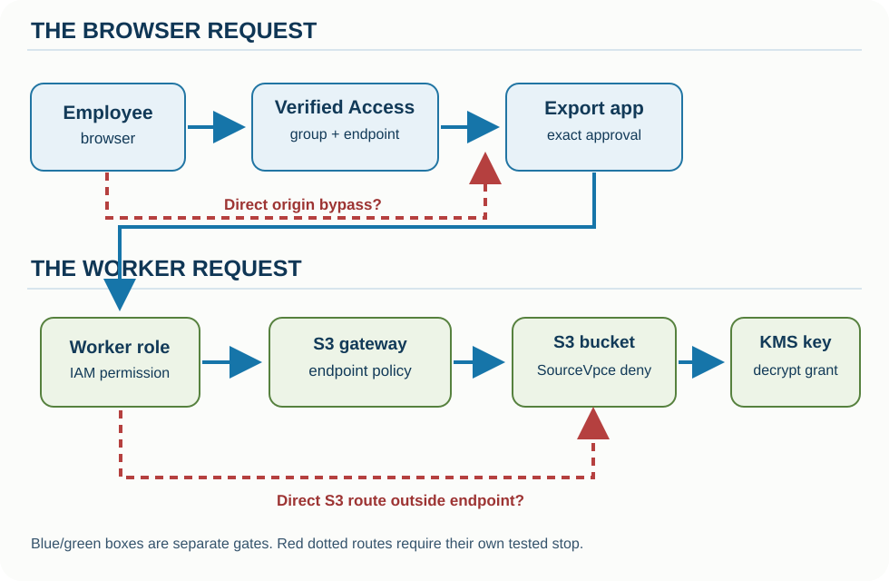

# Data perimeter: find the route around the door

Maya approves one customer export for one employee. The employee opens an internal export application; a worker in the production account fetches the approved object from a data-account S3 bucket. This **fictional organization design** is for paper practice. It creates no Verified Access endpoint, VPC endpoint, bucket policy, identity or AWS charge.

## First, draw the two requests

The **browser request** goes through a Verified Access load-balancer endpoint. Its group policy and, if present, its endpoint policy each have to permit the request. The application then checks the employee's business approval for export version `repair-v3`. A permitted visit to the application does **not** authorize an S3 object. The load balancer and application origin also need a network design that prevents a caller from reaching them directly around Verified Access.

The **worker request** uses a different principal: a narrowly scoped application role. It reaches S3 through a gateway VPC endpoint. An endpoint policy can limit which requests pass through that endpoint, but does not replace the role's IAM permission, the bucket policy or the KMS key permission. An endpoint policy alone does not close a different route to S3. For the selected bucket actions, the data owner can design a bucket-policy explicit deny when `aws:SourceVpce` is not the approved endpoint ID. That condition can also block console and legitimate service paths, so its action/resource scope, exceptions, recovery path and actual endpoint ID require separate review before implementation.

These are independent decisions. **Verified Access guards the application entry; application code guards the particular export; the S3 endpoint and bucket policies constrain the worker's network path; IAM and KMS guard the AWS action and decryption.** Passing any one does not imply the others pass.

## Try the changed conditions

For each case, write: requested actor and action; route; first gate that should stop it or evidence still needed; one alternate route to test; owner of that gate; and the smallest observation that could falsify your answer. Use **paper expectation**, **bypass risk** or **unknown**, never a claim that AWS actually allowed or denied the request. Attempt the cases before reading [assessor reasoning](ASSESSOR.md).

| Case | Changed condition |
| --- | --- |
| 1. Intended path | The employee satisfies the Verified Access group and endpoint policies, holds approval for `repair-v3`, and the app worker has exact-object IAM, bucket and KMS grants. Its request uses the approved gateway endpoint. |
| 2. Group refusal | The employee authenticates, but the Verified Access group policy does not permit this session. The endpoint policy would permit it. |
| 3. Direct origin | Both Verified Access policies would reject the employee, but the load balancer has another reachable listener or address. The app still checks export approval. |
| 4. Adjacent export | The employee enters the app but asks for `repair-v4`, which the data owner did not approve. The worker's IAM permission is broader than intended. |
| 5. Endpoint only | The endpoint policy narrows `GetObject` through the gateway endpoint, but the bucket has no `aws:SourceVpce` denial. The same role can route a direct S3 request outside that endpoint. |
| 6. Bucket perimeter | A properly scoped bucket-policy deny for selected object reads rejects a request missing the approved `aws:SourceVpce`, even if an identity policy would otherwise allow that read. The worker's approved path remains available. |
| 7. Wrong endpoint ID | The deny names an old endpoint ID. The console request and the new worker path do not carry that ID. An operator proposes applying the change immediately. |
| 8. Missing key permission | All application, route, IAM, endpoint and bucket checks look right, but the worker lacks the needed customer-managed KMS key permission for the selected object. |

**Transfer:** A new analytics worker needs only a second approved export. Compare a second gateway endpoint, a carefully scoped exception and a separate bucket. Draw every new route and decide who owns role, bucket, key, application, audit and recovery changes. Do not assume `aws:SourceVpce` identifies the human who requested the export. Price any later live design, include endpoint/application/logging meters and cleanup, and keep this organization-dependent scenario design-only.

**Use Codex:** Answer alone first. Then ask: “For each of these eight fictional routes, challenge my first missing gate and find a bypass or legitimate path I overlooked. Mark every result as a paper expectation or unknown. Cite current AWS documentation for service behavior.” Check the cited primary docs and revise your table; AI cannot run an effective-policy or customer-read test from this packet.

Primary references: [Verified Access endpoints](https://docs.aws.amazon.com/verified-access/latest/ug/verified-access-endpoints.html), [Verified Access policy evaluation](https://docs.aws.amazon.com/verified-access/latest/ug/auth-policies-policy-eval.html), [VPC endpoint policies](https://docs.aws.amazon.com/vpc/latest/privatelink/vpc-endpoints-access.html), [S3 bucket policies for VPC endpoints](https://docs.aws.amazon.com/AmazonS3/latest/userguide/example-bucket-policies-vpc-endpoint.html).
