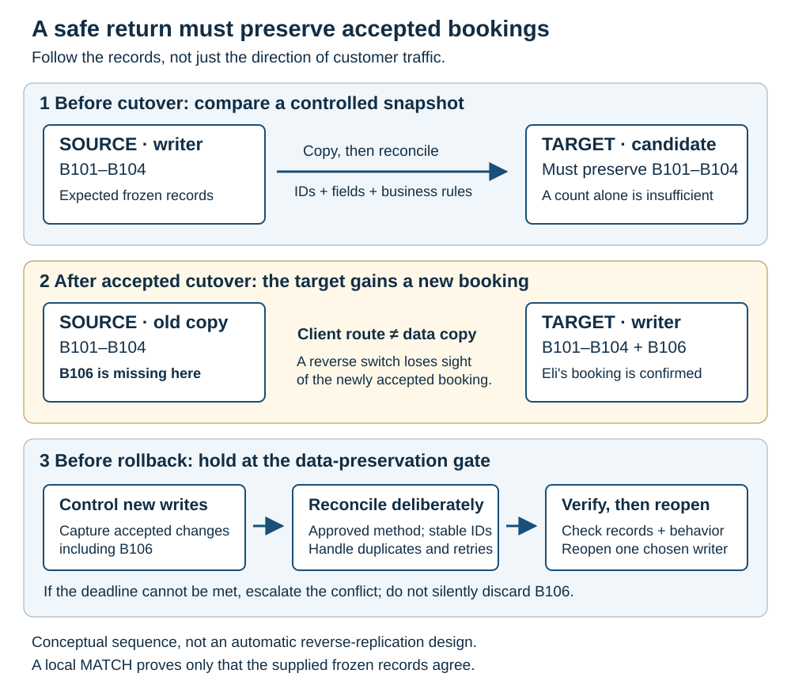

# Database migration rehearsal worksheet

This paper exercise practices SAA-C03 task 4.3 skill 05: migrate database schemas and data to another location or engine. It creates no AWS resources or credentials. Read [Unit 25](../../reader/BOOK-LOCATORS.md#book-895280a1daddfb8b), write a migration plan, then check the [assessor notes](ASSESSOR.md).

## Scenario

Maya's PostgreSQL repair application uses PostGIS and stored procedures. The business is considering a new AWS Region and a MySQL target because a team member recommends the engine. The current system continues to accept bookings and invoices while migration preparation occurs. The owner has not approved an engine conversion, write downtime, data-loss window or final Region. There are tables without primary keys, and the application relies on invoice rounding and locale-aware product-code sorting.

Do not assume the proposed target is right. First decide whether to preserve the engine and change only location, or justify a separate engine conversion. Record the business requirement behind each change.

## Workcard

1. Inventory source/target engine versions, Region, schemas, extensions, routines, types, constraints, keys, collations, drivers, dependencies and required privileges. Mark unknowns.
2. Separate schema assessment/conversion from data movement and application cutover. Name which step a proposed tool supports and what it does not prove.
3. Plan a rehearsal using a representative dataset. Include missing primary keys, large values, nulls, timezone boundaries, Unicode, rounding, sorting, procedures and concurrently changed rows.
4. Choose the migration shape: full load only with a planned write freeze, or full load plus CDC if the exact path supports it. Define how to detect and resolve lag, errors and unsupported objects. Do not assume continuous replication is available for every engine, object or location.
5. Define acceptance: object inventory, row/identity reconciliation, independent monetary totals, ordered product-code results, customer/business invariants and application journeys. State who signs off.
6. Write the cutover gate: pause or control writes, wait for the required final synchronization, verify consistency and credentials, switch clients, monitor, and stop or resume the process according to named thresholds.
7. Write rollback: trigger, time limit, destination, read/write control, how target-only accepted writes are reconciled, backup evidence and who decides. Do not promise a safe reverse switch without a method for preserving new writes.
8. Estimate a migration month separately: schema assessment, source/target compute, replication capacity or serverless task usage, validation queries, storage, cross-Region transfer, logs, temporary overlap, backups, rehearsal and rollback window. Use current Region/date inputs; no prices are provided here.

## Change one condition at a time

Revisit the plan when: the team keeps PostgreSQL rather than converting; the target Region lacks a required version/extension; the downtime budget shrinks; CDC is unsupported; validation lacks unique keys; replication lag grows; data masking transforms values; a write arrives during cutover; the invoice test fails; the target is a different account; or rollback would lose a confirmed transaction. Explain which gate fails and what new evidence or business decision is needed.

## Rehearse with four bookings

Moving a database is like moving a shop's order book. Counting four entries in each book does not tell you whether the same customers still have the same orders. Use these fictional records before choosing a migration tool. Amounts are integer cents, so this exercise introduces no rounding ambiguity.

The source is frozen for this comparison. Booking ID must be unique; customer, amount and status must be preserved exactly. There are no approved transformations.

| Source booking ID | Customer | Amount (cents) | Status |
| --- | --- | ---: | --- |
| B101 | Ada | 12000 | confirmed |
| B102 | Ben | 8000 | confirmed |
| B103 | Chen | 5000 | cancelled |
| B104 | Dee | 15000 | confirmed |

| Candidate target booking ID | Customer | Amount (cents) | Status |
| --- | --- | ---: | --- |
| B101 | Ada | 12000 | confirmed |
| B102 | Ben | 5000 | confirmed |
| B103 | Chen | 8000 | confirmed |
| B105 | Dee | 15000 | confirmed |

Write an answer before consulting the assessor:

1. Compare row counts and total amounts. Would either comparison detect this faulty copy?
2. Reconcile by booking ID. List missing IDs, unexpected IDs and changed fields. Compare the sum for confirmed bookings as a separate business check.
3. State whether cutover is permitted under the stated acceptance rule. Explain why fixing only the total would be insufficient.
4. Now suppose the copy is repaired and verified, clients switch to the target, and the target alone accepts booking B106 for Eli, 7000 cents, confirmed. An application defect triggers rollback. The old source has no B106. Explain what would happen if clients simply switched back.
5. Plan the next steps without assuming reverse replication exists. Include control of new writes, preservation of the target-only booking, an approved reconciliation method, duplicate/retry handling and verification before reopening the chosen writer. If that cannot be completed inside the rollback deadline, name the decision that must be escalated rather than silently discarding the booking.

Draw two boxes labelled Source and Target. Put the accepted B106 inside Target and trace where it must survive before Source can safely become the writer again. This is a data-preservation requirement; a network-routing change alone does not move the record.

After your first attempt, ask Codex to propose checks that would catch each discrepancy. Require it to use booking IDs and named fields, not merely say “validate the data.” Then ask it to critique the rollback plan for lost or duplicated bookings. Retain your first answer, its feedback and your revision separately. Do not paste real customer data or credentials into the exercise. This paper rehearsal establishes no AWS migration, service compatibility, measured recovery time or learner outcome.

## Follow the accepted write



**Figure: traffic can move without the data moving with it.** Read from top to bottom. The first stage requires a controlled snapshot and reconciliation. The second assumes cutover was approved after the other gates passed; B106 is now part of the business promise. The third shows work required before returning to the old source. Its arrows describe an operational sequence, not a configured replication service. The new booking must survive, and duplicate processing must not create a second booking.

Explain the figure aloud without naming an AWS service. Then name the source/target compatibility, write-control and verification evidence that a real service-specific implementation would still need. The diagram does not imply that every migration path supports reversal.

## Run the frozen-record comparison locally

After answering the paper questions, use Python 3 to compare the supplied fictional exports. From this exercise's folder, run:

```sh
python3 reconcile.py fixtures/source.json fixtures/faulty-target.json
```

Expect `HOLD` and exit code 1. The report shows equal overall counts and amounts alongside missing B104, unexpected B105 and changed B102/B103 fields. A nonzero exit here is the intended discovery, not an installation failure. `INVALID` (exit 2) means the input does not meet this small exercise's schema. Duplicate IDs produce `HOLD` without silently replacing one row with another.

To model rollback after B106 was accepted, the target's accepted records become the expected baseline and the old source becomes the candidate:

```sh
python3 reconcile.py fixtures/target-after-cutover.json fixtures/source.json
python3 test_reconcile.py
```

The comparison must report missing B106. The tests should pass because they expect the unsafe copy to be rejected. For a positive control, compare `fixtures/source.json` with itself; expect `MATCH` and exit 0. Then copy a fixture into a scratch file, change one customer's name without changing its amount, and predict the result before rerunning the comparison.

The script reads local files and prints a report. It does not connect to a database, perform a repair or switch clients. It loads the complete exports into memory and intentionally rejects empty inputs for this exercise. It is not a production migration validator. `MATCH` means these supplied frozen records agree under these four fields; it does not prove the exports are complete, writers were stopped, replication caught up, related tables agree, application behavior works or rollback is approved. You still need those separate gates.

Ask Codex why an ID-keyed dictionary can hide duplicate records if duplicates are not checked first. Verify its explanation by reading the duplicate-ID test, then describe a real schema requirement this four-field exercise leaves untested.
