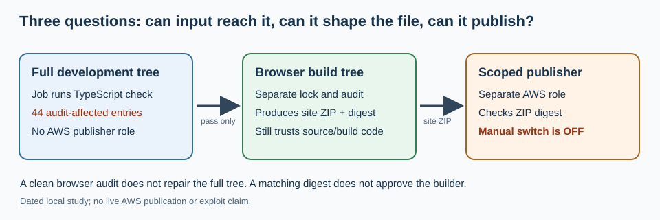

# Follow an advisory through the workshop

Maya's team has a small customer website. The browser bundle has its own locked build toolchain. A second, larger toolchain generates Amplify backend definitions and type information. The latter has an audit finding. Maya must decide whether that finding can reach a customer request, whether it can change a published file, and what would count as a repair. These are **three different questions**.



Read the [dependency field lesson](../../reader/DEPENDENCY-FIELD-LESSON.md) and the [publisher workflow](../github-workflows/amplify-publish.yml). Then, from `app/`, run `npm explain braces` and `npm audit --json`. Run `npm audit --omit=dev --json` separately. The audit command may exit nonzero because it found an advisory; a registry failure is a different result. Do not paste an account token or private configuration into a public report.

At the October 20 checkpoint, one observed path was:

```text
@aws-amplify/backend@1.25.1 (direct development dependency)
  -> @aws-amplify/backend-data@1.9.0
  -> @aws-amplify/graphql-generator@0.5.4
  -> @aws-amplify/graphql-types-generator@3.6.0
  -> globby@11.1.0 -> fast-glob@3.3.3
  -> micromatch@4.0.8 -> braces@3.0.3
```

There are other parents for `braces`; this path is one example, not the whole graph. The [braces advisory](https://github.com/advisories/GHSA-vfj7-8cjw-p6xm) was **withdrawn October 23** because its publishers judged the reported issue not practically exploitable. Its historical dependency path remains useful for learning how to investigate a build tool; do not count the withdrawn notice as a current active finding. The [GraphQL Tools advisory](https://github.com/advisories/GHSA-7mx3-vvmw-hjmv) describes response merging in a federated gateway; the audited `@graphql-tools/utils` copies here are in the development tree. The [OpenTelemetry advisory](https://github.com/advisories/GHSA-8988-4f7v-96qf) concerns oversized inbound baggage. A package's presence establishes an investigation path. It does not by itself establish that this app exposes the advisory's triggering input or runs the affected function for customer requests.

## Draw the boundary before reading the assessor

For each case, record **input -> process -> authority -> output -> missing evidence -> decision**. State what was observed in this checkout and what is only a scenario assumption.

1. A stranger sends a normal HTTP request to the published static website. Does the `npm explain` path prove that this request executes `braces`? What artifact or runtime evidence would settle the browser question?
2. A contributor proposes a source change with an extremely nested glob pattern. The current workflow's full-tree job runs `tsc --noEmit`, not the GraphQL types generator. Does merely installing `braces` prove that this job parses the pattern? What changes if a later generation command does accept contributor-controlled patterns, and which input and job-permission controls matter?
3. A teammate says the development tree is safe because `npm audit --omit=dev` returns zero. The same job builds or generates files that a later job publishes. Identify the flaw in that reasoning and the trust boundary between the two jobs.
4. A proposed override makes the top-level `@opentelemetry/core` version newer, but four nested 2.0.0 lock records and the full audit count remain. A fresh installation resolves a newer physical copy at the inspected bundle root. Which observations disagree? What tests must a candidate update pass before it is called a repair?
5. The `@graphql-tools/utils` advisory shows a remote federated-gateway query. Our static app does not run a federated gateway, but its generation chain has old `utils` copies. Which conclusion is justified today? How would your answer change if the team later added a gateway that merges customer-controlled aliases?
6. A maintainer can edit the main branch and change the browser build script. The site ZIP digest matches the file produced by that script. What did the digest prove, and which separate control or review would test whether the built content was authorized?
7. The same committed lockfile produces a smaller audit after the `braces` advisory is withdrawn. What changed, and what did **not** change? Compare three decisions: record the withdrawal and keep the existing generator under normal input/permission review; replace the generator for a separate demonstrated need; or stop using it. State the capability and evidence cost of each. Do not call the lower audit count a package repair or force a downgrade merely to change the count.

After answering, read the [assessor reasoning](BUILD-PATH-ASSESSOR.md). Ask Codex to challenge your weakest *input-to-process* assumption without giving you an answer first. Recheck its path and version claims against the lockfile, `npm explain`, the workflow and the current upstream advisory. This exercise uses the current repository and paper changes; it does not deploy AWS, prove exploitability, or validate a learner independently.
