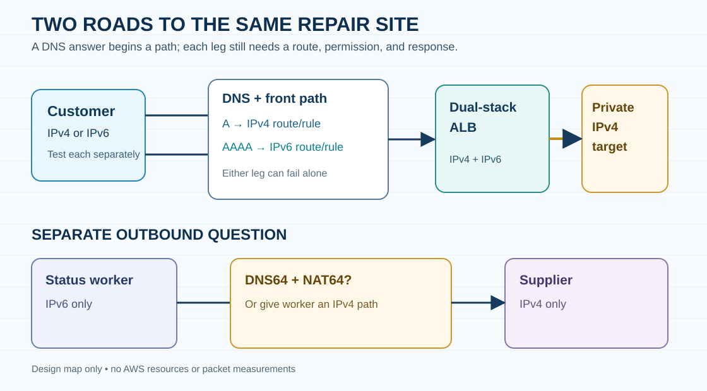

# Two roads to Maya's repair site

Maya's customers can reach her repair-status page over an old IPv4 road or a new IPv6 road. Adding an IPv6 address to a signpost does not build the road behind it. A customer needs a DNS answer, a reachable load balancer, an allowed listener, and a healthy route to the application. The application itself may still use IPv4 behind the load balancer.

This illustrated, **offline** lesson addresses [SAP-C03 skill 1.4.4](https://docs.aws.amazon.com/aws-certification/latest/solutions-architect-professional-03/solutions-architect-professional-03-domain1.html). Continue from [network paths](../../reader/BOOK-LOCATORS.md#book-6948135871204c55) and the [IPv4 address-growth exercise](../network-growth/README.md). The local program checks stated design assumptions; it does not create a VPC, resolve real DNS, forward packets, or prove AWS reachability.



## Walk both roads

An **A record** answers with an IPv4 address; an **AAAA record** answers with an IPv6 address. A dual-stack Application Load Balancer can accept both families when its chosen subnets have both address ranges. Its **target group's** IP address type independently controls the load-balancer-to-target leg. Thus an IPv6 customer can reach the dual-stack front door while the load balancer talks to an IPv4 target group. Check the listener, subnet route, security rules, target health and application response on the relevant leg. [AWS load-balancer address families](https://docs.aws.amazon.com/elasticloadbalancing/latest/userguide/how-elastic-load-balancing-works.html), [target groups](https://docs.aws.amazon.com/elasticloadbalancing/latest/application/load-balancer-target-groups.html).

For an existing IPv4-only VPC, AWS documents adding IPv6 support to make it dual-stack. It does **not** describe an in-place migration of an IPv4-only subnet to an IPv6-only subnet. Keep the existing IPv4 customer path during a staged migration. Publishing AAAA before the IPv6 ingress path works risks directing IPv6-capable customers to a broken road; removing AAAA may be a rollback step but cannot serve customers who only have IPv6, and cached DNS answers may persist. [AWS VPC IPv6 migration](https://docs.aws.amazon.com/vpc/latest/userguide/vpc-migrate-ipv6.html), [subnet address types](https://docs.aws.amazon.com/vpc/latest/userguide/configure-subnets.html).

Do not confuse an **egress-only internet gateway** with an inbound IPv6 front door. It permits outbound IPv6 initiation and responses, not unsolicited inbound connections, and it does not translate IPv6 packets to IPv4. If a separate **IPv6-only worker** must call an **IPv4-only supplier**, choose an IPv4-capable worker path or evaluate DNS64 with NAT64, its NAT gateway route, policy, and cost. A dual-stack worker that can use IPv4 does not need NAT64 solely for this mismatch. [AWS egress-only internet gateway](https://docs.aws.amazon.com/vpc/latest/userguide/egress-only-internet-gateway.html), [DNS64/NAT64](https://docs.aws.amazon.com/vpc/latest/userguide/nat-gateway-nat64-dns64.html).

## Try four changes

From the repository root:

```sh
python3 examples/dual-stack-journey/path_lab.py
python3 -m unittest discover -s examples/dual-stack-journey -p 'test_*.py'
```

The program reports the **first failed design gate**, rather than claiming a packet was delivered. Predict each outcome before running it:

1. Maya publishes AAAA while the load balancer subnet has no IPv6 internet route. Which family can still reach the site according to the design, and what would an IPv6-only customer see?
2. The IPv6 listener path is allowed, but the IPv4 target becomes unhealthy. Why do both client families fail despite two DNS records?
3. Maya removes AAAA to roll back a broken IPv6 launch. Which customers retain access? What do DNS caching and an IPv6-only customer mean for the rollback promise?
4. The status worker moves into an IPv6-only subnet. Its supplier has only an A record. Does an egress-only internet gateway solve this? Compare a dual-stack worker with a DNS64/NAT64 design.

Now draw a **verification matrix** with two client rows (IPv4 and IPv6) and four columns: DNS answer, front-door reachability, allowed rule, and successful application response. Add a separate worker-to-supplier row. Record where you would observe a negative result: resolver output, listener/access log, route/security review, target health, and application response. Do not call one healthy route proof that the other works. Ask Codex to invent a broken IPv6-only client and a supplier that loses its A record; require it to identify its assumptions and cite current AWS docs. Check your reasoning against the [assessor](ASSESSOR.md).

This lab spends no AWS credits. A live follow-up would require current plan and pricing, a reviewed whole-run estimate within the account owner's chosen ceiling, an owner-chosen credit reserve, explicit cleanup, and separate IPv4/IPv6 client observations. The offline results are architecture reasoning, not live verification.
