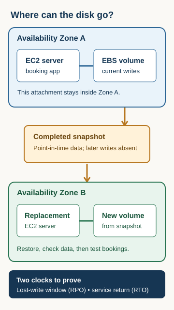

# A disk cannot follow the server into another zone

Maya's repair database runs on an EC2 instance in Availability Zone A. Its EBS volume holds the current database. The recovery plan says that if Zone A fails, a replacement server in Zone B will simply attach the same disk. That sounds like moving a laptop drive to another desk. It misses the location rule: an EBS volume attaches to an instance in **the same Availability Zone**. A snapshot can be used to create a **new** volume in another zone in the same Region, but that new disk contains the snapshot's point-in-time data, not every later write. [EBS volume attachment](https://docs.aws.amazon.com/ebs/latest/userguide/ebs-volumes.html); [EBS snapshots](https://docs.aws.amazon.com/ebs/latest/userguide/ebs-snapshots.html).



The business sets two separate promises. **RPO** is the maximum acceptable window of lost writes after restoring an older copy. **RTO** is the maximum time until the customer journey works again. A snapshot answers neither by its existence alone. You need its capture time, successful availability, a recoverable database state, permission to use its encryption key, a replacement server and volume, measured first-read behavior, a working application path, and a customer check. AWS says snapshot data is available across zones in its Region, while a volume remains zone-scoped. AWS also warns that the first read of a restored block can be slower unless the volume is initialized or an eligible fast-restore path is used. [Snapshot behavior](https://docs.aws.amazon.com/ebs/latest/userguide/ebs-snapshots.html); [EBS performance](https://docs.aws.amazon.com/ebs/latest/userguide/ebs-performance.html); [EBS encryption](https://docs.aws.amazon.com/ebs/latest/userguide/ebs-encryption.html).

## Predict before running

Use only these **fictional** observations and estimates. The last usable snapshot captured data at minute 10 and became available at minute 11. Zone A fails at minute 14. The team estimates 2 minutes to detect the failure, 3 to create and attach a new volume in Zone B, 6 to initialize needed blocks, and 4 to reconnect the app and check a booking. The business asks for RPO 2 minutes and RTO 15 minutes.

1. Why can the replacement in Zone B not attach Zone A's existing volume? What could the completed snapshot do instead?
2. Compute the possible lost-write window from **capture**, not completion, and the fictional recovery clock. Which promise is already unsupported? Does meeting one clock exactly establish that real customers can book within it?
3. What changes if a later snapshot captures data at minute 12 but will not become available until minute 16? What changes if the business accepts RPO 5 and RTO 20? Keep a modeled fit separate from a drilled result.
4. A teammate proposes fast snapshot restore to reduce first-read delay. Explain which part of the problem it might address, which part it cannot address, and what new meter it can add. Do not invent a price. AWS bills fast snapshot restore by enabled snapshot and Availability Zone time, with a minimum billable period. [Fast snapshot restore](https://docs.aws.amazon.com/ebs/latest/userguide/ebs-fast-snapshot-restore.html); [EBS pricing](https://aws.amazon.com/ebs/pricing/).
5. If only the EC2 instance fails and the zone and volume remain healthy, compare replacing the instance in the **same** zone with restoring from a snapshot. State what must be true before reattachment or application service is safe. A stopped or failed machine's database may still need consistency checks; a successful attachment is not a customer recovery result.

From the repository root, run the cloud-free clock:

```sh
python3 examples/ebs-az-recovery/lab.py
python3 examples/ebs-az-recovery/lab.py --capture 12 --available 16
python3 examples/ebs-az-recovery/lab.py --rpo 5 --rto 20
python3 examples/ebs-az-recovery/lab.py --rpo 5 --rto 20 --initialize 12
python3 -m unittest discover -s examples/ebs-az-recovery -p 'test_*.py' -v
```

The output deliberately says `DESIGN_CANDIDATE_NEEDS_DRILL`, never “recovered.” It checks only the fictional arithmetic and snapshot availability. It does not create a volume, prove a consistent backup, check IAM/KMS, reserve EC2 capacity, switch traffic, measure an AWS restore, or see a customer booking.

Save your first answer before opening [assessor reasoning](ASSESSOR.md). Then ask Codex to challenge the weakest claim in your recovery plan and list the evidence that would reverse it. Check service claims against the linked AWS documentation. Keep the independent answer and assisted revision distinct.

For a real plan, choose the permitted data location and recovery promise first. Scope the recovery role and encryption key access, use encrypted volumes and snapshots, test the actual database restore and customer path, and inventory old and replacement resources for cleanup. Price the whole path in the selected Region: snapshot storage, new EBS capacity and performance, replacement EC2, initialization or fast restore, transfer and retained resources. This exercise uses paper and local code; no AWS resource or credit is used. A later authorized cloud run needs a whole-run estimate, account-appropriate spending and credit-reserve limits, a scoped non-root identity, cleanup owner and post-run bill check.
