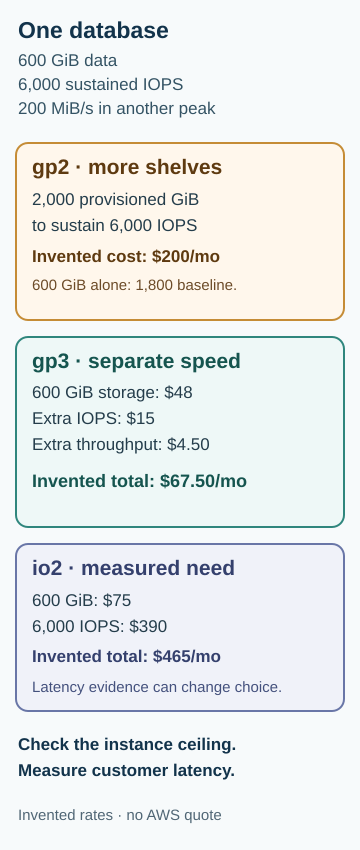

# A disk can fit the data and still miss the promise

Maya's repair database uses 600 GiB. During one busy window it needs 6,000 sustained small operations per second; in a **different** window a report scan needs 200 MiB/s. The selected EC2 instance is assumed, for this fictional case, to carry at most 8,000 EBS IOPS and 300 MiB/s. The customer promise is a timely booking, not merely a disk with enough free space.

Think of storage capacity as shelves, IOPS as how many small folders a clerk can fetch each second, and throughput as how much paper can move down the hallway. Buying more shelves can change gp2's baseline IOPS, but that is an expensive way to acquire speed when the extra shelves are otherwise empty. Gp3 lets the team set capacity and additional IOPS/throughput separately. Io2 adds a different provisioned-performance and latency choice that needs measured justification. [AWS general-purpose SSD behavior](https://docs.aws.amazon.com/ebs/latest/userguide/general-purpose.html), [EBS volume types](https://docs.aws.amazon.com/ebs/latest/userguide/ebs-volume-types.html), and the [EBS pricing structure](https://aws.amazon.com/ebs/pricing/) support those distinctions; none supplies a quote for this fictional account.



## Predict before running

The exercise uses **invented 30-day rates**: gp2 USD 0.10 per provisioned GiB; gp3 USD 0.08 per GiB, USD 0.005 per IOPS above its included 3,000, and USD 0.06 per MiB/s above its included 125; io2 USD 0.125 per GiB plus USD 0.065 per provisioned IOPS in this exercise's first tier. These values make arithmetic visible. They are not selected Region prices, account eligibility, a billing cap or a recommendation. The code models only one volume in a 30-day period; EC2, snapshots, initialization, data transfer, monitoring and taxes are omitted.

Before opening the assessor, calculate:

1. At gp2's documented 3 baseline IOPS per GiB, how many GiB must be provisioned for **sustained** 6,000 IOPS? Would a 600-GiB gp2 volume's burst solve that sustained need? What does the fictional storage line cost?
2. For gp3, price 600 GiB, 3,000 extra IOPS and 75 MiB/s extra throughput. Which two settings are separate from storage size? What is the fictional total?
3. Price the simple io2 first-tier case at 600 GiB and 6,000 provisioned IOPS. Does its fictional total prove that io2 is a poor choice for every database?
4. Explain why the assumed instance ceilings and measured application latency must be checked before calling any candidate acceptable. Name the snapshot, restore, retained-volume and cleanup meters missing from this one-volume arithmetic.

From the repository root, run the local model and its focused changed-case tests:

```sh
python3 examples/ebs-volume-economics/lab.py
python3 examples/ebs-volume-economics/lab.py --instance-iops 4000
python3 examples/ebs-volume-economics/lab.py --throughput 300
python3 -m unittest discover -s examples/ebs-volume-economics -p 'test_*.py' -v
```

The 4,000-IOPS instance change makes both general-purpose volume shapes **hold** in this model even if their volume settings look adequate. The 300-MiB/s scan change exceeds gp2's documented maximum throughput while remaining a possible gp3 setting under the model's stated conditions. Neither result proves the chosen EC2 instance or actual application can deliver that rate. The io2 output is a cost line only; the model deliberately makes no io2 latency or acceptance claim.

Save your first choice. Ask Codex: “Try to overturn my EBS choice with one missing observation. Keep the fictional rate card separate from current AWS prices, and identify the first billable resource plus a stop and cleanup plan.” Verify its service statements against the linked AWS pages, then write what you changed and why. Use [assessor reasoning](ASSESSOR.md) after your unaided answer.

For a real account, measure the workload's I/O sizes, latency distribution and peak duration, then check the volume and instance limits, current Region rates, snapshot and retained-resource charges, plan/credit eligibility, a whole-run estimate and an account-appropriate reserve. Use a scoped non-root identity, plan cleanup and reconcile the bill afterward. **Do not provision an EBS volume for this exercise.**
