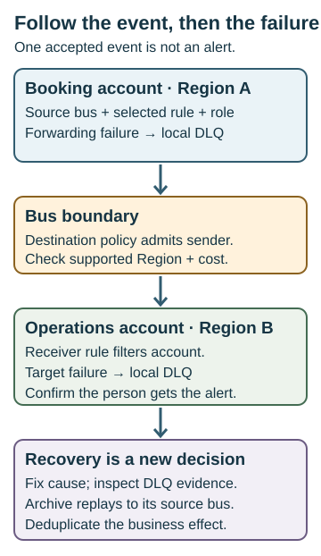

# One event travels across two account and Region boundaries

Maya's booking team works in one AWS account in Region A. The operations team watches deployments from another account in Region B. A deployment fails, but nobody gets the page. The booking team can see that its event was created. That proves the first step only. It does not prove the event crossed into Region B, matched the receiving rule, reached its target, or alerted a person.

This is a **paper design exercise** for EventBridge Classic event-bus rules. [cases.json](cases.json) contains invented accounts, Regions, balances and assertions. [route_review.py](route_review.py) reads that file locally and makes no AWS call. A result of `ready_for_design_review` means only that these supplied statements passed this small checker; it is not a deployed route, IAM simulation, current Region-support check or recipient receipt.

## Trace one event from first rule to last person

The source-account rule selects a `shop.deploy` event and targets the full ARN of the operations bus in the destination Region. Its EventBridge role needs scoped `events:PutEvents` permission on that bus. The receiving bus needs a policy admitting the sender. In the operations account, a second rule selects both the source account and the intended event shape before invoking the operator target. A bus policy alone does not create that second rule or give its target permission. Cross-account, cross-Region bus delivery is supported only where the selected destination Region supports it; verify the actual route and Region before deployment. [AWS cross-account bus route](https://docs.aws.amazon.com/eventbridge/latest/userguide/eb-cross-account.html), [bus target role](https://docs.aws.amazon.com/eventbridge/latest/userguide/eb-events-iam-roles.html), [cross-Region routing](https://docs.aws.amazon.com/eventbridge/latest/userguide/eb-cross-region.html).

There are **two failure pockets**. If the source rule cannot deliver to the remote bus, look at its target failure metric and its standard SQS dead-letter queue (DLQ) in the source rule's Region. If the event reaches the operations bus but the receiving rule cannot invoke its target, inspect that rule's target failure and its own DLQ in the destination Region. The queues need their own permissions and retention decisions. A missing permission can send an event directly to a configured DLQ without exhausting ordinary retries; without a DLQ, an undelivered event can be dropped. A DLQ record helps investigate a failed target; it is not a successful alert. [AWS rule DLQs](https://docs.aws.amazon.com/eventbridge/latest/userguide/eb-rule-dlq.html), [retry policy](https://docs.aws.amazon.com/eventbridge/latest/userguide/eb-rule-retry-policy.html).

An EventBridge archive can replay selected events **to the same bus that supplied that archive**. It does not directly replay into a different bus. A replay may invoke business work again, and AWS does not promise original arrival order, so the consumer needs a stable operation ID and reconciliation rule before anyone presses replay. Nor can an event forwarded from one bus simply be forwarded onward to a third bus by another bus rule. Design direct source fan-out or a separately authorized producer if the business truly needs another destination. [AWS archive and replay](https://docs.aws.amazon.com/eventbridge/latest/userguide/eb-archive.html), [cross-account hop limit](https://docs.aws.amazon.com/eventbridge/latest/userguide/eb-cross-account.html).

## Work the changed cases

Write your decision before running the checker. For each case, draw the account and Region of the first rule, receiving bus, receiving rule, target, both failure queues and any archive. Name the operation ID, the expected successful receipt, an intentional denial, a failure owner and the smallest observation that would disprove the design.

1. **`direct-reviewed-route`:** Explain why the paper route passes while real bus permission, rule matching, Region availability, DLQ writes and human alert delivery remain untested.
2. **`bus-policy-only`:** The receiver policy admits booking, but the source target role is not reviewed. Predict the first hold and where a failed forwarding attempt would need to appear.
3. **`broad-receiver-rule`:** The receiving bus also admits training. Its rule filters `source` but omits `account`. Construct a near-match event that should not page. Explain why a broad bus permission makes the receiver filter more consequential.
4. **`third-hop-and-wrong-replay`:** The design tries to route the forwarded event to a third bus and replay a source archive into the operations bus. Identify both unsupported steps and redraw a direct or producer-owned path.
5. **`lost-failure-and-duplicate-effect`:** The forwarding DLQ is in the wrong Region and lacks reviewed queue permission; the receiver target has no reviewed permission or valid DLQ. Explain which failed hop each queue was meant to record. Then assume a replay duplicates a deployment action. Which stable ID and reconciliation fact must stop a second effect?
6. **`reserve-is-not-routing-permission`:** The fictional $8 gross estimate fits the $12 run limit and $15 gross headroom, but a $45 balance minus $8 leaves $37, below the fictional $40 reserve. State the hold. Price source and forwarded events, both queues, archive, target, logs and any selected transfer/retention before a real proposal; these figures are not current AWS rates or the author's account budget.

Run `python3 examples/event-route-boundaries/route_review.py` at the repository root. Change one field in a copied case and rerun it. Ask Codex to challenge the diagram with an alternate failure location, then check its claim against the case, [assessor reasoning](ASSESSOR.md) and official AWS behavior. The checker verifies no live identity, policy, metric, queue, archive, bill or person. This organization-dependent lab remains design-only and spends no AWS credit.
