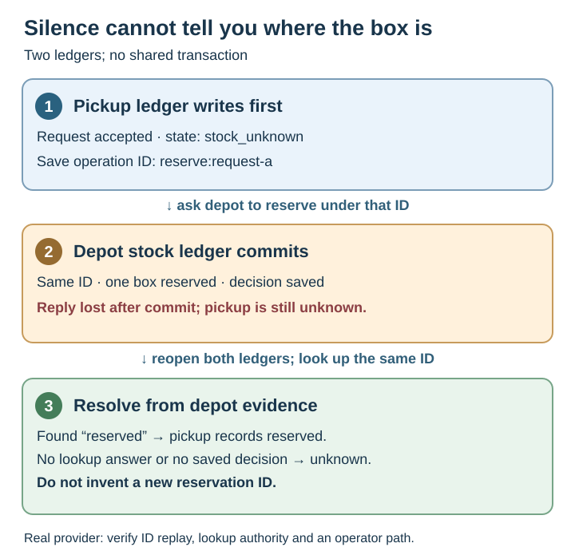

# A food-bank pickup: a receipt is not a box

A partner asks a food bank for one food box. The reply vanishes. Did the food bank accept the request? Is a box reserved? Can the partner print a pickup label? Those are three different questions. A truthful service must give three different answers until the depot actually makes its decision.

This local exercise uses **one synthetic depot and one box**. It is an integrated customer path through loopback HTTP and a temporary SQLite database. It uses fixture partner and operator tokens and a clock measured in example minutes. No AWS account, Amplify application, real partner, stock system, attachment store, or money is involved.

## Predict the customer view

| Moment | What the receipt means | What the partner may see |
| --- | --- | --- |
| Accepted at minute 0 | The request is stored, due for the example's 90-minute target | `pending_inventory`; no label |
| Depot confirms at minute 30 | One stock unit is atomically reserved | `reserved`; still no label |
| Depot marks ready at minute 75 | The first ready time is recorded | `ready`; the owning partner can get a synthetic label |
| Second partner requests the last box | Its own request is accepted, but stock is gone | `unavailable`; never the first partner's record or label |

The service records a due time, then reports whether the fixture ready time met it. It cannot promise that a real depot will be ready in 90 minutes. That requires inventory integration, capacity and operational evidence.

From the repository root, run:

```sh
python3 examples/food-bank-pickup/lab.py
python3 -m unittest discover -s examples/food-bank-pickup -p test_lab.py -v
```

The first command runs one full path and removes its temporary database. Look for a lost first reply, a **new loopback server and service object** reopening the committed SQLite file, the recovered **same** request ID on retry, `pending_inventory` before the depot decision, denial to the other partner, a reserved box, on-time readiness, and a second partner's `unavailable` result. This is a same-machine restart model, not a crash or independent-host test. The tests also submit two confirmations concurrently against one box. Exactly one can reserve it. The SQLite write transaction is the local authority for that result; it says nothing about a real depot's stock API. A separate test tries to backdate readiness before the recorded stock confirmation. The service rejects it rather than turning a late pickup into an apparent on-time one.

Read [the implementation](lab.py) after predicting the output. `submit` binds a retry key to one partner and one intent. A replay returns the original request and original clock; a changed depot cannot silently become a new request. `confirm` performs the stock decrement and state change in one transaction and keeps its first confirmation time. `ready` cannot precede that time or rewrite its first ready time. `status` and `label` use the actor determined from a fixture bearer token, never a partner name supplied in the request body. The route returns 404 for another partner's request ID so a guessed ID does not expose its state. These narrow checks do not audit every possible read path or make fixture tokens production authentication.

## When the stock system has its own ledger

The first lab keeps request and stock in one SQLite file. A real depot may own a separate stock system. Picture sending “reserve one box” and hearing nothing back. The depot might have reserved it just before the connection failed. Sending a *new* reservation could consume another box; telling the partner “unavailable” could hide the box already held for them.



Run the separate [two-ledger fixture](external_stock.py) and its tests:

```sh
python3 examples/food-bank-pickup/external_stock.py
python3 -m unittest discover -s examples/food-bank-pickup -p 'test_*.py' -v
```

It writes a pickup ledger and a stock ledger to different local SQLite files. Before calling stock, the pickup side commits `stock_unknown` and a stable `reserve:request-a` operation ID. The stock side commits one reservation under that ID, then the exercise drops its reply. After both files reopen, a lookup under the **same ID** finds `reserved`; a second request gets `unavailable`. If the lookup is unavailable, the first request stays unknown. If the lookup returns no decision, this fixture also declines to infer failure. A repeated stock call with the same ID is safe **only because this toy stock system explicitly saves and replays that ID's first decision**. Reusing that ID for another request is rejected.

Two bounded designs now have different obligations. An outside stock API with durable idempotency keys *and* authoritative result lookup can support automatic reconciliation after a lost reply. If the API cannot answer for an old operation, keep the customer state uncertain, stop fresh reservation attempts for that request, and send it to an operator with the request ID, operation ID and depot evidence. A timeout alone is not permission to create another operation. The fixture has no real network, API authentication, depot audit, transaction across the two files, human queue or proof that an external provider honors this contract. Ask for those facts before adapting the code to AWS.

### Let the stock service disappear between the call and the answer

The first exercise calls another Python object in one process. The [process-separated continuation](stock_http.py) instead starts a loopback HTTP stock provider in its **own operating-system process**, with its own SQLite file. Run:

```sh
python3 examples/food-bank-pickup/stock_http.py demo
python3 -m unittest discover -s examples/food-bank-pickup -p 'test_stock_http.py' -v
```

The pickup process sends `reserve:request-a`. The provider commits the box, then closes the connection without an HTTP answer. From the pickup side, silence means **unknown**, even though this teaching fixture deliberately knows a commit occurred. The provider process stops. A lookup while it is down leaves `stock_unknown`; a new provider process opens the same stock file and returns the recorded decision for the same operation ID. A replay with that ID returns `reserved` without taking another box. A second request gets `unavailable`. The separate no-commit test drops the provider *before* the request: after restart, lookup returns no decision and pickup still stays unknown. That absence does not prove a failed attempt is safe to replace with a new ID.

There is a second question: who may ask the stock service to reserve or inspect a box? The local harness gives each provider process a fresh random **fixture bearer token** and gives it only to the cooperating client. The provider checks that token before reading a reserve request or returning a decision or availability. Missing and wrong tokens receive `401`; the tests confirm they cannot change stock or read a saved decision. After a provider restart, the old token is refused while the saved stock decision remains readable to the newly authorized client. That separates *authority to ask* from *durability of the answer*.

Here the network is only `127.0.0.1`, the ledger is still on the same machine, and the token travels through a child-process environment variable and plain HTTP. This is a local authorization fixture, **not production authentication or transport security**. Another process under the same local user may be able to inspect its environment; an exposed token would grant the holder the fixture's full reserve and lookup authority. A real depot integration needs a verified service identity, protected transport, scoped operations, rotation, audit and an owner for ambiguous decisions. Process restart proves that the recorded operation survives this local provider replacement; it does not prove cross-host durability, a depot's actual idempotency lifetime, realistic failures or AWS behavior. Ask Codex to identify what an operator would need to see before resolving an operation whose provider no longer has a receipt. The safe answer is evidence and a decision owner, not an automatic second reservation.

## Make a design decision

Compare two bounded candidates. **Reserve before responding** lets the receipt mean a box is reserved, but the caller waits for depot inventory and an uncertain reply still needs safe retry. **Accept a durable request, then confirm inventory** gives a prompt recoverable receipt while the depot is unavailable; it needs explicit pending and unavailable states, a worker/operator path, a clock, and reconciliation. This lab models the second candidate because its business promise is “we received your request,” not “your box is already reserved.” If the business requires a guaranteed box at submission, this model fails that promise.

Before opening the [assessor notes](ASSESSOR.md), answer these changed cases:

1. Eight depots share one partner portal. Which depot may reserve a box, and what proves a partner cannot inspect another partner's request through an API, cache, export or file link?
2. The depot confirms at minute 100, and a ready event then claims minute 20. Should the service accept it? What if the first valid ready event is minute 101 and a repeated event later claims minute 20?
3. A depot's stock system says “maybe” after a timeout. What evidence permits retry without reserving twice, and where does a human reconcile an ambiguous result?
4. A morning burst is 100 times the sample. What peak arrival, stock, worker, deadline and cost facts are missing before claiming capacity?
5. A partner needs a real private pickup PDF. Where is the owning-partner check performed for a direct object link, and how do links expire or get revoked?
6. A depot needs to restore its data without changing another depot's requests. Which records, reservations, labels and outside messages form one recovery promise?
7. Another process knows a request ID but has no current stock-service token. Which reads and writes must fail? Does a successful token check prove that this caller is the correct depot in a real deployment?

Draw a path from partner identity through receipt, stock authority, ready result and customer observation. Mark each statement **local evidence**, **design hypothesis**, or **requires field evidence**. For an AWS implementation, estimate all request, storage, transfer, logging and failure-path charges using current primary prices; choose account-appropriate spending and reserve limits and define cleanup and stop conditions before a run. This exercise spends zero credits.

**AI practice:** Give Codex your diagram and the seven changed cases. Ask for one counterexample to each business promise, an observation that would reject each of your two designs, and the missing price or authority facts. Check its answers against the code and current AWS primary documentation before adopting a product claim. Do not give it real partner data or credentials.
