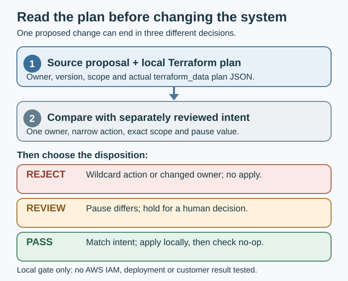

# A17 Review one infrastructure proposal before applying it

Maya's media team wants one approved exhibition export. Another team proposes `s3:*` on `*` because it is quicker than naming the needed read. A syntactically valid Terraform plan does not decide whether that permission or owner is acceptable. This local exercise lets the reader see the **planned value**, compare it with a separate reviewed contract and stop before applying a bad proposal.

From the repository root, with Terraform 1.6–1.x and Python 3.9 or newer:

```sh
python3 examples/governed-delivery/lab.py
python3 -m unittest discover -s examples/governed-delivery -p 'test_*.py' -v
```

The runner copies [`main.tf`](main.tf) into a temporary folder, initializes Terraform without a backend or external provider, and reads `terraform show -json` for each saved plan. Its only resource is `terraform_data.delivery_proposal`. That resource records a **fictional proposal**, not an IAM policy or a real Amplify setting. The runner removes the folder, state and plans afterward. It strips inherited `TF_` and `AWS_` environment variables from Terraform subprocesses; it makes no AWS call.

Before running, predict the guard's answer and what, if anything, is applied:

| Proposed change | Expected decision | Why it matters |
| --- | --- | --- |
| Media team, module version 1.2.0, one `s3:GetObject` scope | Pass | Matches this exercise's reviewed contract |
| `s3:*` on `*` | Reject | Excess action and resource scope; do not apply |
| Same narrow read but another owner | Reject | A shared module does not erase resource ownership |
| Pause automatic builds during an incident | Review | A deliberate emergency change may be right, but it changes reviewed intent |

In the final case, the exercise first receives `review`, updates its fictional reviewed intent after an explicit decision, applies that local plan, and obtains a fresh no-op plan. It does **not** claim an emergency approval happened in AWS. It demonstrates why blindly reverting a useful emergency pause can be worse than reconciling desired state. The `module_version` field is only a version label: this lab does not implement, publish or consume a real Terraform module.

The guard is intentionally narrow. It expects one `terraform_data` address, the five known fields, no deletion/replacement, one owner and one exact action/resource string. It does not evaluate effective IAM policy semantics, conditions, resource policies, permission boundaries, SCPs or trust. It also cannot verify that the proposed owner is the person who actually approved the change. A saved plan may contain sensitive inputs; this exercise creates only synthetic values in a disposable directory.



## Change the facts before reading the assessor

1. The plan changes only `module_version` to 1.3.0. Why should a version label alone not auto-authorize the update? Name the consumer and migration checks.
2. A guard sees one narrow `terraform_data` proposal. Could another Terraform configuration, CloudFormation stack or console operator still own the real object? What inventory would resolve that question?
3. A teammate says the successful no-op after the emergency pause proves customers can reach the website and old sessions lost access. Which evidence is missing?
4. A reviewer changes the `owner` string in the source and the reviewed contract at the same time. Does this fixture authenticate that reviewer or establish a safe ownership transfer?
5. The team copies this pattern into a live pipeline. What exact identity, state backend, plan/source binding, permission review, stop condition, cost/retention review and post-apply check would you require before the first real run?

Write your first answer, then consult the [assessor](ASSESSOR.md). Ask Codex to explain the actual plan JSON and identify what this guard fails to prove. Check its answer against the source, not the elegance of its prose. A future AWS experiment needs a scoped non-root identity, current account/Region and price checks, a whole-run estimate, account-appropriate spending and reserve limits, a stop owner and verified cleanup. Organization-wide rollout remains design-only unless separately authorized in a suitable environment.
