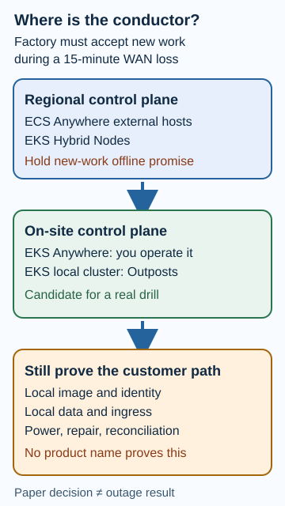

# The machines are local. Where is the conductor?

Maya's factory presses a safety button. A local controller must accept a new work item and show a trustworthy result during a 15-minute WAN outage. Moving the container to a machine in the factory is only one part of that promise. Where are the scheduler, image, identity check, input record, ingress path and power? Predict before running this cloud-free worksheet.



```sh
python3 examples/hybrid-container-placement/review.py
python3 -m unittest discover -s examples/hybrid-container-placement -p 'test_*.py'
```

The script has seven fictional changed cases and no AWS SDK, network, container or account calls. `HOLD` means a stated dependency conflicts with the promise. `REVIEW_WITH_DISCONNECTION_DRILL` means the paper path is plausible, **not** that a platform or customer operation has passed a failure test.

| Placement | Where the control plane is | What this changes for a WAN outage |
| --- | --- | --- |
| **ECS Anywhere** external instances | ECS control plane in an AWS Region; your hosts on site | Registration, task management and agent communication depend on AWS endpoints. Do not promise new task scheduling while disconnected without selected evidence. ECS service load balancing is not supported for external instances; plan local ingress separately. |
| **EKS Hybrid Nodes** | AWS-managed Kubernetes control plane in a Region; your nodes on site | Existing application behavior during a link loss depends on its configuration and dependencies. New scheduling and cluster changes require a tested regional path. |
| **EKS Anywhere** | Customer-managed Kubernetes control plane and nodes on site | It can suit a self-contained air-gapped design, but the owner must operate the cluster and prepare local images, identity, data, ingress and recovery. |
| **EKS local cluster on Outposts** | EKS control plane and nodes on an Outpost | Local cluster operation during a cloud disconnect is a supported design to investigate; site power, capacity, service link, commercial terms and exact AWS service dependencies remain. |

These are different operating models, not interchangeable brand names. AWS's [EKS deployment-options guide](https://docs.aws.amazon.com/eks/latest/userguide/eks-deployment-options.html) distinguishes EKS Hybrid Nodes, EKS Anywhere and Outposts local clusters. Its [hybrid-disconnection guide](https://docs.aws.amazon.com/eks/latest/best-practices/hybrid-nodes-network-disconnections.html) asks teams to test their own applications. The [ECS external-instance guide](https://docs.aws.amazon.com/AmazonECS/latest/developerguide/ecs-anywhere.html) describes agent endpoints and unsupported service load balancing. AWS's [Outposts local-cluster disconnection guide](https://docs.aws.amazon.com/eks/latest/userguide/eks-outposts-network-disconnects.html) describes continued local cluster operation, with caveats. Check the current service/Region/site prerequisites before a real design.

## Change one fact before choosing

1. The local image cache is empty when the WAN fails. Does a local Kubernetes control plane supply the missing image? **No.** Hold until the image path is prepared and tested.
2. Identity validation calls a regional service. Does local compute make the access decision available offline? **No.** Name a bounded local authority or a safe deny behavior; test reconciliation when the link returns.
3. A manager needs new tasks after a local node fails during the outage. A regional ECS or EKS control plane is unreachable. **Hold** that new-work promise; existing-task continuity is a separate observation.
4. The factory's browser must reach an ECS Anywhere external task through ECS service load balancing. **Hold**; that integration is unsupported. Design and test a separate on-site ingress path.
5. Images, identity and data are local, but the factory loses power. **Hold.** A local control plane cannot create electricity.

Read [the assessor](ASSESSOR.md) after defending which option you would investigate and what you would reject. Ask Codex to draw every dependency crossing the WAN and to challenge your answer with a node failure, a stale local identity decision and a delayed repair receipt. Verify its product claims against the cited AWS docs, and do not paste a live site topology or credentials into a prompt.

**Cost and scope.** This exercise is offline. A real comparison must include site hardware, power, operations, subscriptions or managed-instance charges, data transfer, logging, support, recovery and cleanup. Check current prices, eligibility, the account's Free-plan terms and an authorized whole-run estimate before any cloud lab. Site and organization-dependent platforms remain design-only unless separately authorized in a suitable environment.
