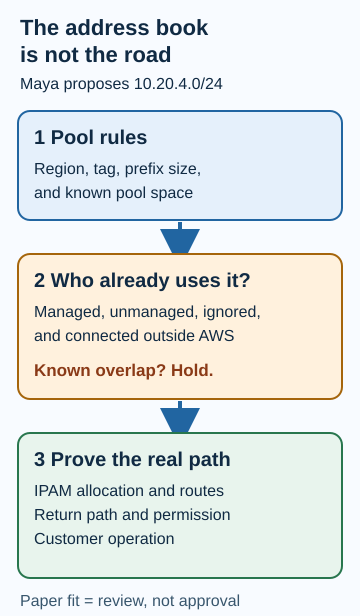

# The address book is not the road

Maya is adding a second repair application. Its team chooses `10.20.4.0/24` because that block is absent from **their** deployment sheet. A legacy VPC already uses it. The VPC was created outside the proposed IPAM pool, so a pool-only list would miss the collision. Predict what must stop before a route or peering request is made.



Run from the repository root. This Python standard-library exercise makes no AWS or network calls and creates no resources:

```sh
python3 examples/ipam-governance/plan.py
python3 -m unittest discover -s examples/ipam-governance -p 'test_*.py'
```

The fictional pool allows only tagged production `/24` requests in `us-west-2`. The ledger has a managed VPC, an **unmanaged** legacy VPC, an **ignored** review item and a VPC in a separate claimed routing scope. A request overlapping any recorded CIDR in its proposed connected scope is held. The ignored item remains a planning conflict; “ignored by IPAM” is not evidence that its addresses vanished. A different scope can reuse space only when the networks are truly disconnected. This exercise requires a stated isolation observation before returning a **review**, never an approval. [AWS resource states and overlap view](https://docs.aws.amazon.com/vpc/latest/ipam/monitor-cidr-compliance-ipam.html), [IPAM scopes](https://docs.aws.amazon.com/vpc/latest/ipam/add-scope-ipam.html).

| Changed fact | Local decision | Reader's next observation |
| --- | --- | --- |
| Existing managed, unmanaged or ignored `10.20.x.0/24` overlaps | Hold | Inventory every connected address domain, including out-of-pool VPCs and on-premises routes. |
| Requested Region, tag or prefix violates the pool rule | Hold | Check the actual IPAM pool locale and allocation rules. |
| Same CIDR appears in another claimed scope | Hold until isolation evidence; then review | Confirm the domains cannot be connected now or by the planned architecture. |
| No known overlap; paper rules fit | Review with IPAM and route evidence | Confirm allocation, VPC associations, route-table path, return path, security rules and application result. |

IPAM pools can apply locale, netmask and required-tag rules to managed resources. A discovered resource outside a pool may be **unmanaged**: IPAM can still show its overlap, but its pool-rule compliance is not established. An ignored resource is not evaluated for overlap or rule compliance by IPAM. Our fictional ledger intentionally continues to count its address claim until an owner resolves it. This is a conservative planning policy, not a claim about what an AWS API would return. [AWS pool rules](https://docs.aws.amazon.com/vpc/latest/ipam/create-top-ipam.html), [AWS resource states](https://docs.aws.amazon.com/vpc/latest/ipam/monitor-cidr-compliance-ipam.html).

**Tier and cost boundary.** AWS's current [IPAM pricing page](https://aws.amazon.com/vpc/pricing/) lists private IPv4 management in **Advanced Tier**, not IPAM Free Tier. Advanced Tier bills by active IP address hour; other VPC and public IPv4 charges can still apply. Do not create Advanced Tier IPAM merely to finish this lesson. A real exercise would first verify the selected account's plan, current regional price, expected active IP hours, whole-run spend and cleanup owner against that account's own budget and reserve. Organization and cross-Region IPAM work in this exercise remains design-only.

The local result is not an AWS allocation, compliance finding, peering eligibility result or connectivity test. AWS [does not permit peering VPCs with overlapping CIDRs](https://docs.aws.amazon.com/vpc/latest/peering/vpc-peering-basics.html); a [transit gateway does not propagate the newly attached VPC's overlapping route](https://docs.aws.amazon.com/vpc/latest/tgw/tgw-vpc-attachments.html). Neither observation is simulated here.

Before reading [the assessor](ASSESSOR.md), explain why the legacy block was missing from the team's sheet, why the ignored block is still a question, and what evidence would make two scopes safely reusable. Ask Codex to challenge your answer with a future network connection, a return-route failure and an uncounted recurring charge; check its claims against the cited AWS references. Do not supply live CIDRs, account identifiers or confidential topology to a public prompt.
