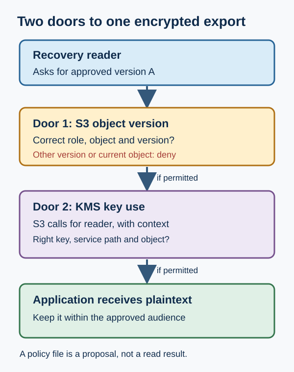

# Two doors to one encrypted export

Maya approves **one version** of a weekly export for a recovery reader. The object is stored with SSE-KMS under a fictional customer managed key. A worker may need permission to retrieve that exact S3 version **and** permission to use the KMS key for its decryption. A green check on either door alone is insufficient.

All names here are invented: account `111122223333`, Region `us-east-2`, bucket `amplify-aws-example-private`, role `ExampleExportReader`, object `exports/weekly.json`, and version `ApprovedVersionA`. The key exists only in the story. The object is assumed to have been encrypted under the same-Region key **without S3 Bucket Keys**, so its KMS encryption context uses the object ARN. There is no customer data or deployable Terraform. The policy files are teaching specimens, not approved account policies.



Read [the reader role policy](reader-role.json) and [the KMS key policy](key-policy.json) before opening the [assessor](ASSESSOR.md). The first policy permits `s3:GetObjectVersion` only for the named object/version and explicitly denies other versions and an unversioned `s3:GetObject` of that object. The key policy gives the named role `kms:Decrypt` only when S3 in the chosen Region calls KMS on its behalf with the stated object encryption context. Its account-principal statement preserves a path to inspect or revise key policy; it does **not** delegate general decryption through IAM. A new broad `kms:Decrypt` IAM allow for the reader would not replace the missing key-policy grant in this specimen.

We chose a **direct, named-role key-policy grant** for this small story so the reader can see the key-use door in one file. An alternative is to let the key policy enable IAM delegation and give the role a matching, scoped IAM KMS allow. That can fit larger role-management workflows, but the effective permission then spans more documents; a later broad IAM grant can change the result. Either route needs key administrators and recovery ownership, policy review, effective-permission checks and an actual permitted/denied request before use. The specimen's account-principal administration actions are fictional recovery scaffolding, not a production administration design.

AWS documents the [KMS key-policy gate](https://docs.aws.amazon.com/kms/latest/developerguide/iam-policies.html), [SSE-KMS download permission](https://docs.aws.amazon.com/AmazonS3/latest/userguide/UsingKMSEncryption.html), [version-specific S3 policy condition](https://docs.aws.amazon.com/AmazonS3/latest/userguide/amazon-s3-policy-keys.html), and [`kms:ViaService`](https://docs.aws.amazon.com/kms/latest/developerguide/conditions-kms.html). S3 Bucket Keys change the KMS context to the **bucket** ARN; applying this object's context condition to a bucket-key object can break the read. [AWS Bucket Key context guidance](https://docs.aws.amazon.com/AmazonS3/latest/userguide/configuring-bucket-key.html).

## Predict before checking

For each case, record the first gate you would investigate, a safe positive or negative observation, and what the result cannot prove.

1. The named role reads `ApprovedVersionA` from the named object through S3. No additional policy denies apply; the key is enabled and matches the encryption metadata. What should the design permit? What must a real request still verify?
2. The role asks for another version of the same object. What changes at the S3 gate? Would adding `kms:Decrypt` help?
3. The role calls S3 without a version ID. Which action does that request need, and what does the explicit deny cover?
4. The role can retrieve the approved object, but the KMS reader statement is removed. Someone adds `kms:Decrypt` to its IAM policy. Does this key policy allow IAM to delegate decrypt? Identify the narrower repair question.
5. The role calls KMS directly rather than through S3, or the object was written with an S3 Bucket Key. Which condition differs? Explain why you cannot diagnose the exact failure from an HTTP 403 alone.
6. Another principal obtains a copy of the encrypted object's bytes and an unrelated key. Does successful object access, an S3 version ID or any KMS permission automatically prove it can read the plaintext?

Run the local source check:

```sh
python3 examples/key-use-policy/check_specimen.py
```

It verifies that the two JSON files still express the **specified teaching shape**. It does not parse all IAM conditions, merge policies, simulate AWS, test key state, inspect S3 metadata, authenticate a role or establish a real allow/deny result. A real review must inspect the exact account, key, object metadata and all applicable identity, resource, boundary, session, endpoint and organization policies; run an allowed read and neighboring denied requests under the intended scoped role; inspect service and audit evidence; and price and plan cleanup for any bounded run before using a real account. This packet makes **no AWS call**.

Ask Codex to produce a second interpretation for one failed read and identify the smallest observation that would separate it from yours. Do not paste real policy secrets, customer export data or credentials into the exercise. Record your first answer before reading its analysis.
