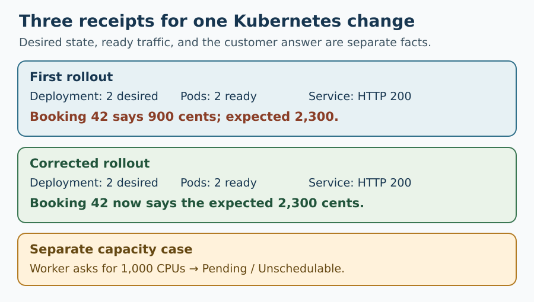

# A green Deployment can serve the wrong booking

Maya asks Kubernetes to keep two copies of her booking API available. The dashboard turns green. A customer asks for booking 42 and receives HTTP 200, but the amount is **900 cents** when the accepted record for this invented exercise is **2,300 cents**. Kubernetes has answered “Are two processes ready for traffic?” The business still has to answer “Did this customer get the right booking?”



This lab runs on the **local Rancher Desktop Kubernetes context only**. It builds a small image from a locally cached Python base, creates a unique temporary namespace, and removes the namespace and image afterward. It makes no AWS call, pushes no image, and creates no EKS cluster. Read the commands in `run_lab.py` before executing them. If Rancher Desktop is unavailable, use the predictions and assessor as a paper exercise.

## Predict, then observe

Before running, write down three predictions:

1. If both Pods pass `/readyz`, what does the Deployment say about available replicas? What does that establish about booking 42?
2. After only `BOOKING_AMOUNT` changes from `900` to `2300`, what must the rollout and customer request each show before Maya may accept this **synthetic** correction?
3. A separate Pod requests 1,000 CPUs on the local workstation. Does writing a Pod manifest make that capacity exist?

From the repository root:

```sh
python3 examples/kubernetes-reality/run_lab.py
```

The runner explicitly selects the `rancher-desktop` Kubernetes and Docker contexts. It refuses a Kubernetes API whose configured server is not loopback. Its image uses `imagePullPolicy: Never`; the Docker build uses `--pull=false --network=none`. It cannot be redirected to EKS by changing your current `kubectl` context. Before building, it checks that the Python base already exists in the selected Docker daemon. These controls are not a network sandbox. Cleanup also runs after a failed build or a lost namespace-create response: it checks the unique ownership label before deleting a namespace. Think of that label as the name on your coat at a coat check—it helps the runner avoid taking someone else’s resources. It reports successful namespace and image cleanup in its JSON result. If interrupted or if cleanup reports an error, inspect only the printed `amplify-k8s-reality-*` namespace and `amplify-k8s-reality:local-*` image before removing them; leave other cluster resources alone.

| Local observation | What it supports | What it does not support |
| --- | --- | --- |
| `desired=2`, `ready=2`, `available=2` on the first rollout | The local Deployment has two ready Pods | Correct booking data, authorized customers or useful capacity under load |
| Service returns HTTP 200 with 900 cents | A selected local Pod served a response | The stipulated 2,300-cent booking promise |
| Corrected rollout returns HTTP 200 with 2,300 cents | This one synthetic customer request now matches the fixture | Other bookings, schema compatibility, a real database or an EKS rollout |
| Oversized worker is `Pending / Unschedulable` with insufficient CPU | The local scheduler could not place that Pod | An EKS node-group limit, AWS quota or cloud-capacity diagnosis |

The first result is a deliberate negative control. The probe URL answers whether the process is listening, not whether its response matches a durable accepted booking. Kubernetes [readiness probes](https://kubernetes.io/docs/tasks/configure-pod-container/configure-liveness-readiness-probes/) determine whether a Pod receives Service traffic, while a Deployment [tracks desired and available replicas](https://kubernetes.io/docs/concepts/workloads/controllers/deployment/). Those mechanisms make the application operable; they do not learn the business's expected booking value. EKS manages a Kubernetes control plane, and Auto Mode can manage more infrastructure, but application behavior still needs its own checks. [Amazon EKS overview](https://docs.aws.amazon.com/eks/latest/userguide/what-is-eks.html).

## Change the case before opening the assessor

1. Both Pods are ready, but only one has stale configuration and the Service chooses between them. How many customer requests would one success justify? What rollout or version evidence would you collect?
2. Change `/readyz` so it checks the database. The database becomes unavailable. What should readiness do, and why might the process still be live? What failure would cause a restart loop if liveness performed the same dependency check?
3. The worker requests 1,000 CPUs but the actual job needs little CPU. Would lowering its request without measuring the workload be a sound capacity fix? Which scheduler and customer signals would you compare?
4. The corrected request succeeds, but a caller for another tenant can read booking 42. Which identity and denial checks are missing from this lab?

Write your first answer, ask Codex to challenge one unsupported inference, then read [the assessor](ASSESSOR.md). The local program tests selected Kubernetes mechanics on this workstation. It does not establish EKS IAM, AWS networking, persistent data, an external load balancer, high availability, representative throughput, cloud charges or certification readiness. A real AWS run would need scoped access, current plan and credit checks, a complete estimated workload, stop and cleanup rules. Choose spending and reserve limits for the account in use.
