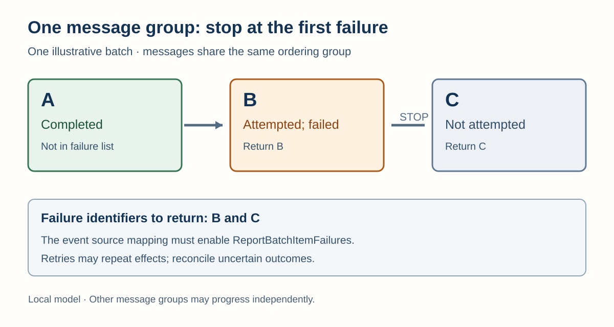

# The envelope you did not open

Maya's repair requests arrive in a FIFO queue. Think of one batch as three envelopes in order for the same message group: A, B and C. The worker finishes A, but a dependency fails while it handles B. Should it open C before B can be retried? Predict the list the worker should return before running this local exercise.



```sh
python3 examples/lambda-fifo-batch/lab.py
python3 -m unittest discover -s examples/lambda-fifo-batch -p 'test_*.py'
```

The model completes A, attempts B, and leaves C unopened. Its response names both B and C as failed or unprocessed. For an SQS FIFO event source with partial batch responses, AWS recommends stopping after the first failure and reporting the failed and unprocessed messages to help preserve order. SQS FIFO ordering applies within a message group; different groups may progress independently. This example deliberately stops the entire batch; it does not model independent message groups or attempt greater parallelism. [AWS: FIFO message groups](https://docs.aws.amazon.com/AWSSimpleQueueService/latest/SQSDeveloperGuide/using-messagegroupid-property.html). [AWS: handling SQS event source errors](https://docs.aws.amazon.com/lambda/latest/dg/services-sqs-errorhandling.html).

The response is only one half of the arrangement. The event source mapping must also enable `ReportBatchItemFailures`. If the function raises an uncaught exception instead of returning a valid response, the whole batch is considered failed. Lambda polls the queue and messages remain hidden during the visibility timeout; when processing succeeds, Lambda deletes messages. Delivery is at least once, so even a previously successful operation needs idempotent handling. A returned failure list is not evidence that an external business action was rolled back or performed only once. [AWS: using Lambda with SQS](https://docs.aws.amazon.com/lambda/latest/dg/with-sqs.html).

Try changing the failure to A and then C. Write the expected attempted records and returned IDs first. Ask Codex to suggest a test that catches processing C after B fails; check the result against the test and AWS guidance. Use fictional data, and inspect generated code before running it.

Now change what the failure means. Suppose B writes a repair assignment to a list, then raises `ValueError` before returning. Does listing B for retry erase the assignment? If you manually pass B and C to the handler again, with a callback that appends each assignment successfully, predict the final list. Separate **attempted**, **changed something**, and **returned successfully** in your answer. They are different observations.

Check your reasoning against the [separate answer guide](ASSESSOR.md) after writing your predictions. The test named `test_retry_does_not_undo_or_deduplicate_side_effect` demonstrates this changed case with a local list. Ask Codex to identify the gap between that list experiment and a durable duplicate-prevention design; do not accept a passing local test as proof of the latter.

This model uses an injected local callback and an in-memory list. It does not run Lambda, poll or delete messages, configure a mapping, implement an idempotency store, simulate visibility timeouts, authenticate a caller, or prove AWS behavior. Before any cloud experiment, separately review its identity, region, whole-run cost, reserve, stop condition and cleanup. No cloud resources are needed here.
