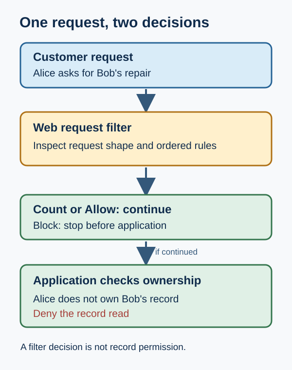

# Count, block, and customer ownership

Alice asks for a repair record. A request filter sees the shape of the HTTP request; the application knows which customer owns the record. These are different decisions. Predict the result of each row in `lab.py` before running it.

```sh
python3 examples/layered-request-boundary/lab.py
python3 -m unittest discover -s examples/layered-request-boundary -p 'test_*.py'
```

The code runs locally, uses invented identities and makes no network or AWS call. `matched_count` records a suspicious request, then evaluation continues to the default Allow and application. `matched_block` ends the path before the application. The deliberately unsafe `owner_check=False` variant returns Bob's record to Alice if no other rule stops her. The `early_allow` variant demonstrates why an Allow rule placed before a later Block can skip that Block; it does **not** grant Alice ownership of Bob's record.



## Try a changed case before reading the check

1. A routine request for Bob's record carries Alice's valid sign-in. Which gate rejects it? Change `enforce_owner` to `False` and identify the lost guarantee.
2. A suspicious request belongs to Alice. Compare Count and Block. What can you infer about application reachability from the trace, and what cannot you infer about a real AWS deployment?
3. An early Allow rule matches a trusted path. What happens to a later suspicious-match Block? What design or rule-order review would you require before calling that path protected?
4. Change the example so the filter is not on the request's actual entry point. Which trace lines would become fictional? Draw a direct-to-origin path separately.

Record your first answer, observed trace, revised answer and one remaining uncertainty. Then ask Codex to challenge your reasoning with a different caller and owner. Do not give it a real customer record or credential. Keep its suggested rule changes as proposals until an accountable reviewer checks the intended request path and legitimate traffic.

## Assessor notes

The critical answer is that Count is **non-terminating**, Block and Allow are **terminating**, and default Allow applies only when no earlier rule terminates. An allowed request still needs application authorization for the requested record. A 403 alone does not identify the denying component. A safe response to a false positive includes the matching rule, intended request population, sampled or logged evidence, rule order, and a bounded change/rollback; “turn off WAF” is not a diagnosis.

AWS documents [rule actions](https://docs.aws.amazon.com/waf/latest/developerguide/waf-rule-action.html), [evaluation order](https://docs.aws.amazon.com/waf/latest/developerguide/web-acl-rule-actions.html), and [the default action](https://docs.aws.amazon.com/waf/latest/developerguide/web-acl-default-action.html). This tiny model omits match statements, managed rule groups, labels, CAPTCHA/Challenge, scope, logging configuration, identities, tokens, real SQL handling and a protected AWS resource. It verifies only its own specified paths. No WAF, application authorization, load balancer or Amplify resource was configured or measured.
