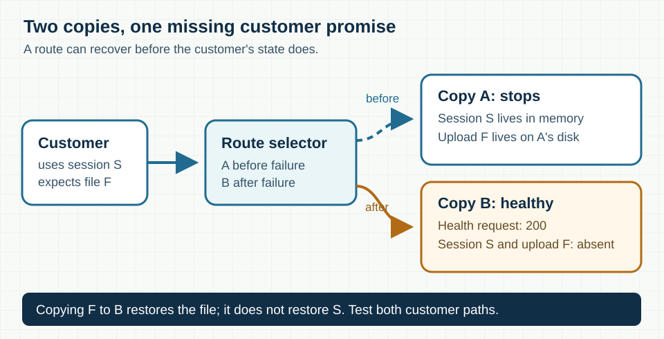

# A second server is not a second memory

Imagine Maya's older scheduling application running on server A. It remembers sign-ins in its own memory and puts a customer's uploaded ticket photo on its own disk. A second running copy, B, answers a health request. Maya adds a route selector so B can receive traffic when A stops. The customer then asks for the photo. What does B actually know?



This [Unit 07 lesson](../../reader/BOOK-LOCATORS.md#book-7cfd6a932c7d812e) addresses a partial SAA-C03 resilience skill: improve a legacy application's availability within real constraints. The [official Task 2.2](https://docs.aws.amazon.com/aws-certification/latest/solutions-architect-associate-03/solutions-architect-associate-03-domain2.html#solutions-architect-associate-03-domain2-task2) includes legacy reliability choices. This is an original teaching lab, not an official exam question.

## Predict before running

Write four predictions: Will B return HTTP 200 for `/health` after A stops? Will A's old session cookie work on B? Will B have the uploaded file? If an operator can recover a copy of the file onto B, will that also recover the old sign-in? Explain each answer without using “the load balancer handles it” as a substitute for a state path.

From the repository root, run:

```sh
python3 examples/legacy-session-failover/legacy_failover.py
python3 -m unittest discover -s examples/legacy-session-failover -p 'test_legacy_failover.py' -v
```

The standard-library program starts three HTTP servers bound to `127.0.0.1`: two application copies and a tiny route selector. It creates two separate temporary folders. On A, a local toy login issues an opaque cookie and an upload writes one file. It stops A's HTTP server, selects B and makes the same requests. It then copies the file from A's still-readable temporary folder to B and tries again. Finally, a new B login reads the copied file. The servers, threads and temporary folders close when the run ends. No AWS credentials, external endpoint or paid service is involved.

| Result field | Expected local observation | What it means |
| --- | --- | --- |
| `standby_health_after_switch` | `200` | B's process answers a health request. |
| `old_session_on_B` | `401` | B never received A's in-memory session. |
| `file_on_B_before_copy` | `false` | B's disk does not contain A's upload. |
| `file_on_B_after_copy` | `true` | This one file was copied; no ongoing synchronization is modeled. |
| `old_session_after_file_copy` | `401` | File recovery did not copy the session. |
| `new_session_file_after_copy` | `200` | A fresh B session can read the copied bytes. |

The four focused tests check customer-path requests and the separate file/session effects. They also check that a selected unavailable target gives this *toy proxy* 503, and that its local inventory endpoint requires an operator header. That header is a fixture marker, not real operator authentication. The toy `/login` is not Cognito or a safe production login. The same host retains A's temporary folder after A's HTTP service stops; a destroyed machine might make that file unrecoverable. This run does **not** reproduce Application Load Balancer routing, sticky-cookie encryption, target-health intervals, an all-unhealthy fail-open, distributed storage, real identity or a multi-AZ failure.

## Choose a bounded improvement

AWS [target-group stickiness](https://docs.aws.amazon.com/elasticloadbalancing/latest/application/edit-target-group-attributes.html) can send a returning client to the same healthy target; AWS says it selects another healthy target if that one fails. That route behavior cannot recreate target-local memory or disk. AWS also documents [ALB fail-open behavior](https://docs.aws.amazon.com/elasticloadbalancing/latest/application/target-group-health-checks.html) when all registered targets are unhealthy. Keep an application authorization check and safe failure response separate from target health.

Compare these options under a **no-source-change** constraint. First, ask whether the vendor supports a shared session store and durable shared file interface; if it does, test the exact client, file and failure paths. Second, if it does not, consider a supported active/passive mode with a tested backup/restore and a realistic interruption promise. Sticky routing may smooth normal use but is not a recovery mechanism for local state. A policy that permits users to sign in again may address a lost session, if the business approves that experience; it cannot excuse a missing confirmed attachment. The right choice depends on vendor support, retention, access, recovery time, cost and measured behavior, not on a service name.

Change the case: A's disk is destroyed and no independently retained file copy exists. Can the lab's copy step run? What evidence would justify saying the confirmed attachment is recoverable? Change it again: B has the file but the business forbids forced sign-in during ordinary instance replacement. What supported state design or revised promise is needed? For each answer, name the customer operation, the state owner, a denial or failure check, the full-run cost meters and a cleanup plan. Do not invent a vendor feature or a measured AWS recovery time.

Ask Codex to draw the request and state paths separately, then challenge one assumption in your first design. Compare its AWS-specific claims with the cited documentation and the observed local responses. Record your original choice, AI assistance and revised changed-case answer separately. The [assessor notes](ASSESSOR.md) are for after that attempt.
