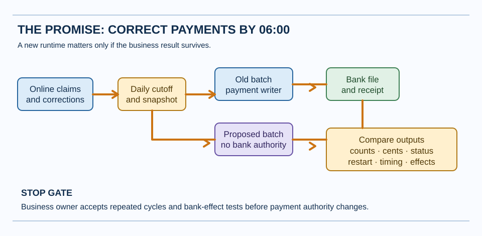

# Mainframe modernization: keep the claim correct at dawn

Maya's insurer closes its repair-claim books every night. Staff enter and correct claims through an online application during the day. A scheduled batch reads those records, pays eligible claims, holds suspicious ones and sends a settlement file to a bank before 06:00. The business promise is **correct payments by 06:00**, not merely that a program starts on a new computer.



## First principles: discover the contract before choosing a target

A mainframe is a system of programs, data formats, schedules, operators and partners. Moving one program without those connections is like moving a kitchen and forgetting the food deliveries. Ask the claims owner and operators to produce this inventory before naming an AWS service:

| What to inventory | The question Maya must answer | Evidence to collect |
| --- | --- | --- |
| Online transactions | Which screen creates, amends, reverses and releases a claim? | Transaction list, user roles, sample before/after records |
| Batch chain | Which job waits for which file, and what happens on a restart? | Job control, schedule, return codes, restart procedure, peak duration |
| Data contract | Are files fixed-width, EBCDIC, packed decimal, VSAM or Db2? What is each field's meaning? | Copybooks/schema, encoding rules, representative authorized test records |
| Outside connections | Which bank, partner, message queue or reporting system expects a file at a fixed hour? | Interface owner, format/version, delivery receipt, failure and replay rules |
| Operations and rights | Who may run, rerun, approve and audit the batch? What software is licensed? | Runbook, security model, license and support terms |
| Business acceptance | Which counts, money totals, holds and reversals must match? | Signed comparison rules and stop conditions |

The architecture sketch deliberately draws a boundary at the normalized comparison. Its CSV sample is **already decoded business data**. It does not model COBOL, JCL, CICS, VSAM, Db2, EBCDIC, packed decimal, bank transport, restart behavior or real platform compatibility.

## Choose a modernization route

| Route | When it may fit | Decision that can defeat it |
| --- | --- | --- |
| Retain and improve interfaces | The current batch is dependable and change risk is greater than benefit. | It leaves platform dependence and existing operating cost in place. |
| Replatform through an eligible vendor-direct runtime | Preserve much of the application behavior while changing execution platform. | Verify vendor eligibility, licensing, file and transaction compatibility, operations and total cost. |
| Refactor a bounded business function | Change code and data model where a clear seam, owner and comparison oracle exist. | Conversion output still needs business, integration, performance and recovery acceptance. |
| Incrementally extract one function | Claims inquiry, for example, can be read from a reconciled projection before payment authority moves. | Two active writers, stale projections or an irreversible bank effect make the seam unsafe. |

The generic server-rehosting path is **not** a shortcut for a z/OS workload. As of the October 27, 2026 source check, AWS states that both its Mainframe Modernization managed runtime and self-managed experience are closed to new customers; existing customers can continue. A new customer should assess current vendor-direct options and [AWS Transform for mainframe](https://docs.aws.amazon.com/transform/latest/userguide/transform-app-mainframe.html), with the target runtime, Region, data handling and price checked at decision time. AWS describes a staged [assess, mobilize, migrate/modernize, operate](https://docs.aws.amazon.com/transform/latest/userguide/transform-app-mainframe-modernization-journey.html) journey; that is a planning structure, not evidence that Maya's batch will be equivalent. See the [availability notice](https://docs.aws.amazon.com/m2/latest/userguide/mainframe-modernization-availability-change.html).

**Maya's first decision:** retain the payment writer while she pilots a claims-inquiry projection and a parallel, nonpaying batch comparison. She rejects a big-bang payment cutover because the bank file and restart behavior have no tested target equivalent. She may later replatform or refactor after the contracts above are measured. This is a scenario choice, not a universal prescription.

## Try the local comparison

From the repository root:

```sh
python3 examples/mainframe-modernization/reconcile.py examples/mainframe-modernization/source.csv examples/mainframe-modernization/candidate.csv
python3 examples/mainframe-modernization/reconcile.py examples/mainframe-modernization/source.csv examples/mainframe-modernization/candidate-defect.csv
```

The first normalized output matches. The second incorrectly pays a held claim and must fail. The comparator checks unique claim IDs, exact cents, status, missing and extra records. It is intentionally smaller than the real acceptance gate.

**Your turn:** A correction arrives at 00:01, one minute after the source snapshot, and the bank has already received yesterday's file. Write (1) the owner and rule for this late correction; (2) how a target rerun avoids a second bank payment; (3) a comparison plan for counts, cents, held claims, reversals and delivery receipts across at least three representative cycles; (4) the stop and rollback decision if one payment differs. State whether your proposed target is still read-only, permitted to produce a bank file, or the sole payment writer. Do not call a matching CSV a cutover pass.

## Evidence before payment authority moves

Use real, authorized and protected test data; decode source records with reviewed layouts and encoding; compare source and target business outputs; test changed and rejected records, job restart, duplicate suppression, bank acknowledgement, volume at the deadline, security and audit access, recovery and operator handoff. Keep the old writer authoritative until the business owner accepts the target and a rollback or forward-repair plan handles effects already sent to the bank. A rollback cannot unsend a bank file.

Codex can help inventory code and job dependencies, draft a comparison harness, surface missing cases and challenge the cutover plan. Give it redacted inputs and verify generated mappings with the people who own record layouts and payment rules. It cannot certify equivalence from a code conversion, green local fixture or architecture diagram.

**Cost boundary:** this lesson creates no AWS resources. A real pilot must price runtime, conversion work, parallel running, storage/transfer, vendor licensing and support before authorization; budget and cleanup rules for the personal AWS account are recorded in the project controls, not assumed to apply to readers.

For a separate worked answer and failure analysis, use [the assessor](ASSESSOR.md).
