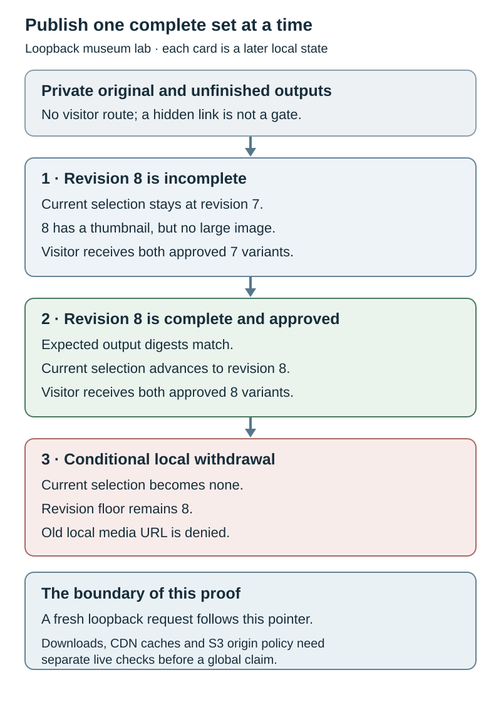

# A05 Museum media publication

This original design study expands [A05](../../curriculum/ARCHITECTURE-STUDIES.md#a05-media-distribution). It is not a deployed architecture, codec implementation or rights-clearance process. All people, files and observations below are fictional. Use synthetic media for any later implementation.

## The visitor sees the exhibition, not the storeroom

A museum receives an original photograph and prepares a thumbnail and a larger web image. The original can contain private annotations or material that has not been approved. Upload completion therefore means “received,” not “ready for visitors.” A converter creates candidate images; an authorized reviewer approves a particular set; a publisher makes that approved set discoverable.

The museum requires both web sizes to refer to the same approved source revision. A failed conversion must leave the previous complete publication usable. A late job for yesterday's upload must not overwrite today's approved result. Originals must remain inaccessible through the public distribution and direct unauthenticated storage access. These are acceptance requirements, not observed results.

```text
Staff upload
    |
    v
PRIVATE original revision
    |
    v
Converter -> PRIVATE candidates
                    |
                    v
           Review exact revision
                    |
                    v
           Publisher checks set
                    |
                    v
          Approved public copies
                    |
                    v
          Distribution -> visitor
```

Use separate private source/candidate storage and published-copy storage in this candidate design. Separation makes intended authority easier to inspect, but bucket names alone enforce nothing. The converter needs its source and output paths; it does not need publication authority. The reviewer approves a source revision and candidate manifest, not merely a filename. The publisher verifies that approval and the complete output set before changing the publication record. The distribution may read approved copies; it must not have a route or grant to the private originals.

## Choose delivery from the actual need

For a tiny internal preview, authenticated direct object delivery can be a simpler candidate. It still needs access control, expiry behavior and a cost estimate. For this public exhibition, an edge distribution is the candidate because visitors need repeated delivery of approved media from different locations. That choice adds cache configuration, origin restrictions, deployment propagation and another operating boundary. Compare request volume, geography, latency and total cost before implementation; this paragraph is not a benchmark or price claim.

For a CloudFront distribution backed by a regular S3 bucket origin, AWS documents Origin Access Control and a bucket policy restricted to the intended distribution. An S3 website endpoint is a different origin type and does not support that OAC path. The proposed origin grant should cover published objects only. OAC authenticates origin requests; it does not decide which private museum draft deserves publication. [AWS origin-access guidance](https://docs.aws.amazon.com/AmazonCloudFront/latest/DeveloperGuide/private-content-restricting-access-to-s3.html).

Before implementation, also review viewer HTTPS, response headers appropriate to the served content, input validation, request filtering, abuse response and traffic-cost monitoring. Select any additional protection from requirements and current pricing; no paid security subscription is a prerequisite for this paper exercise.

## Publish a complete set with stable identities

Record source revision, conversion recipe, expected variants, output digests, approval identity and publication revision. Give each published variant a versioned path. AWS distinguishes this file-naming technique from S3 bucket versioning: a new path lets consumers request the new object rather than rely on replacement of cached bytes at an old path. [AWS file-versioning guidance](https://docs.aws.amazon.com/AmazonCloudFront/latest/DeveloperGuide/UpdatingExistingObjects.html).

Versioned paths alone do not make a complete release. Prepare and verify both variants first, then update a publication record that refers to the complete set. Readers should follow one record revision instead of independently guessing a “latest” thumbnail and “latest” large image. Define how that record is cached and refreshed. Some visitors can still see the prior complete revision during propagation; that differs from seeing a broken mixture. A global simultaneous switch is not assumed.

A conversion retry must identify the same source revision and recipe. A duplicate completion must not publish twice, and an older job must not replace a newer approved publication. Require an expected-current-revision check or equivalent coordination at the publication boundary. A local database transaction could demonstrate that invariant, but would not prove atomic publication across storage, database and edge systems.

## Recovery and withdrawal are different decisions

If the new conversion fails, retain the earlier complete publication and investigate the candidate privately. If a previously published image must be withdrawn, switching the page reference is insufficient: visitors may retain its old URL or a downloaded copy. Define the required withdrawal scope, access behavior, cache handling, retention and verification before promising a deadline. An invalidation or origin deletion cannot retract an image already saved by a visitor.

Retain a prior revision only while its content remains authorized and its recovery purpose remains valid. A known privacy problem is not a good rollback target merely because it loads successfully. Record which originals, candidates, approved copies, publication records and logs remain, why they remain and who owns their removal.

Estimate original and variant storage, conversion attempts including retries, requests, delivery volume, logs, cache-management actions and retained revisions using current prices. Bound traffic as well as runtime: a public URL can attract requests after staff stop working. Any future live exercise needs scoped non-root access and verified teardown. Choose whole-run spending and reserve limits for the account you will use. This study creates no resources.

## Review packets before reading the assessor notes

1. Revision 8 has a valid thumbnail but failed large-image conversion. Revision 7 is complete and still authorized. An engineer suggests publishing the new thumbnail immediately. State the violated requirement and the evidence needed to release revision 8.
2. Revision 8 is published. A delayed completion for revision 7 arrives with a valid old approval. Explain why approval validity alone cannot authorize replacing the current publication.
3. Direct anonymous access to an original returns 403, but the same original is readable through the distribution. Which boundary failed? Does adding OAC by itself repair the publication scope?
4. The publication record moves to revision 8, but a visitor's browser still displays revision 7. What can be inferred, and what must be inspected before calling this a broken conversion or successful global withdrawal?
5. A staff member requests withdrawal of revision 8 because its caption exposes private information. Revision 7 contains the same caption. Choose a containment/recovery direction and identify what cannot be undone remotely. Do not claim a completed privacy response.

For transfer, make the exhibition members-only. Revisit viewer authorization, shared-cache behavior, URL access and revocation requirements; origin protection alone does not establish member access. Write your first answer, ask Codex to trace a bypass from visitor to original, and retain your revision separately. Then consult [assessor notes](ASSESSOR.md).

## Observe the local publication boundary

After the design review, run `python3 examples/media-publication/lab.py` from the repository root. It requires only Python's standard library. Synthetic byte strings stand in for converted images; a temporary SQLite database holds the selected publication manifest. There is no image processing, network listener, AWS credential use or cloud charge.

Predict which publication remains visible when the large variant is absent, when a manifest lists only the thumbnail, when the approval belongs to an older manifest, and when output bytes change after approval. Each failure must preserve revision 7. An injected exception after the database update but before commit must also preserve it. A fresh connection reads the resulting record instead of trusting the publisher's return value.

When both revision 8 variants match the approved manifest, the publication record advances once. An old completion using an outdated generation is rejected. Even an old job supplied with the current generation cannot regress the fixture's monotonically increasing revision. Replaying revision 8 also leaves the record unchanged. This conservative policy has no intentional rollback action: a real recovery procedure needs its own authorization and compatibility rules rather than disabling the stale-job check.

The final check starts two independently approved publishers with separate SQLite connections. Both observed generation 2, but only one may advance it to generation 3. The other receives a stale-publication result; a fresh reader verifies the winner's entire manifest and output set. Either revision 9 or 10 may win. The test does not claim that the larger revision always publishes first or that lock acquisition is fair.

The losing job needs a new decision, not an automatic retry with a freshly read generation. If revision 9 won, publishing revision 10 next could be appropriate after reviewing the intervening state. If revision 10 won, revision 9 must not replace it. In a real workflow, approval expiry, withdrawal and changed business intent also need reconsideration. Optimistic concurrency means “apply only if the version I reviewed is still current”; it does not decide what the next authorized change should be.

The approval is a locally computed digest, not an authenticated reviewer signature. Objects are an in-memory dictionary held unchanged during the competing calls; the database transaction does not freeze an external object store. The exercise does not test concurrent object mutation, every publisher interleaving, origin permissions, propagation, cache withdrawal, image safety or whether a real converter used the claimed source. SQLite serializes these writers; do not infer a managed database's behavior or throughput from this result. The private-original comparison only checks fixture manifest content; it is not an access-denial test.

For a changed-case exercise, explain what happens if a published object disappears after the transaction commits. Identify the retention and immutability controls, read-path observations and recovery evidence needed in a real implementation. Ask Codex to locate where the local transaction's guarantee ends, then verify its explanation against the code.

## Follow the visitor path

The publication transaction answers, “May this complete set become current?” A visitor asks a different question: “What bytes does the current public route give me?” Run the second standard-library lab from the repository root:

```sh
python3 examples/media-publication/read-path-lab.py
```

It starts a loopback-only HTTP server on a temporary port and sends real local requests. `/current` names the selected revision and its two variant URLs. `/media/<revision>/<variant>` serves only a variant named by that current record, and only while its bytes still match the approved digest. There is no generic file server. The invented `private/original` key has no visitor route. Before any selection, `/current` returns 410. An incomplete revision 8 stays hidden while complete revision 7 remains available. Once revision 8 is approved, fresh requests for revision 7 return 404. If the selected large bytes change, its request returns 503; the thumbnail still returns its unchanged bytes. A withdrawal with an outdated generation is rejected. A current withdrawal returns 410 from `/current` and 404 for the previously selected local media URL. The highest revision remains recorded, so an old approved job cannot republish it as a new revision.



This fixture keeps its objects in a Python dictionary and writes its selection in temporary SQLite. It has no real images, converter, authenticated reviewer, object-store permission, CDN or browser cache. An HTTP 404 from this handler is not proof that direct S3 access or an alternate distribution path is denied. The handler sends `Cache-Control: no-store` to simplify local observations; it does not demonstrate propagation or revocation of a previously cached or downloaded copy. The in-memory object mutation is sequential, not a concurrency or immutability test. The server and database are removed after the lab; no cloud resource or credit is used.

For transfer, suppose revision 8 is withdrawn but a viewer already saved its URL and a CDN still has a copy. Draw the path for a **new** visitor request and the path for an **already downloaded** file. Which observation would support a claim that new access has stopped, and which effect can no longer be undone remotely? Ask Codex to trace every path that bypasses `/current`; then compare its list with the architecture drawing and the limits of this local lab before claiming a withdrawal deadline.

## Let a retained copy challenge the withdrawal claim

Imagine the museum removes a photograph after discovering that its caption exposes a customer's address. The museum's own desk now refuses the photograph. A visitor may still have a copy from a delivery shelf that has not checked the desk again. A second visitor may have saved the bytes yesterday. These are three places to inspect, with three different answers.

Before running the next exercise, predict what each path returns immediately after withdrawal and after the shelf's invented 60-second lifetime expires:

| Path in this local exercise | Question to answer |
| --- | --- |
| Direct loopback origin | Does the current publication pointer still authorize revision 8? |
| Proxy respecting `no-store` | Does it ask the origin again after withdrawal? |
| Proxy holding a deliberately cacheable response | Can it return revision 8 without asking the origin yet? |
| Already saved byte copy | Can a later server response erase those bytes? |

Run `python3 examples/media-publication/cache-boundary-lab.py` from the repository root. It uses two loopback origins with the **same** temporary SQLite publication record and synthetic bytes. The ordinary origin sends `Cache-Control: no-store`; the teaching variant sends `public, max-age=60`. Two small local proxies follow those headers. The script advances a supplied clock to second 61 instead of sleeping. It shows the origin returning 404 after withdrawal, the `no-store` proxy missing and returning 404, and the deliberately cacheable proxy still returning its earlier 200 bytes until the simulated lifetime ends. The saved byte string remains afterward. No AWS credentials, cloud resources, browser or CDN are used.

The negative control matters: a 404 at the origin cannot prove the cached visitor path has stopped. The opposite result matters too: an intermediary that respects `no-store` asks the origin again in this fixture. A real distribution can have additional invalidation, path, header and propagation behavior, while a real visitor may have other copies. This lab is a **local HTTP model**, not a measurement of CloudFront or an assertion that every cache will behave this way. Do not promise a public withdrawal deadline from its invented 60 seconds.

**Change one fact:** the museum discovers that revision 7 contains the same private caption. Should the operator point `/current` back to 7 after withdrawing 8? Decide which revision, if any, may be served; then list the origin, every distribution path and already issued links or copies that need separate evidence. Ask Codex to claim that the origin's 404 proves the incident is over, and use the four observations above to correct it. Keep the first answer, AI critique and revised decision separate before opening the [assessor](ASSESSOR.md).
