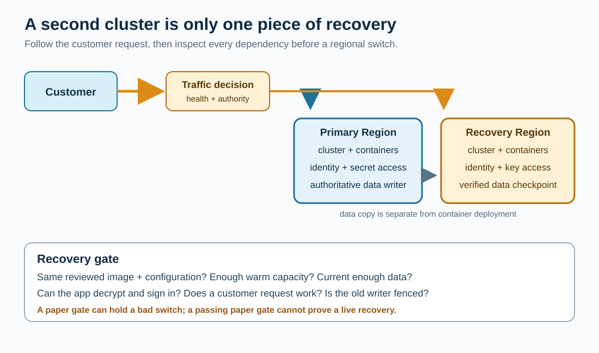

# Two container clusters, one customer promise

Maya's booking application runs in a primary Region. The platform team has created a second container cluster in a recovery Region and says, “We have disaster recovery.” Maya asks a better question: **Can a customer make a correct booking there within 30 minutes, without losing more than five minutes of confirmed work?**

This offline design lab addresses [SAP-C03 skill 4.2.6](https://docs.aws.amazon.com/aws-certification/latest/solutions-architect-professional-03/solutions-architect-professional-03-domain4.html). The [illustrated recovery path](figure.svg) shows why a second cluster alone is insufficient. Read [the recovery lesson](../../reader/BOOK-LOCATORS.md#book-20703bba15f79b2d) and [the container lesson](../../reader/BOOK-LOCATORS.md#book-8444a5a7a3bbe0d5) first. No AWS account, EKS/ECS cluster, traffic switch or credit is used.



## Name the pieces before choosing a service

For each Region, draw its cluster, compute capacity, same reviewed image digest and configuration, ingress, workload identity, secrets and encryption keys, data store, health observer and logging path. Draw the mechanism that makes the data available in the recovery Region. Draw the actor and rule that stops the old Region from continuing to accept writes after a switch. Say who can initiate and reverse the traffic decision.

AWS describes multi-Region [EKS operating patterns](https://aws.amazon.com/blogs/containers/operating-resilient-workloads-on-amazon-eks/) and a [cross-Region backup-and-restore example](https://aws.amazon.com/blogs/containers/cross-region-disaster-recovery-for-amazon-eks-using-aws-backup/). These are examples, not proof that Maya's workload meets its promise. The chosen ECS or EKS mechanism, data service and route must be verified for its current behavior and price.

## Six changed-condition cases

For each case, write **customer effect; missing boundary; immediate decision; observation required before a traffic switch; rollback or failback risk; and recurring/rehearsal cost**.

1. **Ready cluster, stale data.** The second cluster serves its health URL and has the right image, but the most recent confirmed booking in the copied database is 12 minutes old. Maya's maximum loss promise is five minutes. Should traffic move? What must the application show to make the data-loss decision explicit?
2. **Ready data, sleeping capacity.** The copied data is current enough, but the recovery workers are scaled to zero. The 30-minute target includes scaling, pulling images, warming connections, secret access, DNS/client behavior and a first correct customer response. What would a timed rehearsal need to record?
3. **Old writer returns.** The primary Region becomes reachable after traffic has moved. A background worker resumes issuing booking confirmations. Name the write authority or fencing check that must refuse it. What might “switch DNS back” miss?
4. **Different image or key.** The target cluster has an old image digest and cannot decrypt a replicated booking. The load balancer reports healthy. Identify the false green signal and the exact negative and positive requests to run.
5. **Only one app fails.** The booking API is broken in the primary Region, while the repair-photo application remains healthy. Should both applications shift? Describe application-specific health and traffic choice, plus the shared dependencies that might still couple them. [AWS's multi-Region EKS example](https://aws.amazon.com/blogs/containers/implementing-granular-failover-in-multi-region-amazon-eks/) illustrates per-application routing; verify its fit before copying it.
6. **Location and cost change.** A new rule bars booking data from the proposed recovery Region, and the warm cluster has an ongoing bill. Redesign the promise and compare a permitted Region, a slower backup/restore option or a deliberate single-Region recovery plan. Do not solve cost by quietly violating the location rule.

## Run the local gate

The JSON is a fictional review card, with a deliberately stale data checkpoint. Predict the outcome, then run from the repository root:

```sh
python3 examples/multi-cluster-recovery/lab.py
python3 -m unittest discover -s examples/multi-cluster-recovery -p 'test_*.py'
```

Change `data_checkpoint_within_rpo` to `true` and rerun. The result becomes a **candidate for an observed drill**, not a proven recovery. Then set `old_writer_fenced` to `false` and rerun. The gate holds again. The program does not emulate AWS networking, replication, orchestration, customer behavior or elapsed time; it refuses to promote a paper pass into an RTO claim.

Before a real experiment, price the full steady-state and rehearsal path: cluster/control plane as applicable, running or warm compute, image copies, storage/replication, transfer, keys, health checks, logs, DNS, backups and retained resources. You do not need two paid clusters to learn this architecture. Use a bounded local rehearsal first and seek a separate cost and deployment review if cloud evidence becomes necessary.

Ask Codex to attack your first diagram: find a hidden dependency, a false green health check and a path that permits two writers. Require primary AWS sources for service claims. Compare your answer with the [assessor](ASSESSOR.md) after you decide; neither Codex nor the paper gate can certify a live RPO or RTO.
