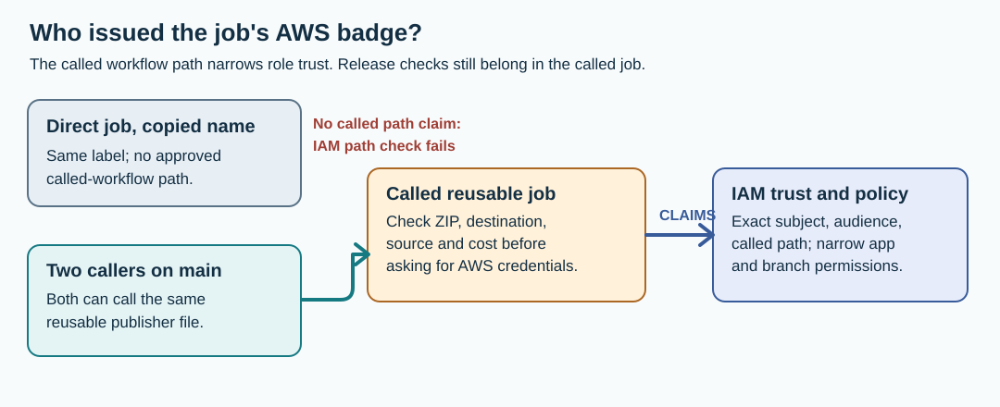

# Which workshop gave this job its AWS badge?

**Source candidate, October 25:** The checked-in caller now invokes `reusable-amplify-publish.yml`; that file builds its own artifact in a job without AWS credentials, then runs a separate credential-bearing job with the publication, artifact, source, cost and destination gates. Terraform source requires the called file's `job_workflow_ref` in addition to the publisher name, immutable caller subject and AWS audience. `actionlint` and local source tests can check this arrangement, but no real token, IAM plan, installed trust or allowed/denied STS result has verified it. The installed role remains the older branch-subject trust. The steps below describe the remaining migration and verification, not a completed cloud change.

Maya tells the guard to admit a delivery worker named “Publish the Amplify lab frontend.” Another worker writes the same name on a badge. A name-only guard checks a label, not which workshop issued it. The earlier source candidate used that name check. The [current exercise](README.md) shows that the new called-path check rejects a direct copied-name job, while a different caller of the approved reusable file remains possible. The installed AWS role was last observed with only repository/branch and audience conditions. Source changes are not an observed live repair.

AWS lists `token.actions.githubusercontent.com:job_workflow_ref` as an IAM trust condition key. GitHub defines the claim for **jobs using a reusable workflow**: it identifies the *called* workflow's repository, file and ref. The previous direct publish job could not be assumed to carry that claim. The source now moves the build and credential-bearing jobs into one reusable workflow, but its exact issued claim still needs observation before any IAM apply. [AWS GitHub OIDC condition keys](https://docs.aws.amazon.com/IAM/latest/UserGuide/reference_policies_iam-condition-keys.html#condition-keys-wif), [GitHub reusable-workflow OIDC behavior](https://docs.github.com/en/actions/how-tos/secure-your-work/security-harden-deployments/oidc-with-reusable-workflows).

## Compare two bounded choices

| Choice | What it checks | Useful limit | Remaining failure or cost |
| --- | --- | --- | --- |
| Retain the earlier name-only source candidate | Exact immutable-repository/`main` subject, AWS audience and `workflow` name | A differently named workflow is excluded by the proposed trust | A same-repository workflow can copy the name; the installed role has older trust until changed and read back. |
| Use the checked-in reusable job and require its `job_workflow_ref` | Exact subject and audience, caller name, plus the called workflow's file/ref | A direct copied-name workflow without the approved called path fails the new source condition | A different caller on the same trusted branch can call the approved reusable workflow. The called build creates the artifact from the checked-out commit; the next job checks source, artifact, destination, cost and publication gates. Source writers can still change a branch-referenced workflow. |

For a **fictional** `paper-owner@101/cloud-lab@202` repository, the second design might compare `sub=repo:paper-owner@101/cloud-lab@202:ref:refs/heads/main` and `job_workflow_ref=paper-owner/cloud-lab/.github/workflows/reusable-publisher.yml@refs/heads/main`. Those are teaching strings, not this account's token or a policy ready to apply. Confirm the exact emitted claims before writing IAM trust. AWS's identity-provider controls accept `sub` or `job_workflow_ref` for GitHub; keeping the exact immutable subject as a second condition preserves the caller-repository and branch boundary in this design. [AWS shared-OIDC controls](https://docs.aws.amazon.com/IAM/latest/UserGuide/id_roles_providers_oidc_secure-by-default.html).

The reusable file is a **workflow path**, not a safety certificate. A malicious or mistaken caller that is allowed to invoke that file could pass the IAM path check. The called build makes the artifact, and the publish job must refuse a mismatched artifact, wrong app or branch, stale source, missing cost review or disabled publication switch **before** assuming a role or making a write. IAM must still limit the role's actions and resource ARNs. Turning the switch off stops future gated jobs; it does not revoke an existing STS session. Review who can edit the caller and called workflow, who can change GitHub variables and secrets, and which branch protection or environment rules apply. A commit hash for the reusable workflow would give a different update contract from `@refs/heads/main`; do not assume one without choosing how updates are reviewed.

## Work seven changed cases before reading the assessor

For each case, record: **token claim expected**, **which proposed trust accepts**, **what remains possible after assumption**, and **the first missing observation**. Do not open [the assessor](WORKFLOW-PATH-ASSESSOR.md) until you have written those four columns.

1. A direct workflow on trusted `main` copies the publisher name but never calls the reviewed reusable file.
2. The reviewed caller invokes the reusable publisher on `main`; its job has the expected `job_workflow_ref`, but dependency code changes the page during the called build before the ZIP is hashed.
3. Another workflow on the same trusted `main` calls the *same* reusable file. It cannot supply a ZIP because the called build creates one; which remaining inputs and source-writing powers matter?
4. A caller on `feature` invokes the reusable file at `main`; the called path matches, but the caller subject names `feature`.
5. The direct job still has the right name and branch, but no `job_workflow_ref` claim is present when the new path condition is installed.
6. The approved job obtained a 15-minute session; a maintainer sets the publication variable to `false` one minute later.
7. A new repository takes the old owner/repository names after a rename but has different immutable IDs. Its workflow file has the same path spelling and publisher name.

## Migration without pretending a diagram is a deployment

1. Inventory all jobs and roles using the present OIDC subject, including the read-only probe. Record the **installed** trust and effective attached/inline policies separately from Terraform source. Keep the publisher variable false and the whole-run cost record pending.
2. Review the checked-in reusable job and caller as one change. The caller retains manual and branch gates; the called job repeats artifact, destination, current-account and stop checks. Verify the probe still has a separate read-only role in source. GitHub source review is not AWS installation.
3. In a controlled **non-publishing** diagnostic, observe the actual token's `aud`, immutable `sub` and `job_workflow_ref` for the called job. Do not save or publish the signed token. Compare exact values with the proposed trust and preserve only nonsecret claim evidence. GitHub's OIDC reference distinguishes the reusable-workflow claim from the ordinary `workflow` name. [GitHub OIDC reference](https://docs.github.com/en/actions/reference/security/oidc).
4. Review a Terraform plan for the intended trust and permission changes. Stage the caller/called-workflow change and IAM update in an order that avoids accidental lockout or an overbroad overlap; verify the final IAM trust readback. A local JSON comparison cannot establish how STS evaluates a real token.
5. Make safe allowed and denied role-assumption probes: approved called job, direct copied-name job, wrong branch and probe role. Then separately inspect effective publication permissions. Do not use a successful read-only `GetJob` as evidence that a write is properly bounded.
6. Before considering a separately reviewed publication, check the current account plan, whole-workload estimate, the account owner's chosen run limit and reserve, gross budget and cleanup plan. This lesson performs no AWS write; a dated budget or local comparison cannot authorize publication by itself.

**Use Codex as a challenger.** Ask it to trace the caller, called file, issued claims, IAM trust, role policy, built ZIP and cost gate. Require one copied-name attack and one different-caller-to-same-reusable attack. Check its AWS and GitHub claims in the current primary sources. A plausible policy snippet or green local exercise is not an observed token, STS result or deployed customer page.
