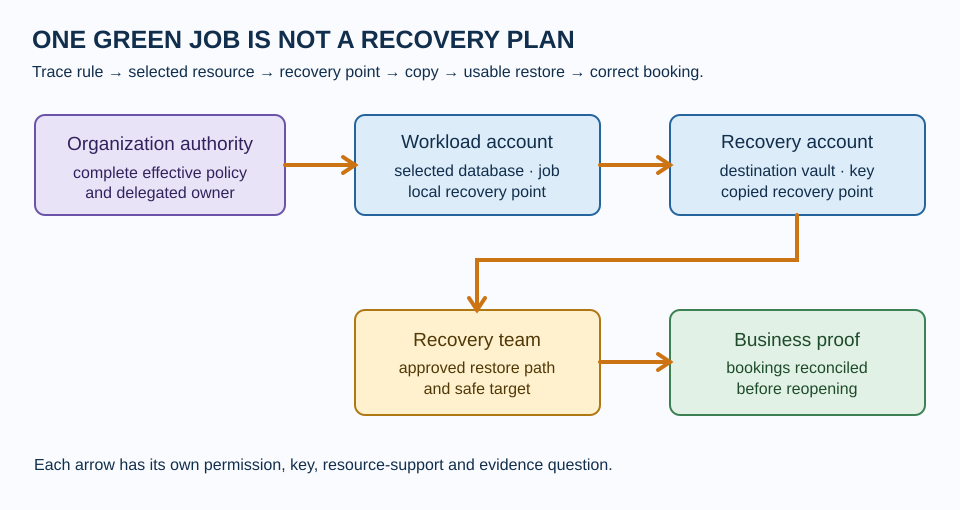

# Who can still restore when the workload account fails?

Maya's booking database lives in a workload account. Its backup dashboard shows a green job. Then an attacker gains broad control of that account and deletes the running database. Maya asks a harder question: **can a separate recovery team find a usable copy, restore it, and prove the bookings are correct without trusting the damaged account?**

## Three different controls

Think of an organization backup policy as a rulebook sent to accounts. The **effective policy** is the combined rulebook an account receives after root, OU and account inheritance. A backup job is a run of that rulebook. A **recovery point** is the stored result. A green job does not say that a recovery point reached the separate account, that its key works, or that a restored booking is correct.

| Layer | Owner and design question | Evidence to ask for |
| --- | --- | --- |
| Organization rule | Management account enables AWS Backup integration; an explicitly delegated backup administrator manages policy where permitted. Does the effective policy cover this account and Region? | Effective policy for each representative account, attachments, service opt-in, required IAM role and vault existence |
| Workload selection | Does the policy select the database by resource type or tag, with the right schedule and retention? | Resource inventory, selection match, latest job status and recovery point age |
| Independent copy | Can a supported recovery point copy to a vault in a separate account? | Copy job and destination recovery point, vault access policy, encryption/key permissions and retention |
| Recovery authority | Who can perform a restore into a clean recovery environment? | Approved operator identity, destination/key/network prerequisites, restore job and customer-record reconciliation |

These controls are separate. AWS says an Organizations backup policy must produce a **complete effective policy** with all required elements; otherwise affected resources may not be backed up. Policy-created plans appear as immutable plans in member accounts, but required vaults and roles still need to exist. The management account can delegate some backup administration, but a delegated administrator does not become the management account or override other members' service opt-in. See [Organizations backup policies](https://docs.aws.amazon.com/organizations/latest/userguide/orgs_manage_policies_backup.html), [policy best practices](https://docs.aws.amazon.com/organizations/latest/userguide/orgs_manage_policies_backup_best-practices.html) and [cross-account management](https://docs.aws.amazon.com/aws-backup/latest/devguide/manage-cross-account.html).

## Choose the copy path carefully

Maya proposes a source vault in the workload account and a destination vault in a recovery account in the same Organization. AWS Backup cross-account copy must be enabled by the management account. The destination vault access policy needs the supported `backup:CopyIntoBackupVault` permission for the source; that permission is **for copying**, not a general cross-account restore grant. The copy also needs support for the selected resource and a usable encryption path. AWS-managed keys can prevent cross-account copies for resource types not fully managed by AWS Backup; use a compatible customer-managed key path or a documented service-specific route after checking the selected resource. A standard copied recovery point may need to be copied back to the source account before restoring; design a clean recovery-account path explicitly rather than assuming every vault policy permits direct restore. See [cross-account copies](https://docs.aws.amazon.com/aws-backup/latest/devguide/create-cross-account-backup.html) and [backup encryption](https://docs.aws.amazon.com/aws-backup/latest/devguide/encryption.html).

An alternative is a logically air-gapped vault where supported. It has different lock, key and AWS RAM sharing behavior, and a shared vault can support a restore by a different account. That does not remove the need to check resource/Region support, recovery identity and an actual restore. Compare it with the standard copy design rather than treating the two vault types as interchangeable. See [logically air-gapped vaults](https://docs.aws.amazon.com/aws-backup/latest/devguide/logicallyairgappedvault.html).

**Design choice for this case:** use the standard separate-account copy as the baseline because the team first needs to demonstrate policy inheritance, copy permissions and a restore route. Consider a logically air-gapped vault if its supported resource set and recovery workflow fit the threat model. Reject a same-account-only backup as the sole recovery boundary for the compromised-account scenario. This is an architecture exercise; no Organization or backup resource was created.

## Tabletop: change one fact at a time

Write an evidence packet for each case. Name the first broken control, who can repair it, which existing recovery points remain usable, and what test proves recovery. Do not invent a successful restore.

1. The management account has a complete root policy. A child OU policy changes its schedule, but the effective policy for one member no longer contains the required selection. The member's old green job is from before the change. What would you inspect before claiming coverage?
2. A database loses the tag used by the backup policy. Its most recent source recovery point is 25 hours old, and the business accepts at most one hour of data loss. The destination account still has yesterday's copy. Does the policy's existence satisfy the promise?
3. The source job succeeds, but a cross-account copy fails after a key-policy change. A destination recovery point from last week is present. The workload account is now untrusted. Who may change the key and where could a restore safely be attempted?
4. Both job and copy show success. A restore job completes, but booking `B-204` is missing. What is the result of the exercise, and which independent business evidence resolves the missing booking?

Use [the assessor](ASSESSOR.md) after writing your answers. Ask Codex to challenge your assumptions about policy inheritance, selection, key ownership and restore location. It can draft a checklist or review sanitized policy JSON, but its answer is not a copy job, a permission test or a restored customer record. Verify current service behavior against the AWS sources above.

## Cost and proof boundary

Price backup storage, cross-account copies, retention, key use, restore tests, data movement and any supported vault premium for the chosen resource and Region. A central policy can increase cost across every selected account. Use a budget, staged rollout and job/copy monitoring before widening scope. This tabletop uses no AWS credit. A real proof requires an authorized Organization, representative resource and key, a completed copy, a restore into a safe target, a negative access test and a business-record comparison. The printed book's general backup lesson supplies RTO/RPO and business reconciliation; this companion adds the organization and account authority path.
