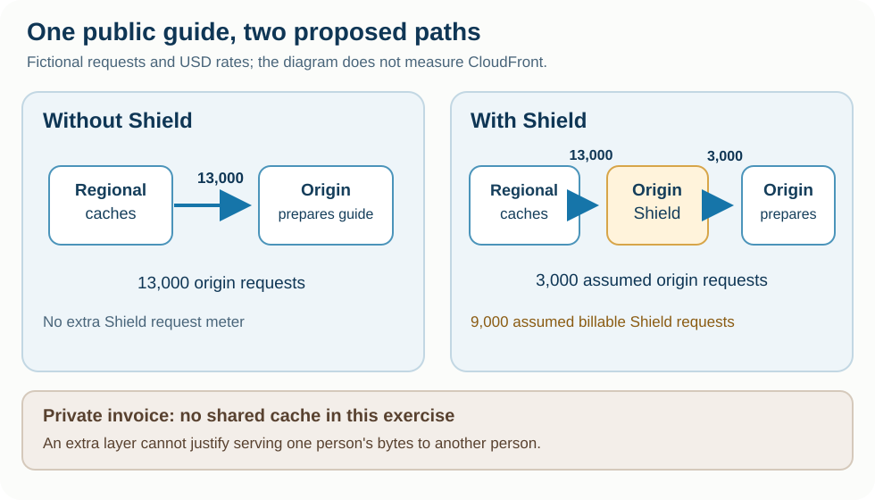

# Does a second cache earn its place?

Maya publishes one **public, versioned guide** for readers in several places. The guide is requested 100,000 times in a fictional period. Edge and regional caches answer most requests, but the regional caches still send 13,000 misses toward an origin that must perform a costly image/document preparation step. Would one more shared cache, CloudFront Origin Shield, help?



For a narrow screen, open the [phone-width version](origin-shield-choice-phone.svg) of the same comparison.

The counts and USD unit prices in [cases.json](cases.json) are **invented teaching assumptions**, not AWS prices or measurements. The estimate assumes 3,000 origin requests *with* Shield and 9,000 billable incremental Shield requests for the public guide. Those two numbers are inputs, not discoveries made by the program. AWS describes Origin Shield as another caching layer between regional caches and an origin, and says it can reduce repeated origin requests; not every request incurs the incremental Shield charge. Dynamic/low-cacheability traffic can be a poor fit. See [AWS Origin Shield behavior, Region choice and charging rules](https://docs.aws.amazon.com/AmazonCloudFront/latest/DeveloperGuide/origin-shield.html).

## Calculate before running the script

Write the following for both cases:

1. The fraction of viewer requests that miss the regional caches. This is **not** a measured CloudFront console hit rate: the fixture simplifies several layers and uses invented counts.
2. Origin work without Shield: `regional_cache_misses × origin_work_usd_per_1000_requests / 1,000`.
3. Origin work with Shield: `estimated_origin_requests_with_shield × origin_work_usd_per_1000_requests / 1,000`.
4. Incremental Shield cost: `estimated_billable_shield_requests × shield_usd_per_10000_requests / 10,000`.
5. The modeled difference, including whether there is an origin-cost case to test. Do not convert a cheaper worksheet into a deployment recommendation without cache correctness, latency, origin-load and whole-bill evidence.
6. The break-even origin work rate per 1,000 avoided requests: `incremental Shield cost × 1,000 / origin requests avoided`. When no requests are avoided, that division is undefined. If the incremental charge is positive, no origin-work rate can make the options tie in this narrow model. If the incremental charge is also zero, the modeled costs tie at every origin-work rate; there is no single threshold.

Then run locally from this folder:

```sh
python3 estimate.py
python3 -m unittest discover -s . -p 'test_*.py'
```

The script validates count units, rejects duplicate JSON field names and prints arithmetic over the declared inputs. If an edited file repeats a field, correct it before interpreting the result. The script does not model CloudFront routing, edge and regional cache expiration, request collapsing, Origin Shield billing eligibility, AWS prices, transfer, logs, invalidations, origin capacity, latency, cache-key correctness or private-data isolation.

## Change a fact

- Copy `cases.json` to a working file, then set the public guide’s `estimated_origin_requests_with_shield` to `13000`. Run `python3 estimate.py /path/to/your-copy.json`. What does the extra layer cost when it saves no origin request? The original fixture remains unchanged.
- In that copy, also set `estimated_billable_shield_requests` to `0`. Compare the two modeled costs. Why does the calculator report a tie for every origin-work rate instead of a break-even threshold? This is an arithmetic scenario, not a prediction that a real configuration incurs no charge.
- Add a highly variable query value to the cache key, causing more distinct copies. Predict how the regional miss count and Origin Shield hit opportunity might change. Explain which response differences truly require that key. Do not assume Shield can repair a wrong cache key.
- A teammate wants to cache the `private_invoice` case to improve the hit ratio. Explain why person-specific content needs a separately proven authorization and cache-isolation design. Compare its current no-cache arithmetic with the public guide; the lower origin load of one case cannot justify exposing another customer's invoice.
- The origin moves to another Region. Which Shield Region should be reconsidered, and what latency and pricing facts would you remeasure? AWS advises choosing a Shield Region with the lowest latency to the origin; support and billing must be checked for the chosen configuration.
- A second workload uses gRPC through a distribution that also has Origin Shield enabled. Does the public guide's assumed reduction in origin requests apply to that workload? Trace its actual protocol path and identify which request counts would need their own estimate before comparing cost or capacity.

Answer before reading [assessor reasoning](ASSESSOR.md). Ask Codex for a claim/evidence/unknown table and a counterexample where the cheapest modeled plan harms a reader. Verify service-specific claims against AWS's [Origin Shield guide](https://docs.aws.amazon.com/AmazonCloudFront/latest/DeveloperGuide/origin-shield.html), [cache-key guidance](https://docs.aws.amazon.com/AmazonCloudFront/latest/DeveloperGuide/understanding-the-cache-key.html) and [current pricing](https://aws.amazon.com/cloudfront/pricing/). The exercise uses no AWS account, credits, distribution or customer content. Any later trial needs a scoped non-root identity, current plan and price check, whole-run budget and reserve, explicit measurements and cleanup.
