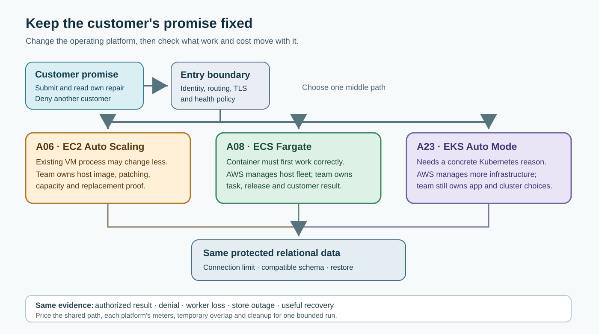

# One repair promise, three operating platforms

Maya's customer submits a repair request, receives an ID, and later reads that exact repair. A second customer must not read it. If one app worker is replaced, the request must remain; if the shared data store is unavailable, the system must report that useful service is unavailable rather than call a green process check a success. Those are the **same acceptance checks** for every candidate below. Start with the [Unit 15 platform choice](../../reader/BOOK-LOCATORS.md#book-0049352fe151bbf0) and [A06 two-worker local path](../three-tier-boundary/README.md); then attempt this transfer before reading [assessor reasoning](ASSESSOR.md).



The three middle boxes are **alternatives**, not one proposed stack. An ALB, network controls, identity and the shared store still need a concrete design for any chosen path. The drawing does not create an EC2, ECS or EKS deployment. EKS Auto Mode manages more cluster infrastructure than a standard EKS setup, but the application, VPC and cluster configuration remain the team's concern. [AWS EKS Auto Mode responsibility](https://docs.aws.amazon.com/eks/latest/userguide/automode.html). Fargate runs ECS tasks without the team managing EC2 hosts, while ECS on EC2 puts host capacity and patching back on the team. [AWS ECS compute options](https://docs.aws.amazon.com/AmazonECS/latest/developerguide/capacity-launch-type-comparison.html).

## Make the decision, then change one fact

In the base case, the repair program already runs as a continuously running web process on a VM. It writes requests to a relational database, but uses worker memory for a receipt cache. The two-person team can operate its present OS; it has **not** proved that the program starts cleanly in a container. No Kubernetes API, controller or ecosystem requirement has been named. For arithmetic practice, this fictional case starts with a 12-hour window, a USD 5 **whole-run** estimate limit and a USD 100 credit reserve. They are case inputs, not recommended reader limits or a verified account balance.

Write one page with: the customer check that stays fixed; the hidden local-state repair needed under all three paths; the lowest-change candidate; a second bounded alternative; which team owns image/AMI, runtime, capacity, network, identity, deployment, database and recovery; and the evidence that would reverse your choice. Do not select a platform from its logo, a green liveness check or the cheapest single price line.

Then change the case in order:

1. The application is containerized and passes exact image-start, wrong-customer denial, worker-replacement and shared-store interruption checks. The team has no host-patching capacity. Which option becomes easier to defend, and what operating work remains?
2. Four existing services depend on a required Kubernetes custom controller and API, and a staffed platform team already owns cluster upgrades and policy. Does this justify evaluating EKS? What compatibility, cost and customer tests remain before adopting it?
3. The team wants a host-kernel feature that its chosen Fargate task mode cannot provide. Does “managed containers” still settle the choice? Which candidate capabilities must be checked against current AWS documentation?
4. A new app image starts, but its database migration prevents the old version from reading requests. Why do successful task/Pod/instance health and a lower compute price fail the same customer promise?
5. The database is saturated and the process path is green. A fourth app replica is added. Which shared limit can remain or worsen? What observed result would show that an app-tier change helped?
6. Someone calls an EKS cluster “free” after setting app replicas to zero. List the resource lifetimes that still need a price and deletion receipt.

For each change, name one fact that is **observed locally**, one fact still requiring a **current AWS configuration or price check**, and one customer result still needing a **live authorized observation**. Ask Codex to argue for a different candidate, then make it identify the requirement that actually changed. Its answer is a review aid, not certification or deployment evidence.

## Price the entire fictional run

Run this standard-library arithmetic from the repository root:

```sh
python3 examples/platform-transfer/whole_run_lab.py
python3 examples/platform-transfer/whole_run_lab.py --hours 4
python3 examples/platform-transfer/whole_run_lab.py --limit-usd 6
python3 -m unittest discover -s examples/platform-transfer -p 'test_*.py' -v
```

The [Python source](whole_run_lab.py) declares **invented** dollars-per-unit rates so the arithmetic is reproducible offline. It includes a common ALB, database, egress, logs and backup set for every candidate, plus each candidate's compute, storage, image/cluster or node-management meters and temporary overlap. Fargate CPU-hours and memory GB-hours are separate. Its overlap quantities represent extra capacity-hours during a release, not a longer customer observation window. The output applies 25% contingency to each full subtotal. Under these invented 12-hour assumptions, EC2/ASG is USD 4.775, ECS/Fargate USD 5.275 and EKS Auto Mode USD 7.00. These are *not AWS quotes or platform recommendations*. An omitted database or Auto Mode meter makes the checker refuse an estimate; a cluster-only cost is a known underestimate.

The four-hour output changes hourly quantities while retaining fixed fixture storage/transfer assumptions. That can make an arithmetic threshold pass without proving that the workload can start, receive traffic, complete business checks and clean up inside four hours. The `--limit-usd 6` run changes **only the comparison**: the Fargate fixture now fits, but its subtotal, omitted real prices and missing customer evidence do not improve. Ask which business or operating fact, if any, has changed. Choose a limit for your own account only after checking its plan, credits and risk tolerance. A genuinely planned run must use current prices in the selected Region and the actual expected quantities for compute, ALB, database, storage, network, logs, release overlap, backup and residual resources. AWS [EKS](https://aws.amazon.com/eks/pricing/), [ECS](https://aws.amazon.com/ecs/pricing/), [Fargate](https://aws.amazon.com/fargate/pricing/) and [EC2](https://aws.amazon.com/ec2/pricing/) pricing pages describe different meter sets; the exact account eligibility and credits need separate inspection. The local script cannot check whether a credit applies, enforce a dollar ceiling in AWS, confirm a reserve or authorize deployment. The fictional case limits do not replace the selected account's own run limits and credit terms.

Keep organization-dependent platform labs on paper in this packet. Any separately authorized live trial needs a scoped non-root identity, current credits and regional prices, bounded duration, useful customer checks, stop condition, teardown and delayed-bill reconciliation. A cluster whose app replicas are zero is not proof that its billable resources have disappeared.
