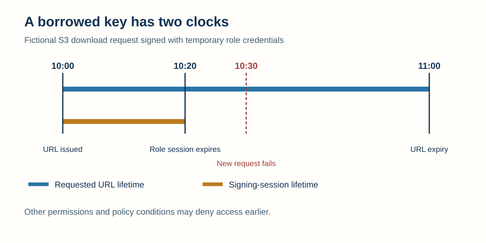

# The borrowed key has two clocks

Maya's repair shop needs to give a customer a temporary way to download a report. A developer signs an S3 download request using a role session. The customer receives the resulting URL; the customer does not need their own AWS credentials for that request. Treat the URL like a borrowed key: anyone who obtains it may be able to use it, within the request's scope and applicable controls.

Before reading the assessor notes, write a prediction and one piece of evidence for each situation. These times and objects are fictional. Assume an S3 presigned GET, a correctly formed request, and no separate denial unless a case says otherwise.

1. At 10:00 the developer issues a URL with a 60-minute lifetime. The role session used to sign it expires at 10:20. The customer starts a new download at 10:30. Which clock matters?
2. A different URL has valid signing credentials and expires at 11:00. The customer begins downloading at 10:59 and the download is still running at 11:01. Does expiration alone require S3 to stop the existing download? What if the connection drops and the customer makes a new request at 11:02?
3. A customer opens a URL successfully, then shares the same link with another person before expiration. Does the first use alone consume the URL? What evidence would establish that the application intended only the first recipient to have access?
4. A URL has 40 minutes left and its signing session is still valid. A newly applied bucket policy explicitly denies the requested operation. Does the printed expiration time promise successful access? Which actual policy and request evidence would you inspect?
5. The shop instead signs an upload for an object key that already contains a report. Can the recipient safely assume the old object is unaffected? Identify the effect and what additional versioning and recovery facts are needed before claiming that the old bytes are recoverable.

After recording your predictions, use this diagram to check the first case.

## Discuss with Codex

Give Codex only the fictional times and outcomes above. Ask it to explain the difference between expiration, signer authority, and a policy denial, and to propose one negative test per case. Compare its answers with [the assessor notes](ASSESSOR.md) and the linked AWS documentation. Never paste a real presigned URL, token, customer report, credential, or account identifier into the prompt: the link itself can grant access.

This is a reasoning exercise, not an S3 simulator, an authorization decision, or a live security test. Before any cloud experiment, separately establish the account and scoped identity, Region, whole-run estimate, spending limit and reserve, stop conditions, cleanup owner and evidence. No AWS resources are needed here.
