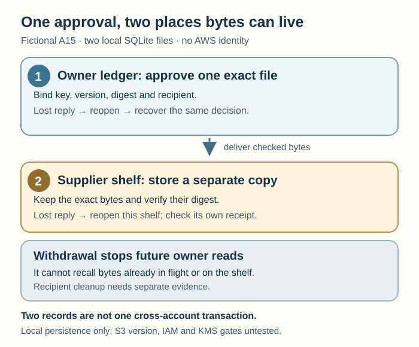

# A15 protected export across accounts

This is a **design architecture exercise with cloud-free contract labs** for a fictional owner and supplier. It creates no AWS account, Organization, role, bucket, key or charge. Read [the data-protection lesson](../../reader/BOOK-LOCATORS.md#book-825913145aea88a5) and its [diagram](../../book/figures/cross-account-export-gates.svg). Record a first answer before reading the [assessor notes](ASSESSOR.md). No policy snippets here are deployable.

Maya's repair service has customer photos, addresses and parts records in a private source system. Supplier P needs a weekly list of part numbers and quantities for approved repairs. It must never receive photos, names or addresses. The fictional owner and supplier have separate AWS accounts. Assume a versioning-enabled general-purpose S3 bucket, a customer-managed KMS key for an SSE-KMS approved-export object, bucket owner enforced object ownership, and no public access. No policy, VPC endpoint, access point, Organization rule or live identity is supplied; you must state which missing inputs prevent a live authorization conclusion.

## Draw the contract before the permissions

1. Define the output schema, approval owner, stable export/version ID, recipient, useful lifetime, replacement and withdrawal procedure. Include what happens if a later export contains an extra private field or if yesterday's approved copy is already downloaded.
2. Compare **direct read** of one approved object with **copying a minimized object** into a supplier-controlled destination. For each, list where copies remain, who can revoke future access, what revocation cannot undo, and which party owns cleanup. Choose one for the stated weekly use and say what changed requirement would reverse your choice.
3. For direct read, draw the request from the supplier's temporary role to one object **version**. At each boundary list the exact actor, action, key, version, owning account, policy owner and one safe positive/negative observation. Include supplier IAM, owner bucket policy, owner KMS key policy, supplier key-use permission, and any selected access-point or VPC-endpoint policy. Check that an unversioned `GetObject` path cannot expose a later current version. Distinguish an absent grant from an explicit deny and a policy decision from a real request result. AWS distinguishes [`s3:GetObjectVersion` from `s3:GetObject`](https://docs.aws.amazon.com/AmazonS3/latest/API/API_GetObject.html) and documents an [`s3:VersionId` policy condition](https://docs.aws.amazon.com/AmazonS3/latest/userguide/amazon-s3-policy-keys.html).

## Run the version and copy contract locally

Predict these results before running the standard-library fixture from the repository root:

```sh
python3 examples/protected-export/local_lab.py
python3 -m unittest discover -s examples/protected-export -p 'test_*.py' -v
```

The first export contains only `part_number` and `quantity`. Its digest binds the bytes Maya reviewed, and the invented `v1` label names one immutable candidate in this exercise. A later `v2` with the same key is **not** approved by `v1`'s decision. The fixture should deny `v2` and Supplier Q, deliver exact `v1` bytes to Supplier P, deny a future owner read after withdrawal, and still find the copy already on Supplier P's shelf. The tests also reject a row with a private address, a wrong digest, an actor other than Maya attempting approval or withdrawal, a changed recipient and reuse of a version label.

Ask why those observations differ. The Python caller names are trusted fixture inputs, not authenticated AWS principals. The shelf is an in-memory copy, not S3 replication or a real supplier account. The model does not evaluate IAM, KMS, bucket/access-point/endpoint policy, S3 version IDs, eventual external deletion or provider billing. Use it to reason about **what to test**, then return to the paper policy gates above. No AWS call, organization or credit is used.

## Keep the decision after a lost reply

The first shelf disappears when its process ends. The [two-ledger diagram](approval-copy-boundary.svg) asks a harder question: what if Maya approved the exact export, committed that decision, and the reply to her screen vanished? Clicking again must recover **the same** approval, not silently grant another recipient. Run `python3 examples/protected-export/persistent_lab.py` from the repository root. It uses two temporary SQLite files, one for Maya's approval and one for the supplier-held copy. After simulated lost replies it closes and reopens both files. The approval retry says `already_approved`; the supplier lookup finds the exact digest. Withdrawal then stops a *new* owner read while the earlier supplier copy remains. The script removes both temporary files when it exits.



The focused tests also race two different supplier approvals against one version; only one wins the local database transaction. A second case withdraws access **after the owner read but before the supplier shelf write**. The copy can still arrive. That race is why a change to Maya's future-read policy cannot by itself recall bytes already in flight. The toy actor names remain caller-supplied, and the two files live on one computer: this is no cross-account transaction, authenticated supplier, encrypted S3 object, KMS authorization, network delivery or evidence of deletion. [Try the changed cases](PERSISTENCE-ASSESSOR.md) before reading their reasoning.

An actual design must choose where the authoritative approval and version/digest record lives, how an uncertain delivery is reconciled with the supplier, what event proves withdrawal was noticed, and what happens to supplier backups. S3 Versioning preserves separate whole-object versions and can retain older ones after an overwrite or a delete marker; each retained version has storage cost. It does not supply Maya's business approval or delete the supplier's copy. [AWS Versioning guide](https://docs.aws.amazon.com/AmazonS3/latest/userguide/Versioning.html). Include the approval store, version retention, recipient copies, requests, KMS use, logs and cleanup in a selected **whole-run** estimate before a future live test.

## Let the service identify the requester

The SQLite exercise lets a caller pass the word `Maya` to `approve`. That is useful for testing the decision rule, but it would be a dangerous public API: Supplier P could type Maya's name. Think of a shop counter. Writing “manager” on an order slip does not give a visitor the manager's badge. The service must check the badge it issued or a trusted identity system supplied, then decide which action that identity may take.

Run the [loopback HTTP exercise](identity_http_lab.py) from the repository root:

```sh
python3 examples/protected-export/identity_http_lab.py
python3 -m unittest discover -s examples/protected-export -p 'test_*.py' -v
```

The server listens only on `127.0.0.1` and creates three random, temporary session values: Maya, Supplier P and Supplier Q. The values never appear in the output or repository. A supplier request that writes `"actor": "Maya"` still receives HTTP 403 because the **session** identifies Supplier P. Maya's session can approve the exact key, version, digest and recipient. Supplier P can read that version; Supplier Q, Maya's owner session used as a supplier, an absent session and an unapproved replacement version cannot. The supplier stores the delivered bytes in its separate local SQLite file. After Maya withdraws future access, a new HTTP read is denied while the supplier's earlier copy remains. [Try the changed cases](IDENTITY-ASSESSOR.md) before looking at the reasoning.

This is an **identity-boundary rehearsal**, not AWS authentication. The temporary values are trusted only inside one Python process; there is no Cognito, IAM Identity Center, STS, SigV4, S3 bucket policy, KMS key policy, TLS, internet endpoint or real supplier account. The response digest catches a mismatched payload in this local path, but it does not establish who signed or transported it in a real system. A future live design needs scoped principals, all applicable policies, a harmless allowed version and denied neighboring-version/object tests, response and audit evidence, current prices and cleanup within limits chosen for the account. Never send a real bearer token, key or private export to Codex.

## Review four changed packets

| Packet | New fact | Your decision |
| --- | --- | --- |
| A | The supplier role has a matching S3 read permission and the owner bucket policy grants its exact role ARN on the approved object. The object uses SSE-KMS, but the owner's KMS policy has no external-use grant. | Can the encrypted object be read as intended? Which gate blocks it under these assumptions? |
| B | The owner KMS policy and supplier IAM allow the intended decrypt path. The supplier asks for a neighboring private source object outside the bucket policy's allowed object ARN. | Does key use give S3 read access? What is the safest relevant denied test? |
| C | The owner switches to a cross-account S3 access point but does not update the underlying bucket policy for that path. | Does the new access point alone give the supplier data access? |
| D | A weekly export was downloaded and stored by the supplier. Maya revokes future source access and calls the file “withdrawn.” | Which bytes can Maya still control? What agreement, notification and evidence are needed for the supplier-held copy? |

For every packet, say **specified**, **would require current policy inspection**, or **would require a harmless live request**. Do not fill gaps with assumed account settings. If an access request is denied, check that the object exists in the intended test fixture and that the denial is caused by the target permission boundary, not by a typo, wrong Region or unavailable key. Never test by reading actual customer data.

## Plan a bounded future experiment

Use synthetic content only. Before any later authorized live run, verify the exact AWS identity and Region, service eligibility and current S3/KMS prices. Estimate storage/versions, requests, transfer, key and cryptographic requests, logs and any optional endpoint or replication. Set a conservative whole-run limit and credit reserve for the account before running anything. Name a scoped non-root deployment identity, one approved export fixture, one adjacent forbidden fixture, stop conditions, retention/cleanup owners and a later billing reconciliation. Keep organization-dependent work in this exercise design-only. Do not fabricate a second account or claim the proposed test was run.

**Codex practice:** Give Codex this fictional packet, not credentials or private data. Ask it to make a two-column policy-path table for A and B, cite current AWS primary documentation for S3/KMS cross-account behavior, then attack its conclusion with an omitted deny or copied-export case. Compare its proposed actions with your own first answer. Generated IAM JSON is only a draft and must be reviewed against the exact selected resources before any live use.
