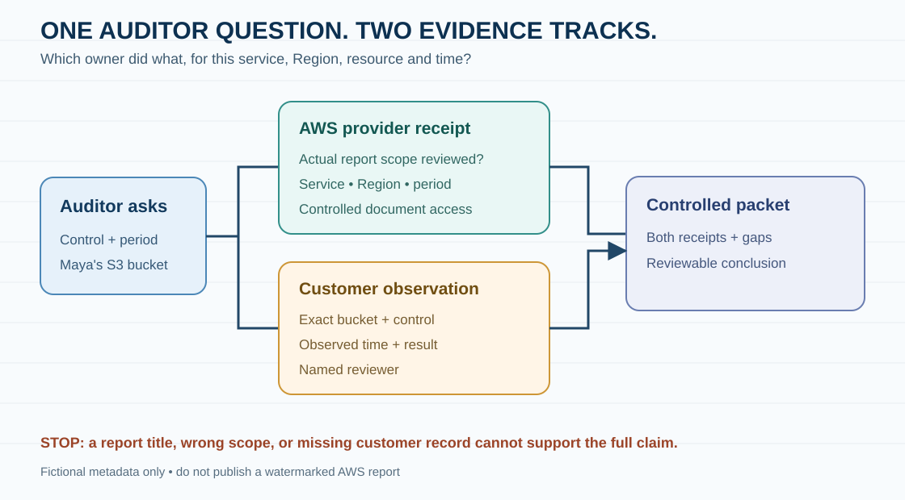

# The auditor asks for two kinds of proof

Maya's repair shop stores customer repair photos in an Amazon S3 bucket. An auditor asks, “What supports the provider's security controls, and what proves this particular bucket was configured as required during the review period?” Maya needs **two evidence tracks**. An AWS report may support an AWS-owned control. Her team must separately show what *it* configured and observed. A report title cannot answer both questions.

This illustrated, offline exercise supports [SAP-C03 skill 2.4.5](https://docs.aws.amazon.com/aws-certification/latest/solutions-architect-professional-03/solutions-architect-professional-03-domain2.html). It extends the [security evidence chapter](../../reader/BOOK-LOCATORS.md#book-367ab937e61db26d). The code uses **fictional metadata** and never downloads, copies, or republishes an AWS Artifact document.



## Choose the evidence before collecting it

**AWS Artifact** provides on-demand AWS security and compliance reports and documents, and can also present third-party vendor reports and AWS agreements. These are distinct categories. For a provider-control question, locate the relevant AWS report, open its details and actual document, and inspect its control, service, Region, exclusions, and reporting period. The [AWS services-in-scope list](https://aws.amazon.com/compliance/services-in-scope/) can guide selection; the applicable report and program still need review. If the requested period extends past a SOC report, check whether a relevant [SOC Continued Operations Letter](https://aws.amazon.com/compliance/soc-faqs/) covers the intervening period; do not silently treat an older report as current. [AWS Artifact overview](https://docs.aws.amazon.com/artifact/latest/ug/), [report download guide](https://docs.aws.amazon.com/artifact/latest/ug/downloading-documents.html).

Next draw a line between **AWS-owned**, **shared**, and **customer-owned** control work. For example, an AWS infrastructure report does not prove that Maya's bucket policy, access settings, retention, or application access were correct. The customer evidence record should name the account and resource, the exact control, observation time, result, reviewer, and a protected location for supporting output. A shared control needs both relevant portions. AWS explicitly places customer configuration and control evidence with the customer. [Shared responsibility model](https://aws.amazon.com/compliance/shared-responsibility-model/).

Do not put a downloaded report in a public repository, issue, email attachment, or open AI prompt. AWS says downloads are uniquely watermarked and may be confidential or governed by accepted terms. Store an access-controlled **receipt** in the packet: exact title/identifier, version and reporting period, scope notes, permitted storage location, access owner, and how an authorized reviewer can retrieve it. Keep actual confidential bytes in the approved controlled location. An AWS report, a third-party report, and an agreement serve different questions; accepting an agreement is not evidence that a customer bucket is configured correctly. [AWS report handling](https://docs.aws.amazon.com/artifact/latest/ug/downloading-documents.html), [agreements](https://docs.aws.amazon.com/artifact/latest/ug/managing-agreements.html).

## Run the fictional packet review

From the repository root:

```sh
python3 examples/provider-evidence-packet/packet.py
python3 -m unittest discover -s examples/provider-evidence-packet -p 'test_*.py'
```

The fixture represents a **made-up report and made-up bucket**, not an available AWS report or a valid compliance attestation. The checker asks whether the metadata claims the correct service, Region, control, period and customer resource. A blank gap list means only that the fixture is internally coherent. It cannot inspect report contents, real scope, actual AWS configuration, observation integrity, or an auditor's acceptance.

Make the auditor's request harder in four steps:

1. The report's title sounds right, but its scope list omits Amazon S3. Is it usable for this service?
2. The report covers the service but omits Maya's Region or ends before the requested period. What document or scope confirmation would you seek next? What can you honestly say now?
3. The report covers an AWS-owned infrastructure control. Maya claims it also proves her bucket policy. Draw the two owners and name the separate customer observation needed.
4. The team finds an Artifact agreement and a third-party vendor report. Can either replace the requested AWS provider report? When might each be relevant for a *different* question?

Before reading the [assessor](ASSESSOR.md), write a packet index: auditor question, control owner, selected report receipt and scope, customer evidence receipt, missing evidence, access restriction, and review conclusion. Ask Codex to challenge a wrong Region, stale period, missing customer record, and an accidentally public report link. Require it to cite current AWS documents and label every unverified assumption.

This local exercise uses no AWS resources or trial credits. AWS states Artifact documents and agreements are available free of charge, but a real evidence workflow can incur storage, logging, review, or other service charges; verify current prices for any proposed implementation. This exercise does not create an organization-scale compliance environment. Live Artifact access, actual report-scope review, customer configuration observations, and an auditor's judgment remain separate evidence gates.
