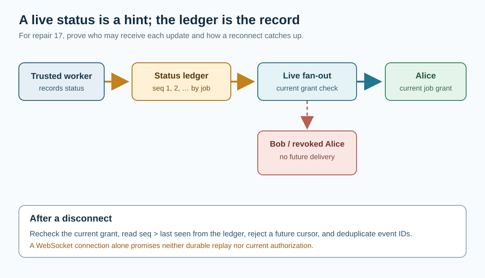

# The repair-status screen goes live

Maya's repair shop wants customers to see “checking,” “parts ordered,” and “ready” without refreshing the page. A live connection can deliver those updates quickly, but it cannot decide who owns a repair, preserve every missed event, or make a wrong status true. Treat the socket as a courier and the repair ledger as the record.

This illustrated, offline lab supports [SAP-C03 skill 1.1.12](https://docs.aws.amazon.com/aws-certification/latest/solutions-architect-professional-03/solutions-architect-professional-03-domain1.html). It extends the [events lesson](../../reader/BOOK-LOCATORS.md#book-f0f0044d800d44b9) and [identity lesson](../../reader/BOOK-LOCATORS.md#book-47726780fac09ca7). The local Python code models grants, ordered events, delivery candidates and replay; it is **not** a WebSocket server, AppSync API or API Gateway deployment.



## Choose the service by the promise

An **API Gateway WebSocket API** gives the team connection routes such as `$connect` and `$disconnect` and custom message routes. AWS documents authorization at `$connect` only; the application must design any later job-level permission checks and revocation behavior. `$disconnect` is best effort, so cleaning a connection table cannot rely on receiving every disconnect event. [AWS connect/disconnect guide](https://docs.aws.amazon.com/apigateway/latest/developerguide/apigateway-websocket-api-route-keys-connect-disconnect.html).

**AWS AppSync Events** offers managed channel publish/subscribe over WebSocket and supports authorization for those operations. A connected client may subscribe to several channels and may publish without subscribing. Channel rules still need to match the customer's actual repair ownership and current permission; a successful connection alone is not permission to hear every job. Confirm the chosen authorization mode, handler behavior and what happens to a long-lived subscription after a grant changes. [AWS AppSync Events overview](https://docs.aws.amazon.com/appsync/latest/eventapi/), [protocol](https://docs.aws.amazon.com/appsync/latest/eventapi/event-api-websocket-protocol.html), [authorization](https://docs.aws.amazon.com/appsync/latest/eventapi/configure-event-api-auth.html).

If Maya merely needs occasional status refreshes, a bounded HTTP poll may be simpler. A live channel earns its cost when the freshness and fan-out promise justify connection management, authorization checks, reconnect handling and operations. Compare current Region/model support and price before choosing.

## Run the local evidence path

From the repository root:

```sh
python3 examples/realtime-status/ledger.py
python3 -m unittest discover -s examples/realtime-status -p 'test_*.py'
```

The model gives Alice a grant for `repair-17`, denies Bob, accepts an event only from a fixture worker, removes Alice's subscription after revocation, and replays a missed event from an ordered ledger when a currently authorized client reconnects. An exact repeated event ID does not append a second ledger event, but a repeated publish may still produce another delivery candidate; clients need event-ID/sequence deduplication. The model's method arguments stand in for trusted identity and job ownership; a real application must derive and verify those facts rather than accept them from a socket message.

## Six decisions before reading the assessor

For each case state **who acts, what is authoritative, which permission is checked and when, one allowed and one forbidden observation, the retry/replay rule, and the cost meters**.

1. **Wrong repair:** Bob connects successfully and guesses Alice's `repair-17` channel. Should he receive its status? Explain the difference between permission to connect and permission to subscribe or receive that repair's event.
2. **Long-lived connection:** Alice subscribed yesterday but sold the repair contract this morning. A status arrives at noon. Where must the change in ownership take effect? What happens to the existing connection or channel, and which live behavior would you test? Do not promise that a token's original approval automatically revokes itself.
3. **Dropped connection:** Alice's browser disconnects between sequences 1 and 2. On reconnect it reports last seen sequence 1. Which authority supplies sequence 2? What should happen if the browser reports sequence 99 or replays the same event twice?
4. **Untrusted publisher:** A browser sends `ready` for its own repair. The worker ledger still says `checking`. Decide whether customer messages may publish status, whether the message changes the business record, and how a trusted status update reaches the channel.
5. **Scale and failure:** Ten thousand customers stay connected while the status worker retries a publish. Estimate the *categories* to price: connection duration, published/delivered messages, worker execution, status storage, read/replay requests, logs, outbound data and retries. What customer symptom tells you the screen is stale even if sockets are open?
6. **Different protocol need:** The shop's machines now send device telemetry with distinct device certificates and topic permissions. Compare keeping the customer WebSocket path with a purpose-built IoT/MQTT ingestion path. Do not assume one customer channel is an equipment authentication system.

Ask Codex to attack your first diagram: invent a guessed channel, a mid-connection revocation, a missed status and a duplicated publish. Require current AWS sources for any service claim and ask what a local model cannot prove. Check your answer against the [assessor](ASSESSOR.md). A real deployment would need explicit authorization, route/channel configuration, observed delivery and denial, measured reconnect/replay, current pricing and teardown. This lab uses no AWS account or credits.
