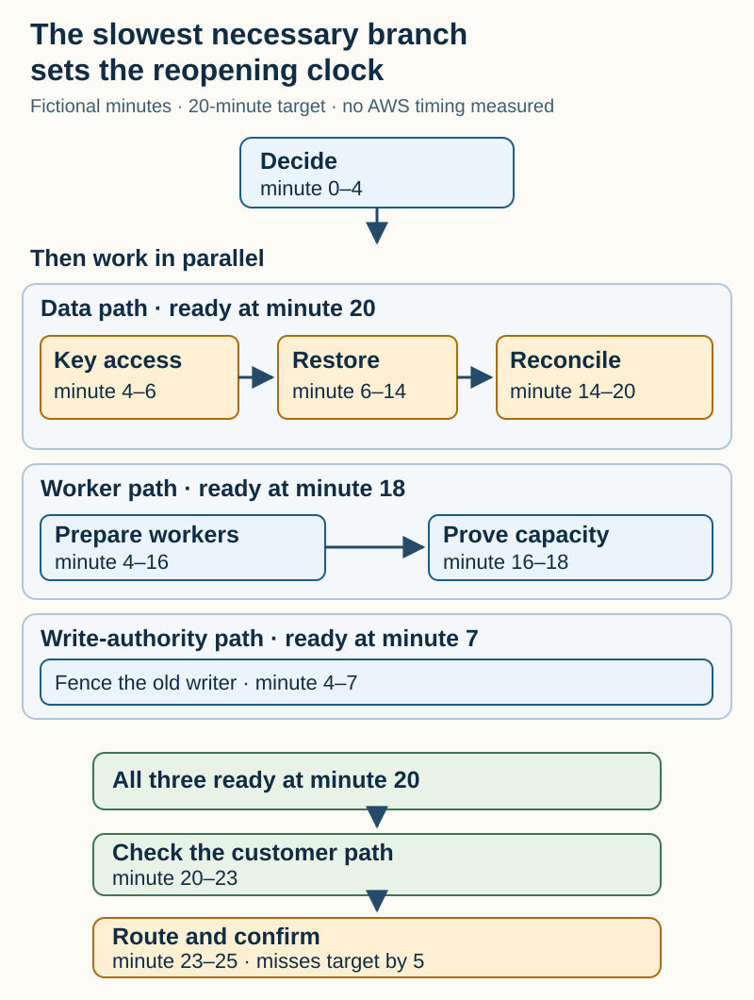

# Recovery critical path: the slowest necessary chain wins

Maya can prepare application workers and restore booking data at the same time. She cannot let a customer make a new booking until **both** paths, old-writer control and a customer check are ready. Think of reopening a shop after a flood: extra staff do not help if the appointment book is still locked in a safe nobody can open.

This is a fictional **design screen**, not a timed recovery drill. All minutes, booking IDs and receipts are supplied. The program makes no AWS calls. First predict the answers, then run from the repository root:

```sh
python3 examples/recovery-critical-path/lab.py
python3 -m unittest discover -s examples/recovery-critical-path -p 'test_*.py' -v
```

The objective is useful customer service by minute 20. The graph starts when the declared incident clock starts. Detection and decision take four minutes. The data branch then checks the destination key for two minutes, restores for eight and reconciles confirmed bookings for six. In parallel, worker preparation takes twelve minutes and capacity proof takes two; old-writer fencing takes three. A customer read/write check waits for **all three** branches, then routing and confirmation take two more minutes.



The copy contains B110 for **1,200 cents**; a separately supplied journal contains B111 for **2,300 cents**. Those are *stipulated receipts*, not a discovered or authenticated ledger. The gate requires exact IDs **and amounts** to match the declared confirmations. It also rejects a copy and journal that disagree about the same ID. A completed copy receipt, usable destination key, old-writer fence, enough capacity and a passed customer check are separate requirements. The gate calls a passing case `PLAN_FITS_ASSUMPTIONS`, not `RECOVERED`.

| Change one input | Projected customer minute | What the model decides |
| --- | ---: | --- |
| Pilot-light workers, eight-minute restore | 25 | Misses the 20-minute design target |
| Warm workers in two minutes, same restore | 25 | Still misses; data is the critical path |
| Three-minute restore, slow workers | 23 | Still misses; worker readiness now matters |
| Faster restore **and** warm workers | 20 | Fits exactly under the stipulated evidence and durations |
| Same fast graph, destination key denied | 20 on paper | `NO_GO`; the copy cannot be used by the recovery role |
| Same fast graph, B111 absent from candidate and journal | 20 on paper | `NO_GO`; confirmed work is unaccounted for |
| Same fast graph, B110 amount changed from 1,200 to 1,300 cents | 20 on paper | `NO_GO`; the booking exists but its value is wrong |
| Same fast graph, candidate and journal disagree about B111 | 20 on paper | `NO_GO`; source authority is unresolved |

**Try before opening the assessor.** Draw the three branches and calculate when each ends. Predict why spending on warm capacity alone buys no time here. Then remove B111 from the journal, change B110's recovered amount, make the candidate and journal disagree about B111, deny the destination key, or lower capacity from 80 to 79 requests per minute against demand of 80. For each, state which observation could repair the plan. Finally, delete the reconciliation dependency from `customer_read_and_write` in a scratch copy. The model now says minute 13. Explain why that faster answer is **less** trustworthy. Do not make the production plan omit a dependency to pass a spreadsheet target.

The [assessor](ASSESSOR.md) gives the arithmetic and a changed-case answer. Ask Codex to identify the critical path and one omitted dependency; check its proposed graph against the booking promise and supplied records. Record your unaided answer separately from its critique.

For an eventual AWS design, verify the selected resource's cross-Region copy and restore support, destination key and role access, independent confirmation evidence, writer ownership, service quotas, customer path and **whole-run cost**. Compare recurring standby cost with the value of recovered time. Any live experiment needs a current account-plan/credit and gross-budget read, a scoped identity, an account-chosen spending limit and reserve, a stop and cleanup plan, and later bill reconciliation. Choose whole-run spending and reserve limits for the account you will use. This lab authorizes no cloud rehearsal. [AWS Backup cross-Region guidance](https://docs.aws.amazon.com/aws-backup/latest/devguide/cross-region-backup.html), [restore testing validation](https://docs.aws.amazon.com/aws-backup/latest/devguide/restore-testing-validation.html).

The graph assumes reviewed durations and safe overlap. Its confirmation values are authored fixture inputs, not independently verified business records. It does not discover a complete journal, exercise KMS/IAM, fence a distributed writer, measure AWS restore or routing time, test an independent customer, price standby, or establish RTO/RPO. A `PLAN_FITS_ASSUMPTIONS` result is a reason to design a bounded rehearsal, not permission to reopen a live service.

The local inputs require an explicit true or false for each modeled check. An unknown, missing or non-boolean value is rejected for investigation instead of being treated as evidence that a check passed. An explicit true is still only a supplied claim: a real decision needs the underlying observation and its owner.

Matching lists alone do not establish that the list of confirmed bookings is complete. The model also asks for an explicit confirmation-inventory completeness claim; if it is false, even two matching empty lists produce `NO_GO`. In a real recovery, establish the time boundary and use independently reconciled records to support that claim. The local boolean cannot discover an omitted booking or authenticate the supplied ledger.

New evidence records default to unconfirmed checks and therefore hold the plan. The worked example explicitly supplies its fictional passing claims so the timing cases can be compared. Do not mistake those fixture values for measurements.
