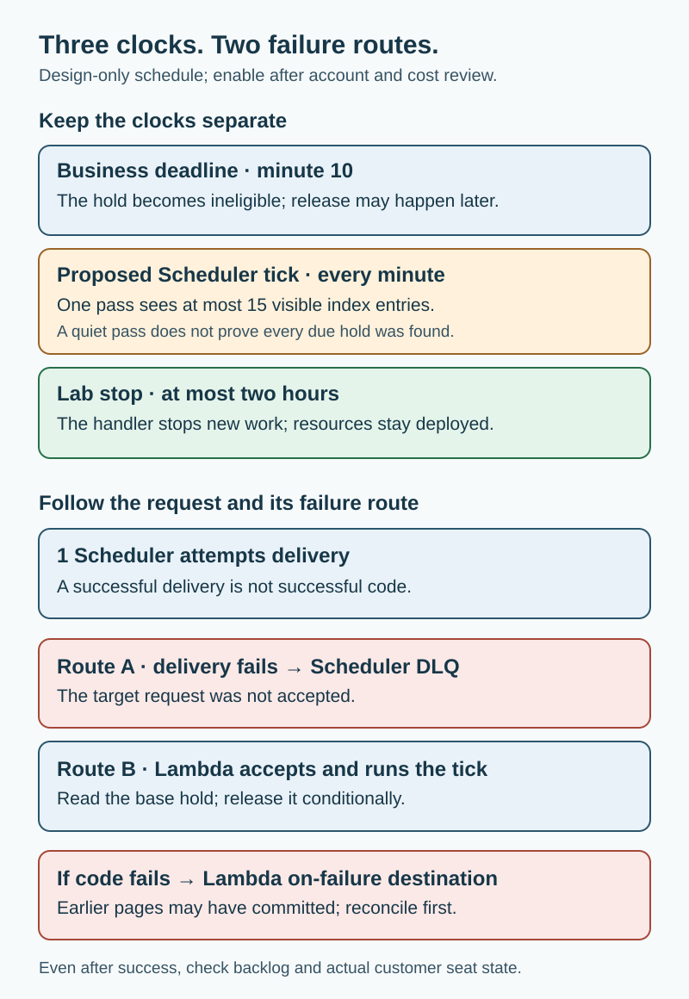

# A03 schedule decision: who checks the tray, and who notices failure?

Maya promises to return an unpaid seat after ten minutes. The [current A03 source](../../architectures/reliable-workflows/README.md#a03-extension-set-aside-a-seat) knows how to release a due hold once and how to inspect up to three five-entry index pages per `query_due_tick`. The Terraform schedule is **opt-in and off by default**. This packet explains that candidate; it neither authorizes a cloud run nor claims that a one-minute recurrence meets an exact ten-minute release promise.



## Choose a small-lab route

| Route | What it adds | What can still fail | Decision for this teaching lab |
| --- | --- | --- | --- |
| EventBridge Scheduler → dedicated due-tick Lambda | One recurring schedule, an invocation role and a bounded direct tick. | The Scheduler request may fail before Lambda accepts it; accepted asynchronous work may later fail in code. A successful tick may stop at 15 visible entries. | Implemented as **disabled-by-default source** for a short synthetic run; live behavior and whole-run cost still need review. |
| EventBridge Scheduler → new SQS work queue → Lambda consumer | A durable queue between the clock and the worker, with queue redrive and a separate consumer. | Queue delivery can duplicate; polling adds requests; consumer failures and lag still need recovery. The existing A02 worker does not understand `query_due_tick`. | Keep as a useful alternative when buffering/backpressure is part of the actual requirement; it is more source and operating scope here. |
| One schedule per hold | A separate schedule for each changing business deadline. | Creation/deletion races, schedule quotas, duplicate deliveries and per-hold cost/cleanup widen the path. | Do not introduce it for this tiny shared-tray exercise without a measured deadline need and a new design review. |

The direct route delegates the *attempt time* to Scheduler, not the *seat decision*. The handler still supplies its own clock, rereads the authoritative base record and runs the conditional `HELD` → `EXPIRED` release. A duplicate tick is safe for the seat count only because that condition protects the transaction. AWS says [Scheduler invokes Lambda asynchronously](https://docs.aws.amazon.com/lambda/latest/dg/with-eventbridge-scheduler.html). EventBridge Scheduler's [recurring schedules and end date](https://docs.aws.amazon.com/scheduler/latest/UserGuide/schedule-types.html) control new occurrences; an end date is not resource deletion or a promise that already accepted asynchronous work has drained.

## Read the opt-in Terraform as a set of promises

The [scheduled resource file](../../architectures/reliable-workflows/infra/scheduled_due_tick.tf) creates nothing while `enable_due_tick_schedule` is false. If an operator explicitly sets it true in the private run variables, the candidate adds a dedicated `handlers.due_tick` Lambda and one UTC `rate(1 minute)` schedule whose end date is the same Unix instant as the lab's handler stop. It creates a separate Scheduler role, scoped to the new schedule group and target function, and separate delivery-failure and execution-failure SQS queues. It also creates four console-visible alarms: one for each queue's visible messages, one for tick Lambda errors and one for a failed Lambda destination delivery. **No alarm notification action is configured.** The scheduled worksheet therefore requires a named operator and an inspection interval of at most five minutes; the source cannot prove that the person will actually watch the alarms.

The [handler](../../architectures/reliable-workflows/src/handlers.py) takes time from the function clock and ignores the event's `now`; the [domain method](../../architectures/reliable-workflows/src/domain.py) starts a fresh pass of at most three five-entry pages. A second invocation can finish a 16-hold backlog. A failed page raises, so Lambda's asynchronous failure handling sees an error. The seat count remains protected by the base-record conditional transition, not by Scheduler. A successful tick that reached its three-page limit is still a success to Lambda and needs the next recurrence; if arrivals outpace 15 visible entries per minute, backlog can grow. The alarms do **not** measure that backlog, so the operator's worksheet must name a separate due-age/reconciliation check.

## Trace both failure paths

Scheduler's target has one retry with a 60-second maximum event age and a standard SQS delivery dead-letter queue. It records a target *delivery* that Scheduler could not complete after its configured attempts; it does not observe a later exception inside Lambda. The execution role permits only this Lambda invocation and sending to that delivery queue, and its trust policy is scoped to the schedule group and account. [Scheduler retry and DLQ](https://docs.aws.amazon.com/scheduler/latest/UserGuide/configuring-schedule-dlq.html), [Scheduler target/role settings](https://docs.aws.amazon.com/scheduler/latest/UserGuide/managing-targets-templated.html), [schedule-group trust scope](https://docs.aws.amazon.com/scheduler/latest/UserGuide/cross-service-confused-deputy-prevention.html).

The accepted request enters Lambda's asynchronous handling. The dedicated function has one code-error retry, a 120-second maximum event age and an on-failure destination to a **different** standard SQS queue. Its execution role permits `sqs:SendMessage` only to that queue. A failure on page two can leave page one's releases committed, so a recovered tick must start a fresh pass and rely on the conditional release. Track destination-delivery failure metrics too: a configured failure queue can itself fail to receive a record. [Lambda asynchronous retries](https://docs.aws.amazon.com/lambda/latest/dg/invocation-async-error-handling.html), [failure destination and permission](https://docs.aws.amazon.com/lambda/latest/dg/invocation-async-retain-records.html).

Neither dead-letter queue is an operator. Before enabling, name who inspects both queues, the log group, Lambda errors/throttles and Scheduler invocation failures, when they inspect them, and how they reconcile seat state. Decide whether queue-depth alarms need an approved notification destination; an alarm with no attended route is not an incident response. A quiet queue is not enough: compare the oldest due hold's age and the count of still-`HELD` due records against the business promise, including a reconciliation scan for pre-index holds. Define a safe manual stop: disable the schedule, inspect outstanding asynchronous events, then perform exact Terraform destroy and verify resources and later billing.

## Bound one proposed run before considering `plan`

For a **planning example only**, a two-hour interval with both minute boundaries counted allows 121 one-minute occurrences. Three index pages per occurrence mean 363 index-query pages and at most 1,815 returned entries *before* delivery retries or Lambda replays. An empty page and index propagation can change the real count; these are input assumptions, not a hard AWS ceiling. The hold-release transactions, base-record reads and GSI maintenance depend on actual records and retries. Do not reuse the [ten-hold indexed example](../costs/ohio-indexed-hold-2026-10-19.json) as a schedule quote.

| Cost or retained item | Quantity question for the private whole-run worksheet |
| --- | --- |
| Scheduler invocations | How many planned occurrences, delivery retries, replay attempts and repeated runs? Check current Region/account pricing and eligibility; do not assume a free allowance. |
| Lambda request and GB-seconds | Include successful ticks, code-error retries, throttled/aged events and work that begins near the lab stop. |
| DynamoDB table and due-index work | Price pages actually read, strong base reads, release transactions, index writes and storage, reconciliation scans and replays. |
| Two SQS failure queues | Price send, receive/delete/inspection requests and applicable transfer; inspect retained messages through deletion. Standard SQS retention is not a separate GB-month charge; check any chosen KMS key and alarm/notification route. |
| Logs, metrics and alarms | Include noisy failures, retention, alarm metrics and any paid alert destination. |
| Teardown and delayed billing | The two-hour handler stop and schedule end do not delete queues, logs, roles, table or schedule. Price the cleanup interval and later usage. |

The [manual worksheet](../costs/worksheet.json) has none of the Scheduler/two-failure-queue/alarm lines. The separate [scheduled worksheet candidate](../costs/scheduled-due-tick-worksheet.json) adds them but keeps every rate and the account/operator review pending. The guarded runner matches its `schedule_mode` to the Terraform flag, requires indexed-query hold mode, all four scheduled meters at positive reviewed rates and quantities, at least 121 Scheduler invocations, the downstream Lambda/table/index/log meters, a named failure/reconciliation procedure, an inspection interval of one to five minutes and a cleanup deadline no later than an hour after lab expiry. It rejects the obsolete invented SQS storage meter. It binds the worksheet bytes to the reviewed plan. Those fields can be filled incorrectly, so an operator must still verify actual rates, workload, identity, alarms and cleanup. For the author's trial account, the estimate must remain at most USD 5 with at least USD 100 verified credits after it, using a scoped non-root session. Readers choose limits for their own account and must inspect the runner's configured checks before adapting it. These checks are planning gates, not billing caps. [AWS SQS billing FAQ](https://aws.amazon.com/sqs/faqs/).

The [dated Ohio teaching scenario](../costs/ohio-scheduled-due-tick-2026-10-19.json) fills those four meter rates from public offer files and leaves `run_review.status: pending`. Run `python3 scripts/estimate-lab-cost.py examples/costs/ohio-scheduled-due-tick-2026-10-19.json` from the repository root: the authored quantities produce USD 0.1870736875000 before contingency and USD 0.3741473750000 after doubling. The original A02 queue-polling stress assumption is USD 0.1600000000 of the subtotal; the Scheduler, two failure-queue request lines and alarms add USD 0.0034020000. This is **arithmetic on assumptions**, not a live quote or a reason to switch on the schedule. `python3 scripts/refresh-scheduled-due-tick-prices.py --check examples/costs/ohio-scheduled-due-tick-2026-10-19.json` compares public offer hashes and selected dimensions; it does not check the account, traffic, cleanup or later bill. Change the 400,000 original-queue requests to 40,000 and predict the subtotal change before running the estimator. Then change the alarm retention from the buffered 0.03 alarm-month (about 5.4 hours for four alarms in a 720-hour month) to four full alarm-months and explain why a missed destroy matters even after the handler stops. [AWS EventBridge Scheduler price example](https://aws.amazon.com/eventbridge/pricing/), [CloudWatch alarm prorating](https://aws.amazon.com/cloudwatch/pricing/).

## Changed-condition exercise

Before reading the assessor, run the [local schedule diagnostic](schedule_diagnostic.py) from the repository root:

```sh
python3 examples/reservation-cloud-transition/schedule_diagnostic.py
python3 -m unittest discover -s examples/reservation-cloud-transition -p 'test_schedule_diagnostic.py' -v
```

Each row is an **authored observation**, not an AWS event. First cover the `supported_observation` column and predict it from the case name and the source's evidence fields. The `shortcut` column deliberately treats two empty failure queues as “all clear.” It gives that wrong answer for the capped tick, the unknown Lambda outcome and the base record still due after an empty index pass. `clear_at_observation` means only that this synthetic check saw a completed tick and zero due base records at that moment; it is not a future deadline guarantee. If both queues have records, investigate both routes instead of forcing one story. Change `due_base_records` in a copy of `observed_clear_pass` to 1 and rerun `classify` to see why a new observation changes the conclusion. The [assessor](SCHEDULE-ASSESSOR.md) explains the operational meaning after the attempt.

First, 16 holds expire together. Tick one releases 15 and reports a page limit; tick two may release the last one. What does a quiet delivery DLQ prove about either tick? Second, page two of a seven-hold tick throws after page one committed. Put the evidence in the correct failure queue and describe a safe retry. Third, the schedule reaches its end date just as an accepted Lambda event is waiting. Which clock stops new schedule occurrences, which handler check can reject late work, and which resources still need removal? Finally, change the product promise to “the seat is available at exactly minute ten.” Decide whether the one-minute route can honestly support that wording.

Use Codex to generate one wrong incident narrative that confuses the two failure queues. Correct it by citing the actual [bounded tick test](../../architectures/reliable-workflows/tests/test_domain.py) and the AWS delivery and asynchronous-invocation contracts. The [assessor](SCHEDULE-ASSESSOR.md) is a separate reasoning aid; neither file is learner-outcome evidence.
