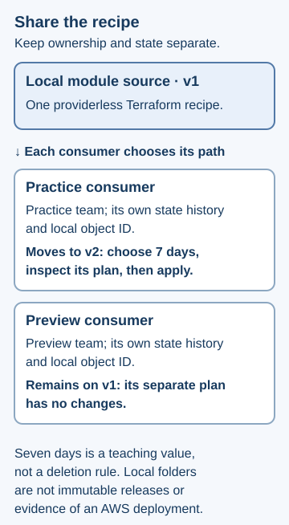

# A17 Reuse one Terraform module without sharing state

Maya has a practice exhibit and a preview exhibit. Both need the same small infrastructure *recipe*, but they have different owners and must not share a management record. A Terraform module is a reusable set of definitions and inputs. Calling it twice does not mean both callers should write the same state file or upgrade on the same day.

Run from the repository root with Terraform 1.6–1.x and Python 3.9 or newer:

```sh
python3 examples/reusable-module/lab.py
```

The runner copies the two consumers and [`v1`](modules/exhibit/v1/main.tf) and [`v2`](modules/exhibit/v2/main.tf) into a disposable folder. Both consumers start on the same local v1 source path. It initializes, plans and applies them in separate directories, then reads each state lineage, object ID and output. The two lineages and IDs differ; both plans become no-op. The only resource is Terraform's built-in `terraform_data`, so this does not install an AWS provider, open a remote backend, create an AWS object or spend a credit. It removes the temporary configurations, plans and states afterward.



Before running, predict each result:

| Change | Expected evidence |
| --- | --- |
| Both consumers call v1 | Same module definition, distinct input owners and distinct state histories |
| Practice points at v2 without `retention_days` | Validation fails; existing practice state remains unchanged |
| Practice supplies `retention_days = 0` | Module input rule rejects the proposal; existing state remains unchanged |
| Practice supplies seven days | Saved plan proposes an update; local object ID and lineage survive apply |
| Preview is left on v1 | Its plan stays no-op and its state remains unchanged |

The v2 field is a **recorded teaching decision**, not an S3 Lifecycle rule. Seven days in this local output does not delete bytes on day seven. A real retention design needs approved data categories, current and noncurrent versions, access deadlines, restore needs, pricing and observed deletion behavior. The module's `publication_enabled = false` is also only a recorded value, not an Amplify setting.

These version folders are copied local paths. Their names illustrate deliberate consumer selection, but they are not immutable releases: editing `v1/main.tf` in place could change both consumers' next plans. In a real shared module workflow, publish an immutable versioned source, pin each consumer to an exact revision, inspect the diff and plan for each state, and keep old versions available while consumers migrate. Separate state paths and execution roles must be enforced; different directory names alone are not an access control.

## Changed cases

1. Preview must remain on v1 for a month while practice uses v2. Who owns the v1 source and how will you prevent an in-place edit from silently changing preview's next plan?
2. A teammate copies practice's state file into preview because both call the same module. Which observation in this lab tells you that is wrong, and what could an incorrect state cause Terraform to propose?
3. The v2 plan says `update`, but the real module being considered for AWS also changes an S3 bucket name. What must be inspected before assuming the object ID and data survive?
4. A customer asks for deletion after seven days. Why does the v2 output fail to prove that promise? Name the application access, current-object, old-version and billing evidence you would need.
5. A proposal changes the owner string in both consumers and removes their separate execution roles. What has changed about authority even if each plan says no-op for its current local record?

Record an independent first answer, then read the [assessor notes](ASSESSOR.md). Ask Codex to compare the actual v1/v2 source and saved-plan actions, then challenge it on state ownership and the difference between a recorded retention value and enforcement. The local run is not a registry release, remote-lock test, AWS module deployment, IAM check, shared-state exercise or customer retention test. Any later live run needs a scoped non-root identity, current account/Region and prices, a whole-run estimate, spending and reserve limits chosen for the account, a stop owner and cleanup/reconciliation evidence. Organization-wide rollout stays design-only unless separately authorized in a suitable environment.
