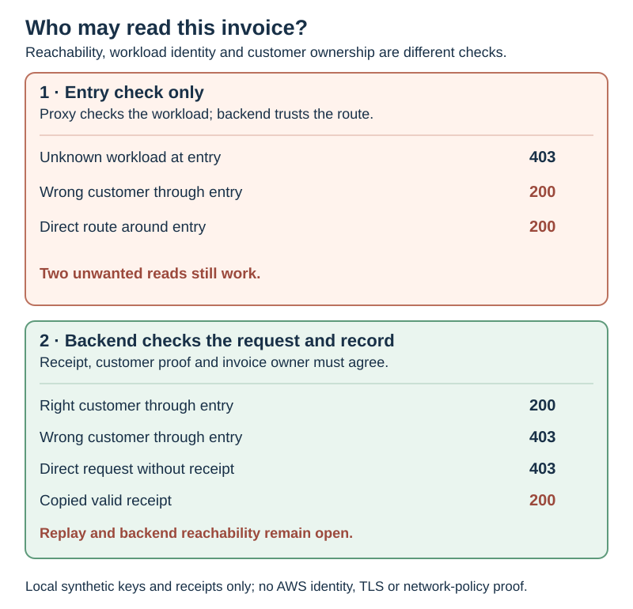
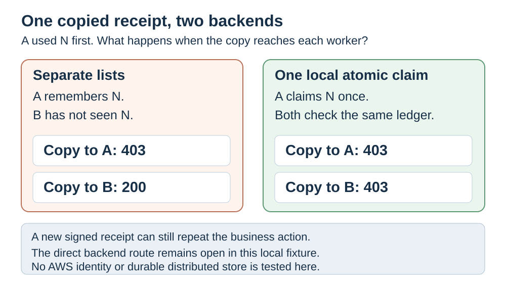
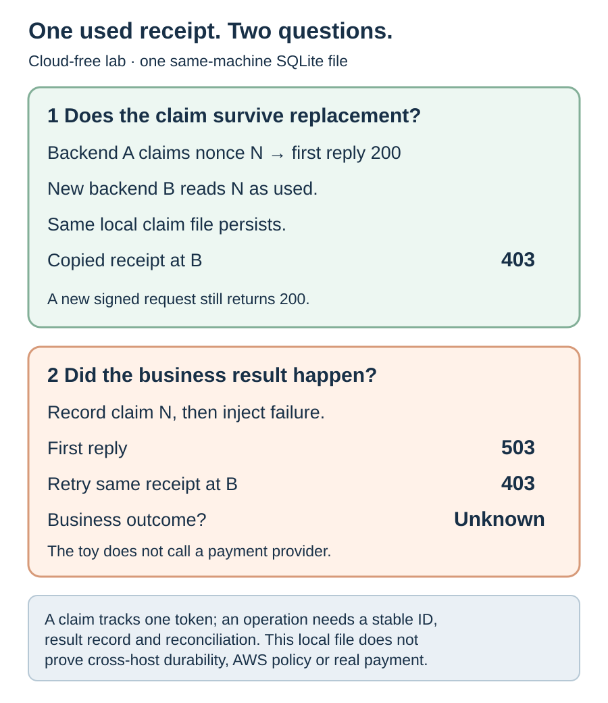
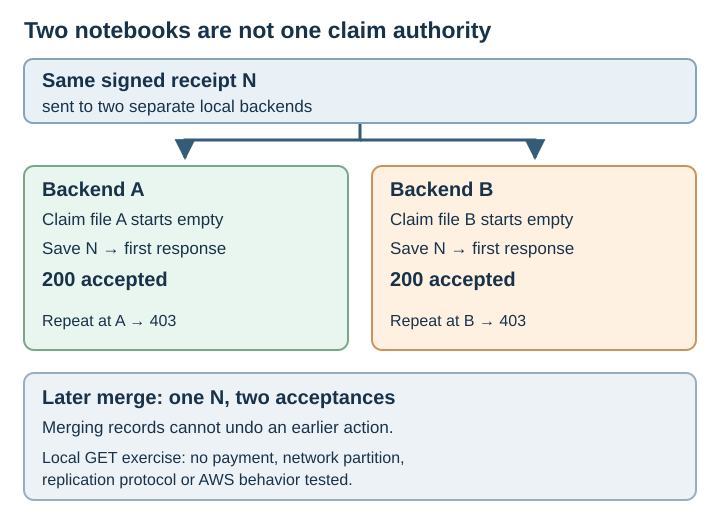

# A reachable service can still owe you a denial

Design cases and a cloud-free HTTP exercise for [unit 15](../../reader/BOOK-LOCATORS.md#book-8444a5a7a3bbe0d5). Read its service-communication section, then answer before opening [assessor reasoning](ASSESSOR.md). These are fictional requirements, not AWS exam questions or deployment instructions.

## Watch the side door, then test the remaining hole

Imagine a repair shop where the front desk checks a visitor's badge, but the invoice cabinet has a second door. A reporter is turned away at the desk. That result tells us nothing about the second door or whether a permitted worker may open the wrong customer's folder. Run the cloud-free [loopback HTTP fixture](proxy_bypass_lab.py) to observe both failures:

```sh
python3 examples/service-communication/proxy_bypass_lab.py
```

The script starts a service entry and an invoice backend on random `127.0.0.1` ports, makes five requests against an entry-only version and a guarded version, prints status codes, and shuts down both servers. It uses one invented invoice (`INV-01`, customer `c-one`, 900 cents); no AWS credentials, account, network, charge or customer data are involved. Its temporary workload key, customer proof and proxy receipt are generated inside the process. They are **synthetic test tokens**, not a model of IAM, SigV4, TLS or a production customer identity.



| Request | Entry-only backend | Guarded backend | What the observation teaches |
| --- | ---: | ---: | --- |
| Booking, right customer, through entry | 200 | 200 | A permitted path remains usable. |
| Wrong workload, through entry | 403 | 403 | The front-door check can deny a caller. |
| Booking, wrong customer, through entry | 200 | 403 | Service access does not grant record ownership. |
| Direct backend, with customer proof but no proxy receipt | 200 | 403 | The backend can reject a route that skipped the entry. |
| Direct backend, with a copied valid receipt | 200 | 200 | This toy receipt is replayable; the direct network path remains open. |

The guarded backend checks three independent facts in this fixture: a proxy-created receipt for this request, a customer proof and the stored invoice owner. The entry strips a caller-supplied proxy receipt before forwarding. The final row is an intentional negative control. A copied valid receipt still works because the fixture does not enforce freshness or close the backend port. A real design must separately verify network reachability, caller identity, protected transport, credential handling, replay behavior and record-level authorization. Do not equate this HMAC demonstration with an AWS service policy.

### Copy the receipt across two backend copies

Suppose Maya adds a second invoice worker for availability. The first worker remembers that it has seen receipt N and rejects another use. The second has an empty list. A person who copied N can try the still-open direct route to that second worker. Predict both results, then run the [two-backend continuation](replay_boundary_lab.py):

```sh
python3 examples/service-communication/replay_boundary_lab.py
python3 -m unittest discover -s examples/service-communication -p 'test_replay_boundary_lab.py' -v
```



| Observation | Separate lists | Shared local claim ledger |
| --- | ---: | ---: |
| First request through the entry to A | 200 | 200 |
| Copied receipt sent directly to A | 403 | 403 |
| Same copied receipt sent directly to B | **200** | 403 |
| New request through the entry | 200 | 200 |
| Direct request without a receipt | 403 | 403 |

The entry makes a new random nonce and signs the method, path, customer and nonce. The test captures its forwarded headers **inside the process** to simulate a stolen receipt; the HTTP response does not hand them to the caller. Both backends check the stored invoice owner. The ledger claims a nonce only after those checks, and a lock makes a simultaneous local claim have one winner. In the separate-list version, B has never seen N. In the shared version, A and B consult the same in-memory object, so B rejects it. That object is not a durable distributed store, and this lab does not model partitions, expiry, key rotation or a real token theft path.

The new request gets a fresh nonce and succeeds. Replay rejection therefore does **not** stop a caller from repeating a business command under a new receipt; a stable business operation ID and outcome reconciliation serve that different purpose. The direct backend address is still reachable in both variants, and a stolen valid receipt may be used before its intended first use. A future AWS design must review those paths, real identity, policy, transport, shared-state semantics, owner authorization and cost for the selected service. None is established by this loopback fixture.

Before reading the [assessor](ASSESSOR.md#two-backend-replay-reasoning), explain why adding more workers can invalidate a per-process security assumption. Change the case: a real invoice **payment** request times out after the provider may have charged the customer. Decide what the replay ledger can establish, what business operation key and provider receipt must be reconciled, and which result remains unknown. Ask Codex to challenge your answer for a path that still reaches the backend directly. Keep your first attempt and correction separate.

### Restart a worker with a shared claim file

An in-memory shared list disappears when its process exits. Put the claim in one SQLite file on this machine, then run two **separate** backend processes. Predict what a copied receipt will do at A, B and a replacement B. Also predict whether a new signed request can still work after replacement.

```sh
python3 examples/service-communication/process_replay_lab.py
python3 -m unittest discover -s examples/service-communication -p 'test_process_replay_lab.py' -v
```



| Observation | Expected local status | Meaning |
| --- | ---: | --- |
| First signed request through entry to A | 200 | A claims the nonce and returns this toy invoice. |
| Copied receipt to A, B, then replacement B | 403 each | All three consult the same claim file. |
| Fresh nonce without a signed receipt after restart | 403 | A nonce alone is not authorization. |
| New correctly signed request after restart | 200 | Replacement B can still serve new work. |
| 32 concurrent copies split across A and B | one 200, 31 denied | One unique SQLite insert wins in this local race. |
| Injected error immediately after claim | 503 | No normal invoice response is produced. |
| Same receipt retried after replacement | 403 | The used receipt reveals no business result. |

The script creates its database and tokens in a temporary directory and removes them when it exits. The error is deliberately injected **after the claim and before the normal response**; this is not a simulated payment provider. The lab does not demonstrate a lost network reply, a charge, cross-host durability, replication, TLS, AWS identity or an inaccessible backend route. Its direct backend port remains reachable.

Before opening the [assessor](ASSESSOR.md#process-replacement-and-uncertain-result), answer: What does the persisted claim establish? What remains unknown after the 503 and later 403? If this were a payment, which stable business-operation ID, recorded result and provider lookup would you need? Ask Codex to challenge your answer without supplying those missing observations, and retain your original answer and revision.

### Let two isolated copies answer

The same script also starts A and B with **separate empty SQLite files**, then sends the same signed receipt to each. Predict A's first result, B's first result and both repeats before running it. The output's `isolated_copies` entry shows two accepted responses, then two local denials. Afterward the script reads both files: the union has one distinct nonce. It cannot tell from that union how many responses already succeeded.



This is a controlled **split-state** counterexample, not a real network fault, replication test or payment. The files never shared a global claim authority. In a real architecture, compare two bounded choices: keep one reachable decision authority and stop claims when it is unavailable, or permit isolated work only when the business can tolerate and reconcile duplicates. Specify which customer promise selects the choice, what outcome record you would reconcile, and what observation would reject your design. Ask Codex to argue for the other choice, then inspect its assumptions against the [assessor](ASSESSOR.md#isolated-claim-copies).

Before reading the answer, predict the five status pairs and explain which layer produces each denial. Change the fictional requirement: an outside partner needs only aggregate totals. Decide where to place the partner entry, what data the invoice application must refuse, and which new bypass paths you would test. Ask Codex to challenge your diagram for a direct path and a copied credential, then record your own revised reasoning separately. The [assessor](ASSESSOR.md#loopback-fixture-reasoning) gives one bounded interpretation, not a learner score.

1. Booking and invoicing are ECS services using the intended Service Connect namespace. A new office desktop client tries the same short name and fails. Explain which assumption changed and what to investigate before changing the invoice application's permission rules.
2. A reporter establishes a protected connection to the invoice entry point. It requests one customer's invoice even though its job allows only aggregate counts. A reviewer treats the successful connection as approval. Identify the missing decisions and a denial test.
3. A Lattice service uses `AWS_IAM`, but its policy permits an anonymous caller. A diagram labels every accepted request “authenticated workload.” Explain why the label is unsupported and what evidence would establish the intended caller restriction.
4. A Lattice service-network policy protects a service design. The team adds a resource configuration for a database and assumes the same policy applies. State the scope error and the separate review required.
5. The chosen proxy path enforces an intended restriction, but the backend also accepts direct traffic from an unintended caller. Draw the bypass and specify the observation needed before claiming the boundary is enforced.
6. A booking call times out after submission. The application, proxy and outer worker can each retry. Explain why successful discovery and TLS do not prevent duplicate business work. Identify where a stable request identity and outcome record belong.

Submit a request-flow drawing with discovery, protected hops, caller identity, policy evaluation and customer authorization labeled. Compare Service Connect, a Lattice service path and an existing internal entry point only to the extent relevant to your stated requirements. Name one rejected alternative, one changed requirement and one missing observation. Include retained resources and certificate/proxy costs in a future estimate; do not provision anything for this exercise.

Ask Codex to challenge the first answer, then record assisted revisions separately. A convincing diagram is a proposal. No learner assessment or live AWS result is established by this worksheet.
