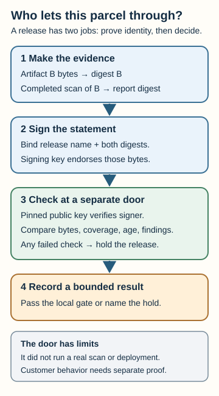

# The signed parcel at the release door

Maya's invoice service has a candidate image called **B**. A dashboard says a scan passed. The release worker must decide whether the *exact bytes* in B may enter production. A name like `candidate` is a sticky note on a box: it can move. A digest is a fingerprint of the contents. A signature says that a particular key endorsed a statement; the verifier must already trust the matching public key.



This exercise runs **only on your computer**. It creates a temporary Ed25519 key pair and fictional artifact/report, then removes them. OpenSSL 3 and Python 3.11 or later are required. It performs no scan, registry push, deployment, AWS call or paid service activation.

## Make your decision before running it

For each changed condition, write **allow or hold**, the evidence you used, and one fact you still need:

1. The report names B's digest, is complete and recent, covers the operating system and application packages, and lists no findings. A trusted signer binds its bytes and B's bytes into one statement.
2. The signature is missing.
3. B's bytes change after the statement is signed.
4. Someone changes the scan report after it is signed.
5. The statement is signed by a different key than the verifier trusts.
6. A trusted signer binds an older scan of B.
7. A trusted signer binds a current scan of B with an open high finding.
8. A trusted signer binds a current scan that covers only the operating system.
9. A trusted signer binds a scan that is still pending.
10. A trusted signer binds a completed report for old image A while the release worker holds B.
11. A trusted signer binds a report containing an unknown finding severity or status. Is a valid signature enough to interpret it?

Run the local model from the repository root:

```sh
python3 examples/signed-release-gate/demo.py
python3 -m unittest discover -s examples/signed-release-gate -p 'test_*.py'
```

Read [the separate assessor](ASSESSOR.md) after comparing your predictions. Then change the policy: the team may temporarily accept one high finding when an accountable owner signs a digest-specific exception that expires tomorrow. Sketch the extra evidence and verification steps; do not simply delete the high-finding check. Ask Codex to attack your proposed exception with an old digest, a forged owner statement, an expired exception and a report whose scanner does not support the base image. Require Codex to label each claim as observed local behavior, a service-specific hypothesis or a missing fact. Keep your original decision for comparison.

The demonstration chooses a **seven-day** scan window and holds open `HIGH`/`CRITICAL` findings as one fictional team's policy. It recognizes only `OPEN` or `CLOSED` and `LOW`, `MEDIUM`, `HIGH` or `CRITICAL`; an unrecognized finding status or severity holds for review. These are not AWS or universal release rules. The report is authored test data; passing it does not prove a scanner ran or that its inventory is complete. The generated signing key exists in the same temporary process as the verifier for teaching convenience. A real release boundary must protect signing authority separately, pin a trusted verification identity, constrain who may sign, and audit exceptions. A valid signature cannot prove the application works, that customer isolation holds, or that the signed bytes were actually deployed.

AWS currently documents [ECR basic and enhanced scan scopes](https://docs.aws.amazon.com/AmazonECR/latest/userguide/image-scanning.html), [ECR image signing methods](https://docs.aws.amazon.com/AmazonECR/latest/userguide/image-signing.html), and [verification options](https://docs.aws.amazon.com/AmazonECR/latest/userguide/image-signing-verification.html). This local Ed25519 exercise models the evidence relationship; it is **not** AWS Signer, Notation, an ECR image signature, or EKS/ECS admission. A later cloud run would need current service and price review, scoped non-root identity, expected-cost ceiling, cleanup and observed allow/deny behavior before claiming that a specific platform enforces the policy.
