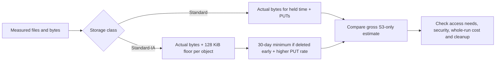

# Ohio S3 cost lesson: count the files, not just the bytes

Imagine Maya has a box of tiny reports. A shelf advertises a lower price per unit of space, so she assumes it will cost less. But that shelf charges for at least 128 KiB per report and 30 days even when she removes a report after ten days. The price on the shelf is only one part of the decision.

This lab compares **S3 Standard** and **S3 Standard-IA** for a tightly defined path: one direct `PUT` per object into an existing private Ohio bucket, no `GET`, `LIST`, copy, transition or restore, then one `DELETE` per object at the planned end. No upload, bucket change or AWS account call occurs. The script uses a [dated public Ohio price snapshot](public-prices.json) from the [AWS Price List offer](https://pricing.us-east-1.amazonaws.com/offers/v1.0/aws/AmazonS3/current/us-east-2/index.json), checked against the [S3 pricing page](https://aws.amazon.com/s3/pricing/) and [storage-class guide](https://docs.aws.amazon.com/AmazonS3/latest/userguide/storage-class-intro.html). It estimates **gross S3 charges before any Free plan allowance or credit**. It is not an invoice or permission to spend.



## What is measured and what is assumed

The snapshot selects seven Ohio on-demand meters: Standard storage and PUT, Standard-IA storage, small-object floor, PUT, and the two early-delete meters. The source offer was published October 15, 2026; our public-offer check was October 20 Denver time (October 21 UTC). The selected starting rates are USD 0.023/GB-month for Standard storage, USD 0.0125/GB-month for Standard-IA storage and its small-object/early-delete meters, USD 0.000005 per Standard PUT, and USD 0.000010 per Standard-IA PUT. These are **per unit** values from the public JSON; request pricing is often displayed per 1,000 on the [pricing page](https://aws.amazon.com/s3/pricing/). The script uses 2^30 bytes for its modeled GB and a 30-day model month. AWS meters storage over time, so exact hourly usage and a real bill may differ.

The two invented workload shapes are 10,000 reports of 1 KiB kept ten days and 100 objects of 1 GiB kept 60 days. A third shape was measured from one dated source ZIP: **1,344 members, 11,336,247 unpacked bytes**, versus its **11,547,097-byte ZIP** as one object. [The frozen measurement](source-shape.json) records only sizes and the source-archive hash, not file contents. The owner's source archive is private; this distribution is a recorded local observation but still a hypothetical S3 workload.

| Ten-day or 60-day path | Standard gross S3 estimate | Standard-IA gross S3 estimate | What changes the decision |
| --- | ---: | ---: | --- |
| 10,000 × 1 KiB, ten days | USD 0.050073 | USD 0.115259 | PUT count, 128 KiB floor and early deletion |
| 100 × 1 GiB, 60 days | USD 4.600500 | USD 2.501000 | Large objects avoid the floor and outlive the minimum |
| Measured source members separately, ten days | USD 0.006801 | USD 0.015512 | 1,344 PUTs and many small-object floors |
| Same source as one ZIP, ten days | USD 0.000087 | USD 0.000144 | One PUT and no small-object floor; access granularity changes |

These modeled dollar amounts are **not** whole-run estimates. Packaging files together changes which individual records can be authorized, updated, deleted or restored. Before a live run, compare a current whole-run estimate with spending and credit-reserve limits chosen for the account, and verify credit terms. Include verification, failed attempts, cleanup and retained charges in the estimate.

## Run and challenge the comparison

From the repository root:

```sh
python3 examples/storage-cost/ohio-upload-delete/lab.py
python3 -m unittest discover -s examples/storage-cost/ohio-upload-delete -p 'test_*.py' -v
python3 examples/storage-cost/ohio-upload-delete/refresh_prices.py
```

The final command reads the public offer and fails if its hash or selected rates changed; it never writes the snapshot unless `--write` is explicitly used after review. First predict which class wins for the tiny ten-day reports. Then change one fact: the reports must be read twice, a file must be deleted independently, or retention rises to 90 days. Identify the **new meters and requirements** before trusting a revised total. For reads, include GET requests, Standard-IA retrieval bytes and any internet or cross-Region transfer; this lab intentionally has no read path. [S3 pricing](https://aws.amazon.com/s3/pricing/) says DELETE requests and ordinary internet ingress are free for this path, but Transfer Acceleration, Multi-Region Access Points, encryption-key requests, replication, versioning, logs, analytics and other enabled features can add cost.

If this were later tested live, use a private bucket with Block Public Access, scope a short-lived non-root identity to the exact bucket and operations, keep encryption at rest and TLS in transit, and verify the effective policy and a denied unrelated path. AWS says new S3 objects receive SSE-S3 by default; SSE-KMS would need its own key/request price and access review. See [AWS S3 security best practices](https://docs.aws.amazon.com/AmazonS3/latest/userguide/security-best-practices.html). No such bucket or identity was created by this exercise.

Ask Codex: “Show every meter and assumption in this selected S3 path. Which one changes if the files are read, versioned, encrypted with KMS, or kept longer? Do not turn this subtotal into permission to deploy.” Check its answer against the dated offer, the workload and the real application promise. The five local tests verify arithmetic and selected-offer shape, not actual billing or independent learner understanding.
